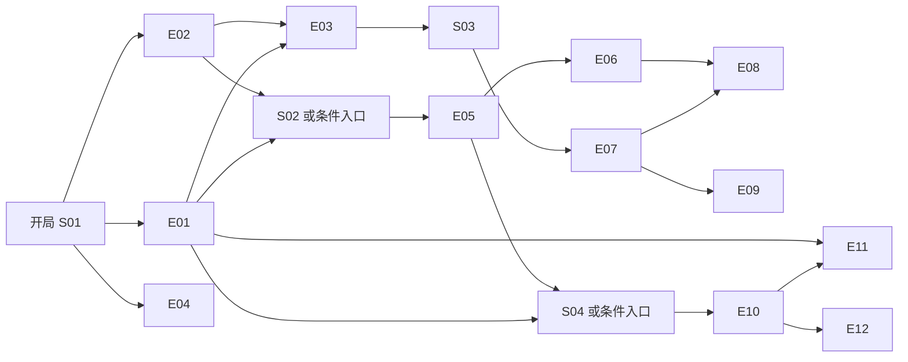

# 停电之夜：正式案件草稿

版本：`case_001 / 1-draft`。状态：作者草稿，待人工叙事复核，不能导入运行。
同目录 `slice.json` 是同一案件的 `2-slice / w1-2` 可玩配置，只有 W1 范围。
程序验证通过不等于人工审核完成，不标记为正式发布版。

## 决策记录

本次依据 W1 路线图开展实现，并提出两项访谈问题：是否采用研究所停电案件；
是否采用选错凶手直接判错、无招供可满分、无证据猜测只能部分正确。
用户已明确确认采用该案件设定，由实现者补齐细节；并确认采用上述评分原则。
这两项方向已确认，详细故事措辞和物证说服力仍待人工复核。

必须能回答的案件审查问题及本稿答案：

- 停电是不是杀人的必要机关？不是。它是周启违规检修引起的偶发机会，沈砚利用它掩饰行踪；不能把周启判成共犯。
- 为什么现场记录没有一起断电？门禁终端独立电池供电，保留校时和人脸核验记录；全案 E11 提供另一来源的供电核对。
- 一枚指纹是否足以证明杀人？不足。E02 明确区分日常指纹与本次新鲜血印，并以伤型、握持位置及 E01 的到场记录共同支撑。
- 为什么拿到三条证据仍要审讯？审讯展示说法如何被证据改变；结案不强制审讯。完整案件再验证其他人物的独立秘密。
- 承认到场是否等于承认杀人？不等于。W1 只实现到场这一层，固定台词禁止越过本层披露。
- 是否有只能通过招供取得的必需物证？没有。12 条证据都通过场景调查获取。
- 玩家有错误推理时会不会卡住？合法但错误的指控正常结案；非法编号、伪造引用才拒绝提交。

## 唯一真相

澄明研究所负责人陆衡发现 B17 实验的原始记录与沈砚提交的数据不一致，
决定次日上午交审计。沈砚已得知此事，为掩盖造假，于案发当晚利用走廊停电进入档案室，
用桌上的铜镇纸杀死陆衡，取走 B17 原始记录并翻乱档案柜伪装失窃。
他没有制造停电。其余三人的秘密与谋杀不等同。

| 时间 | 固定事实 | 原本知道的人 | 支持材料 |
| --- | --- | --- | --- |
| 19:20 | 许岚违规让林澄复印 B17 记录 | NPC02、NPC04 | E05、E06 |
| 20:40 | 林澄为核对异常数据保留了签名快照 | NPC04 | E07、E08、E09 |
| 20:55 | 陆衡签署次日上午的审计移交联；沈砚已收到审计通知 | NPC01；陆衡为已故非交互角色 | E03 |
| 21:08 | 周启未按规程切换回路，走廊停电；备用门禁不受影响 | NPC03 | E10、E11 |
| 21:10 | 沈砚通过正门进入档案室 | NPC01 | E01 |
| 21:12 | 沈砚用铜镇纸袭击陆衡 | NPC01 | E01、E02；分钟来自作者真相，不冒充精确法医读数 |
| 21:12—21:16 | 沈砚取走 B17 原件、翻乱柜子，留下伤后翻柜痕迹 | NPC01 | E02、E03 |
| 21:16 | 沈砚离开，随后谎称一直在休息区 | NPC01 | E01 |
| 21:18 | 周启恢复供电 | NPC03 | E11 |
| 21:25 | 许岚发现陆衡倒地，联系值班台封锁现场 | NPC02、NPC03 | E12 |

不存在毒杀、远程装置、秘密通道、第二名凶手或临时新增关键线索。
W1 的过程候选中的投毒、离所遥控行凶是错误选项，不是事实。

## 人物与知识权限

| 人物 | 公开身份与关系 | 原本知道的私有事实 | 当前隐瞒 | 初始压力／信任 |
| --- | --- | --- | --- | --- |
| NPC01 沈砚 | 副研究员，陆衡的下属，负责 B17 | 造假、审计通知、到场、行凶与取走原件 | 先否认到场，再隐瞒杀人与毁证目的 | 20／40 |
| NPC02 许岚 | 档案管理员，负责借阅 | 自己违规出借副本、发现死者 | 害怕问责，否认给过林澄材料 | 10／35 |
| NPC03 周启 | 值班工程师，负责供电 | 违规检修与恢复供电 | 为逃避处分，把停电说成自动故障 | 15／40 |
| NPC04 林澄 | 研究助理，与沈砚共事 | 自己未获许可的备份、发现数据不一致 | 回避备份违规，但没有配置谎言链 | 10／50 |

权限分为四层，不能互相替代：

1. **作者真相**：上表与全案评分答案；仅载入、校验和结案复盘读取。
2. **角色原有知识**：只属于 `known_by` 中的角色；不知道的事不能用其口吻断言。
3. **当前允许披露**：公开条目、当前层说法、已经承认的条目，以及向该角色实际出示的材料。
4. **玩家已知**：调查背包和披露证词；仅取得物证不会使远处角色自动知道或改口。

NPC01 不知道私借副本、违规检修的实际细节及林澄保存的快照；
NPC02 不知道行凶过程；NPC03 不知道审计目的；NPC04 没有目睹行凶。
出示材料只扩展当前角色的获准材料，不能给他其他角色未披露的秘密。
承认首先登记为未经独立核验的证词，不自动变成已核验事实。

W1 仅有 K01 公开身份条目和 K02 到场承认条目。取得 E01、E03 不公开 K02；
只有 L01 承认才登记它。玩家投影不包含未获得证据正文、真相、心理阈值、评分条件或未来台词。
复盘开放真相，但不补发证据或回填承认。当前没有 Agent 上下文或模型接口。

## 四场景与十二条证据

表中「关键」共 5 条，仅供作者使用。所有资料有预设来源，不由角色即兴生成。
前置集合是 AND；标明「或」的集合是 OR。场景门槛和动作门槛必须同时满足。

| 场景 | 初次开放条件 | 描述 |
| --- | --- | --- |
| S01 档案室 | 开局 | 死者、柜子、备用门禁；W1 唯一场景 |
| S02 资料室 | 持有 E01 或 E02 | 借阅与打印核对 |
| S03 数据间 | 持有 E03 | 实验备份与签名校验 |
| S04 配电值班室 | 持有 E01 或 E05 | 检修、供电和通话记录 |

| 证据 | 场景／动作 | 内容与来源 | 动作所需证据 | 关键 |
| --- | --- | --- | --- | --- |
| E01 备用门禁记录 | S01／A01 查看终端 | 卡、人脸、时钟、独立电源核验；限制到场人选 | 无 | 是 |
| E02 铜镇纸与检验单 | S01／A02 检查物证袋 | 伤型、血迹、新鲜血印、手套片的现场检验 | 无 | 是 |
| E03 审计移交联与翻柜痕迹 | S01／A03 核对卷宗 | 审计对象、失窃范围、伤后翻柜 | E01、E02 | 是 |
| E04 侧门封条勘验 | S01／A04 查看侧门 | 20:00封存到发现时均未破损，窗栏完好；补强出入口范围 | 无 | 否 |
| E05 借阅簿 | S02／A05 查看借阅簿 | 许岚19:20登记给林澄的副本借阅 | 无 | 否 |
| E06 打印回执 | S02／A06 核对打印任务 | 林澄身份、B17批号及副本生成时间 | E05 | 否 |
| E07 备份队列索引 | S03／A07 查看备份索引 | 指向20:40的不可覆盖批次；本身不含实验原文 | 无 | 否 |
| E08 签名实验快照 | S03／A08 校验快照 | 与E06批次核对，确认原始数据与沈砚报表不一致 | E07、E06 | 是 |
| E09 林澄的比对草稿 | S03／A09 查看比对草稿 | 解释保存副本的目的，标注为作者陈述而非独立核验 | E07 | 否 |
| E10 检修工单 | S04／A10 查工单 | 周启签名、未获批准的切换步骤 | 无 | 否 |
| E11 电源与校时记录 | S04／A11 核对记录 | 21:08停电、21:18恢复，独立门禁时钟连续；停电非谋杀机关 | E10、E01 | 是 |
| E12 值班通话记录 | S04／A12 查通话 | 许岚21:25报警与现场封锁时间 | E10 | 否 |

调查动作完成只授予表中一条证据，不因开放场景自动拿到其中的物证。
缺条件时不标记调查完成，补齐后可重试。
W1 将预设现场检验合并为 E02、E03 的固定材料，没有虚构一个需要实际运行的实验鉴定系统。

## 三条谎言链与固定说法

完整案件 3 条链、4 个层级；W1 仅实现 CH01 的 L01 单层。
每层必须按 `UNBROKEN → BROKEN → ADMITTED` 前进。
仅持有反证不击破，必须向本角色明确出示已核验的反证。

| 链／层 | 角色与前置 | 击破条件 | 承认条件与披露 |
| --- | --- | --- | --- |
| CH01／L01 到场 | NPC01，无前置；W1 实现 | 出示 E01 | 出示 E01、E03 且压力 ≥65，披露 K02 到场证词 |
| CH01／L02 目的与行凶 | NPC01，L01 已承认；仅草稿 | 向本角色出示 E02、E08 | 前层已承认，E02、E08 均出示且压力 ≥85，披露其犯罪证词 |
| CH02／L03 私借副本 | NPC02，无前置；仅草稿 | 向本角色出示 E05 | 出示 E05、E06 且压力 ≥45，披露私借事实 |
| CH03／L04 违规检修 | NPC03，无前置；仅草稿 | 向本角色出示 E10 | 出示 E10、E11 且压力 ≥60，披露检修事实 |

| 层 | 未击破 | 已击破、未承认 | 已承认 |
| --- | --- | --- | --- |
| L01 | 停电时我一直在休息区，没有去过档案室。 | 这份记录和我的说法对不上。我现在不想解释那几分钟。 | 我承认21:10到21:16在档案室。关于其他事情，我暂时不作解释。 |
| L02 | 我只承认去过；其余事情暂不解释。 | 镇纸和这份快照让我无法继续回避，但我还没准备好交代。 | 我怕B17造假被查，用镇纸打了陆衡，随后拿走原件，把柜子翻乱。 |
| L03 | 我没有把B17材料借给别人。 | 借阅簿上的字确实像我的，我还需要核对。 | 是我让林澄复印的。我怕被处分，所以没有说实话。 |
| L04 | 走廊是自动跳闸，我没有动过回路。 | 工单和我的说法有矛盾，我现在不想解释。 | 是我违规切换了回路，造成停电。我没有见到行凶。 |

W1 初始20／40；首次出示E01：压力+25、信任−5，结果45／35、BROKEN；
首次出示E03：压力+25，结果70／35、ADMITTED。
反序出示最终相同；E03单独只加压，不绕过E01反证门槛。
重复出示不再增加数值，仍可重新检查承认条件。数值夹在0～100，承认不回退。

`2-slice` 在切片内加入沈砚的口误和出示代价：

- 追问 Q01「档案室丢了什么？」，沈砚答「柜子翻成那样，B17的原件肯定是被偷了。」，记为未核验证词 K03。
- 用 K03 和 E03 指出矛盾：缺失清单是核对后才确定的，此前没有公布。首次压力+15，不改变谎言阶段，重复指出无效果。
- 向沈砚出示与 L01 无关的证据（切片中为 E02），或指出不成立的矛盾，每种组合首次信任−5，不加压。
  E02 的血印虽然也说明他到过档案室，但它是下一层 L02（行凶）的材料，对 L01 出示按无关计。
- 同一次审讯连续两次这样的操作，沈砚只说回避台词，直到结束审讯再进入。
- 导入校验按最坏扣减确认承认仍可达。L01 只看压力门槛，信任代价在切片内只影响情绪显示。

完整草稿另配置：NPC01首次出示E08压力+20；NPC02首次出示E05、E06各+20；
NPC03首次出示E10、E11各+25。只在对应角色作用，信任不变。
第二层未开放时不展示其标题、未来说法或所需材料。前层承认后由下一次明确出示推进，
不在一次披露中递归解锁整条链。NPC04可固定回答其已公开条目，其他问题用「我只能说明已核对的记录」。

## 评分草稿与 W1 定稿规则

W1 使用结构化候选，解释文字不计分。过程采用严格完整顺序，不能添加干扰步骤。
候选凶手包括四人；W01铜镇纸、W02裁纸刀、W03电缆；
M01阻止造假审计、M02掩盖私借B17副本被发现、M03掩盖违规检修造成的事故。
过程正解为 `P_ENTER → P_ATTACK → P_STAGE`，干扰项为 `P_CUT_POWER` 故意切断电源制造黑暗、
`P_SEARCH_FIRST` 先翻柜找记录，被陆衡撞见后行凶。
干扰项按改稿方案各有推翻证据：`P_SEARCH_FIRST` 由 E03 的伤后翻柜痕迹推翻；M02 指向许岚，由 E01 与全案 E11 的刷卡记录排除；
M03 与 `P_CUT_POWER` 指向周启的检修，分别由全案的 E12 和 E10／E11 推翻，切片内暂无对应证据。

| 项目 | W1 分值 | W1 正确依据 | 全案草稿差异 |
| --- | --- | --- | --- |
| 凶手 | 30 | NPC01 | 不变 |
| 凶器 | 15 | W01 | 不变 |
| 动机 | 15 | M01 | 不变 |
| 过程 | 15 | 恰好 P_ENTER、P_ATTACK、P_STAGE | 不变 |
| 到场证据关联 | 10 | P_ENTER明确关联E01 | 需同时关联E01、E11进行独立校时补强 |
| 袭击证据关联 | 10 | P_ATTACK明确关联E02 | 不变 |
| 善后证据关联 | 5 | P_STAGE明确关联E03 | 需同时关联E03、E08核对缺失材料 |

选错凶手直接判「错误」，仍展示逐项原始分数，不能把高分误解为指控成立。
凶手正确时，85～100为「正确」，30～84为「部分正确」，低于30为「错误」。
目前凶手正确至少获得30分，因此不会出现低于30的该分支；保留区间用于清楚表达阈值。
全猜对但不引用证据为75分、部分正确；全部正确且关联三条证据为100分。
有证据但没有引用、只有引用但没有步骤关联、关联给错误步骤，均不能取得对应证据分。
无需招供，不能把数值高、承认、关键证据标签或自由文本当作隐藏加分项。

## 手工推演路径与待复核项

这些是作者预先列出的静态预期，未从评分函数生成，尚待另一位真人审核。

**完整无招供正确路径草稿**：S01取E01、E02，再取E03、E04；
进入S02取E05、E06；进入S03取E07、E08、E09；进入S04取E10、E11、E12。
不进入任何审讯；指控NPC01／W01／M01，过程按进入、袭击、伪装失窃；
将E01和E11关联进入、E02关联袭击、E03和E08关联伪装。预期100分、正确。
每个前置都已在此前取得，没有角色承认作为门槛。

**完整含承认路径草稿**：先走上述取证路径，再向NPC01依次出示E01、E03、E02、E08，
两层依次承认；向NPC02出示E05、E06，向NPC03出示E10、E11。
相同指控仍为100分，不因多招供加分。这条路径只是内容推演，全案运行尚未实现。

**W1可执行路径**：A01、A02、A03；可选审讯NPC01，追问Q01、用K03和E03指出矛盾，并出示E01、E03；
进入指控，选择上述正解，关联E01、E02、E03，预期100分。
不审讯同样100分。仅选中凶手、其余选错且不引用证据为30分、部分正确；
凶手选错但其余全对且关联正确为70分、错误。

尚未完成：真人审核措辞与证据强度；其余场景与NPC的运行配置；多层链、全案权限投影、
全案导入校验与自动通关；案件持久化、HTTP游戏接口、网页玩法。完整剧本不能宣称已实现。
