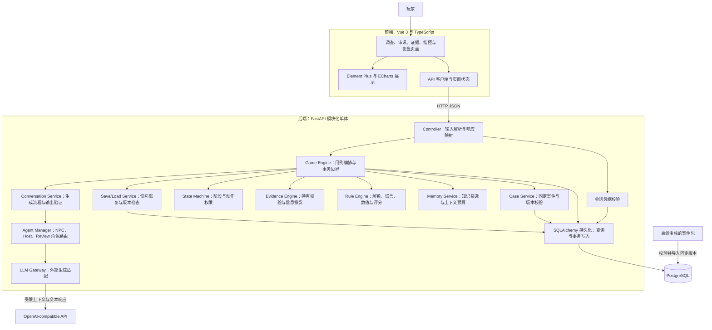
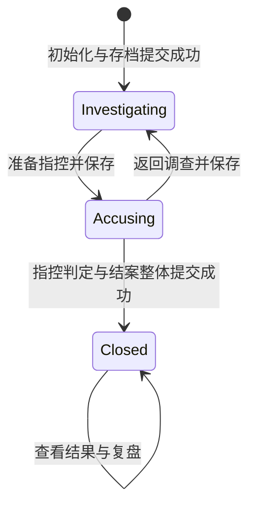
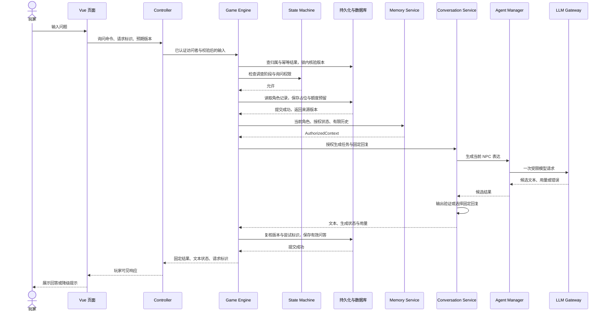
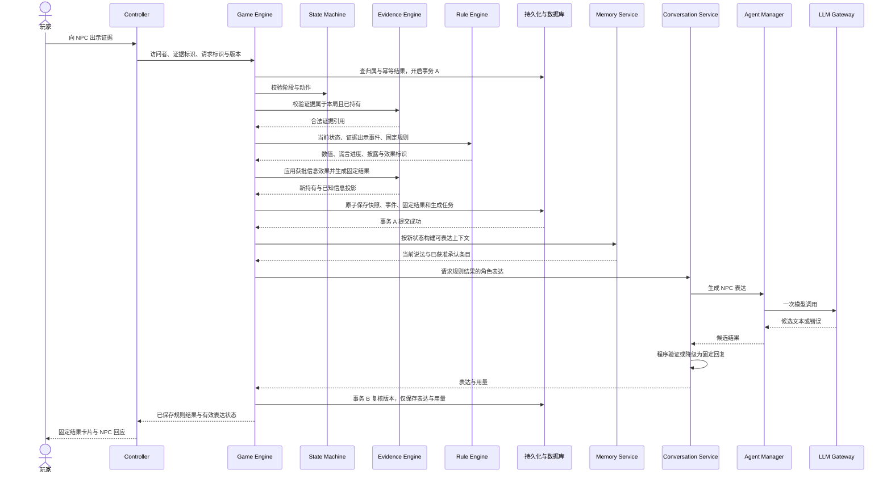
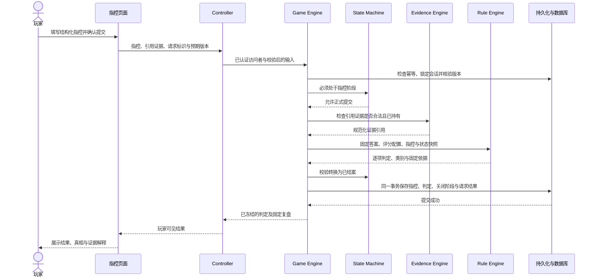

04-domain-model.md04-domain-model.md# 总体技术架构设计

本文依据 [项目范围与 MVP](01-project-scope.md)、[软件需求分析](02-requirements-analysis.md) 和 [项目设计原则](AI_rules.md)。设计范围为单人、单案件、4 个 NPC、4 个场景、12 条证据和 3 条谎言链；本文确定模块边界与执行流程，具体表字段、接口契约和案件参数在后续详细设计中细化。

## 1. 架构决策

采用 **Vue 单页应用 + FastAPI 模块化单体 + 单个关系数据库 + 外部 LLM API**。后端在一个应用内按职责组织，通过普通函数调用协作；各 Engine 是业务模块，不是独立服务。

核心执行原则是：**程序决定并保存游戏结果，模型表达已经获准的内容，前端分别呈现权威结果和角色对话。** 模型不可用时，固定文本仍支持完整通关。

| 领域 | 本次设计选择 | 选择依据 |
| --- | --- | --- |
| 前端 | Vue 3、TypeScript、Element Plus、ECharts | 使用既定技术栈；图表消费后端筛选后的数据 |
| 后端 | Python、FastAPI、SQLAlchemy | HTTP 接入、业务执行和持久化分层，事务由应用层管理 |
| 数据库 | 建议 PostgreSQL，实施时只选一个数据库 | 关系约束和事务管理核心记录，JSONB 保存小规模会话快照与固定案件包 |
| MySQL 备选 | 若部署环境已有 MySQL，可采用同一逻辑模型 | 用 JSON 保存快照；重新验证锁、约束和事务行为，不承诺未经测试的双库兼容 |
| LLM | 一个兼容 OpenAI 风格的服务，通过 LLM Gateway 接入 | 统一超时、长度、错误和用量处理，业务模块不依赖供应商响应结构 |
| 交互 | 普通 HTTP 请求与结果查询 | MVP 不需要 WebSocket；中断后按请求标识查询结果 |
| 运行方式 | 一个后端应用、一个数据库；前端静态部署 | 不引入 Redis、消息队列、向量数据库、微服务或自主 Agent 循环 |

`AI_rules.md` 最初列出 MySQL，后续范围文档和本次任务允许二选一，因此本设计将 PostgreSQL 作为建议基线，而非已落实的配置变更。数据库具体版本、部署资源及模型选型尚未确定。

## 2. 前后端总体架构

### 2.1 Mermaid 总体架构图



图中箭头表示调用方向，结果沿调用链返回。Agent Manager、Memory Service、各领域 Engine 不持有数据库连接；模型没有数据库、游戏命令或任意工具的执行入口。

### 2.2 前端职责

前端按实际玩法组织页面：开始与继续、场景调查、NPC 审讯、证据背包、关系图、时间线、指控、复盘。Element Plus 提供表单与交互组件，ECharts 展示已知关系和时间事件；简单时间列表可以直接使用组件实现。

- API 客户端统一发送请求标识、目标会话和预期状态版本，处理处理中、冲突、失败与重试查询。
- 页面状态只缓存服务器返回的数据与尚未保存的输入。证据获取、谎言击破、阶段切换和指控结果均等待成功提交后更新。
- 分开显示固定结果区和 NPC 对话区。模型漏说承认内容时，固定结果区仍展示程序登记的证词。
- 已知信息接口不返回隐藏条目、答案标记或隐藏数值；不能把完整案件发给浏览器后再通过 CSS 隐藏。
- 模型文本按普通文本渲染，不直接使用 `v-html`；消息返回时比对 `session_id`、`request_id` 和状态版本，防止旧局回复覆盖当前界面。
- 图表保留来源、时间精度和可信度，提供可读列表；处理状态与错误提示不能只靠颜色表达，主要操作支持键盘。

可先使用 Vue 自带的响应式状态和组合函数共享当前会话；跨页面状态管理确实复杂后，再决定是否引入额外状态库。

### 2.3 会话访问与部署边界

MVP 无账号，但仍需要访问凭据。后端签发高熵的匿名访问者令牌，通过 HttpOnly、Secure Cookie 传递，数据库只保存令牌摘要。访问者拥有当前会话，服务端每次校验归属；`session_id` 本身不是授权凭据。

建议前后端同源部署，写请求校验 Origin 并使用适当的 SameSite 策略。重开时在同一事务内创建新会话并切换访问者的当前会话入口；失败保留旧入口。匿名凭据丢失后，MVP 不承诺账号式跨设备恢复。

LLM 密钥仅保存在后端环境配置或部署密钥中。只允许后端配置的服务地址与模型，不接受玩家请求任意指定上游地址。

## 3. 后端分层与依赖规则

| 层 | 内容 | 可以做什么 | 不可以做什么 |
| --- | --- | --- | --- |
| 接口层 | FastAPI 路由、请求与响应模型、认证依赖 | 类型、长度与必填项检查；调用用例；映射 HTTP 错误 | 判断反证、计分、更新压力、操作 ORM 完成业务写入 |
| 应用层 | Game Engine、Case、Conversation、Memory、Save/Load、Agent Manager | 编排用例、授权、知识过滤、确定事务范围和生成流程 | 重复实现领域规则，把模型输出作为状态补丁 |
| 领域层 | State Machine、Evidence Engine、Rule Engine、状态与结果类型 | 根据明确输入执行确定性规则，产生可验证结果 | 访问 HTTP、ORM、环境密钥或外部模型 |
| 基础设施层 | SQLAlchemy 模型与查询、LLM Gateway | 执行持久化、外部请求、错误归一化 | 决定游戏规则或绕过应用层提交业务效果 |

依赖方向为接口层调用应用层，应用层调用领域层和基础设施；领域层仅依赖 Python 数据类型。事务使用 SQLAlchemy 自带的 Session 事务机制，暂不包装通用 Unit of Work 框架，也不为每张表建立一套抽象仓储接口。

写用例由 Game Engine 持有事务，Case Service 和 Save/Load Service 参与调用方事务，不自行中途提交。查询用例可以由 Game Engine 调用专用读取函数，不需要执行规则引擎。

建议的代码组织如下；这是后续落地位置，不要求现在创建空文件：

```text
backend/                       # 独立 Python 项目：pyproject.toml、uv.lock、Compose
  src/backend/
    main.py                    # FastAPI 启动及依赖装配
    api/                       # 路由、认证依赖、输入输出模型
    application/               # Game、Conversation、Memory 等用例协作
    domain/                    # 状态机、证据规则、谎言与评分
    infrastructure/            # SQLAlchemy 持久化与 LLM Gateway
  tests/                       # 对应领域、应用与持久化检查
  assets/
    cases/                     # 仅供后端导入的案件定义，不作为前端静态资源发布
frontend/                      # 独立 Node 项目：package.json、Vite 配置
  src/                         # Vue 应用、API 客户端和页面
  tests/                       # 关键交互检查
docs/
```

模块名称代表职责边界，不要求每个职责都做成类或 Python 包。测试只需要替换真实外部依赖时，使用简单的可注入调用对象即可。

## 4. 各模块的职责与调用关系

| 模块 | 输入 | 输出与职责 | 边界及调用关系 |
| --- | --- | --- | --- |
| Game Engine | 已识别访问者、玩家命令、请求标识、预期版本 | 校验用例前置条件，组织领域计算，提交状态，返回玩家可见结果 | 调用以下模块；掌握写事务，不实现具体评分和谎言规则 |
| State Machine | 阶段、动作类型及必要前置条件 | 动作是否允许、合法目标阶段 | 由 Game 调用；不读库、不生成对话 |
| Evidence Engine | 案件定义、会话快照、证据引用或已批准的信息效果 | 持有校验、证据与披露变更、背包和图表投影 | 由 Game 调用；解锁条件交给 Rule，不分析聊天制造证据 |
| Rule Engine | 固定规则、会话快照、规范化事件或结构化指控 | 确定性效果、规则命中依据、逐项判定 | 由 Game 调用；不写库、不调用 LLM |
| Agent Manager | 角色类型、目标 NPC、已筛选上下文 | 角色化生成请求与候选文本 | 由 Conversation 调用，调用 Gateway；不接收全案对象、ORM Session 或写服务 |
| Memory Service | 当前 NPC 可用定义、权威状态、隔离历史、上下文预算 | 本轮可表达信息与有限历史组成的只读上下文 | 由 Game 调用；筛选和组装，不读写数据库、不授予玩家新信息 |
| LLM Gateway | 已组装消息、输出上限、超时和追踪标识 | 文本、可得用量、耗时和归一化错误 | 只适配外部 API；无游戏规则、无工具执行、无数据库依赖 |
| Case Service | 固定案件标识与版本 | 校验后的案件定义、内容摘要与版本信息 | 调用持久化读取；运行时不更改已发布定义 |
| Conversation Service | 已授权生成任务、固定回复、上下文 | 已验证的文本或降级文本，以及验证与调用元数据 | 调用 Agent，校验输出；由 Game 保存结果，不直接提交业务状态 |
| Save/Load Service | 会话、事务、快照或版本信息 | 保存完整快照，恢复并校验兼容性 | 调用持久化；不回放模型、不重新运行已提交规则 |
| Database 与持久化 | 应用层批准的查询与写入 | 权威数据、事务、唯一约束、访问者与会话隔离 | SQLAlchemy 处理读写；领域和 Agent 不导入 ORM |

核心数据对象采用明确结构，而不是在层间传递任意字典：

- `GameSnapshot`：阶段、状态版本、场景进度、已持有证据、已知信息、NPC 状态、谎言链、已消费效果标识、指控草稿。
- `RuleOutcome`：命中规则、批准的数值增量、谎言转换、预设披露标识、一次性效果标识及原因。
- `AuthorizedContext`：角色、情绪、现行说法、允许表达条目、固定回复、有限历史、来源状态版本。
- `ActionResult`：已提交状态版本、玩家可见的固定结果、文本生成状态和记录引用。
- `Verdict`：逐项命中、缺失证据、计算依据、结果类别、案件版本与评分规则版本。

只有程序内的 Rule Engine 可以构造可提交的规则效果；LLM 的响应类型没有证据授予、数值修改、阶段切换或评分字段。

## 5. Game Engine 与事务一致性

### 5.1 用例入口

Game Engine 提供创建与恢复、探索、询问、出示、进入或退出指控、保存草稿、最终提交和复盘读取等入口。公共写流程如下：

1. 核验访问者和目标会话归属，查找同一请求的已有结果。
2. 开启短事务，锁定目标会话记录，再次检查幂等键与预期状态版本。
3. 调用 State Machine 和领域校验；加载会话绑定的固定案件与规则版本。
4. 调用 Rule Engine、Evidence Engine，生成新快照和固定结果。
5. 在同一事务保存快照、规则事件、请求结果和必要的对话占位记录，成功后才报告规则已生效。
6. 如需文本生成，在事务外调用 Conversation Service；另开短事务保存有效表达及用量。

普通提问不执行第 4 步中的状态变更，只登记问答请求、固定回复和模型额度预留。保存问答、用量及生成状态不增加游戏 `state_version`；影响阶段、规则输入或草稿的变更才增加该版本。

### 5.2 幂等与并发

每个写请求携带 `request_id` 和 `expected_state_version`。请求唯一键为 `(visitor_id, request_id)`，覆盖开局、重开及已有会话操作；同时保存动作类型、目标和规范化输入摘要。

- 权限校验后先查幂等结果，再检查新操作的阶段与版本。因此已成功的旧请求即使遇到新阶段，仍可读回原结果。
- 相同标识、相同输入返回原结果或处理中状态；相同标识、不同输入返回冲突。
- 对同一会话的写操作使用数据库行锁，在锁内比较预期版本。版本不符返回冲突，禁止静默覆盖。
- 幂等请求只防网络重发；玩家换一个标识再次出示同一证据时，另由规则的一次性效果键阻止重复收益。
- 同一会话同时只接受一个进行中的 NPC 生成任务；锁内检查生成状态，新的审讯请求可返回忙碌提示。探索、阶段转换和固定回复流程不等待外部模型。
- 不在 LLM 调用期间持有数据库事务或锁，也不依赖单个 Python 进程中的锁保证一致性。

新建和重开尚无目标会话时，锁定访问者记录，原子创建会话、记录请求结果并更新当前入口，防止重复创建或半途切换。

### 5.3 规则提交与表达提交分开

证据出示采用两个提交点：事务 A 保存所有规则效果、固定结果、生成占位及额度；随后调用模型；事务 B 只保存表达和用量。事务 B 失败不撤销事务 A。

每次生成绑定 `session_id`、`npc_id`、`request_id`、`attempt_id` 和来源 `state_version`。保存表达前重新检查请求仍等待该次尝试、会话版本未变化、阶段允许、目标一致。失败则标记为过期，不把候选文本作为当前有效回复，仍记录调用用量。前端同时核对当前会话，避免旧局响应污染重开后的页面。

生成过期不触发重新评分或再次执行证据规则。历史固定结果保留发生时的版本；界面展示最新状态，并注明该轮表达失效。

### 5.4 保存与恢复

数据库中的当前快照就是自动存档，不再异步复制一份存档文件。恢复时校验凭据、案件版本、规则执行版本和快照结构版本，在同一读取快照内取回状态与相关记录。

模型请求超过截止时间仍未完成时，保留固定回复并将生成标记为超时或结果未知；恢复、刷新及重复查询不自动重发。玩家主动重试生成时创建新的 `attempt_id`、重新检查额度与当前上下文，且仅替换表达，不重复业务效果。旧尝试晚到也不能覆盖新尝试。

程序不能保证上游模型调用恰好执行一次：例如服务发出请求后崩溃，供应商可能已经计费。因此状态未知的尝试保留额度占用，不推断为免费或未执行。

不兼容的存档保留原数据并拒绝猜测恢复；旧案件版本不可被新内容覆盖。数据库备份属于部署保障，应用内自动保存不能替代数据库备份。

## 6. State Machine

### 6.1 游戏主状态机



| 状态 | 允许的主要动作 | 禁止的主要动作 |
| --- | --- | --- |
| `INVESTIGATING` | 探索、询问、出示、查询已知信息、进入指控 | 直接提交尚未进入指控阶段的最终判定 |
| `ACCUSING` | 编辑草稿、查询已知信息、返回调查、确认提交 | 继续调查写操作、继续审讯 |
| `CLOSED` | 读取本局记录、结果、真相和复盘 | 修改调查进度、改写指控与正式判定 |

重新开始是创建新的 `INVESTIGATING` 会话，不是将 `CLOSED` 倒退。进入指控不要求集齐证据或 NPC 招供；缺失证据是评分输入，不能变成未经需求约定的进入门槛。

State Machine 使用枚举、动作允许表和明确转换函数即可，无需第三方工作流框架。阶段变化必须与相关写入在同一事务完成。

### 6.2 NPC 与谎言状态

NPC 的压力、信任是带边界的数值，情绪是规则映射结果，不与游戏主状态做笛卡尔积。规则配置确定初值、边界、事件增量和映射优先级；模型只读取派生情绪。

每条谎言链独立维护 `UNBROKEN → BROKEN → ADMITTED`，以及已满足的反证集合。一次出示同时满足击破与承认条件时，可在一个事务内经过两步到达 `ADMITTED`，规则记录保留两步依据。

已承认状态不会因为聊天内容或历史截断倒退；承认某条谎言不等于认罪，也不是最终指控的必需门槛。

请求处理状态和生成状态单独保存。业务已经提交但表达仍在生成，是合法状态，不能用一个含糊的“成功／失败”字段混合表示。

## 7. Evidence Engine 与 Rule Engine

### 7.1 Evidence Engine

Evidence Engine 管理“玩家持有什么、知道什么、可以看到什么”。案件中的证据定义不可变，玩家获得证据仅增加本局持有与来源记录。

证据与披露条目至少保留标识、类型、来源、预设内容及可见字段。物证、证词、关系、时间事件是不同类型；预设谎言作为证词记录，不自动升级为客观事实。

出示前校验引用存在、属于会话绑定案件、玩家实际持有、目标 NPC 合法。Rule Engine 批准解锁后，Evidence Engine 才把预设条目加入快照，并生成固定结果卡片。

背包、关系图和时间线通过同一套玩家可见投影生成。时间事件保留精确时间、区间或未知时间；相互矛盾的证词保留各自来源。可信度升级必须来自明确规则事件，不能来自模型的自信程度。

### 7.2 Rule Engine

Rule Engine 是普通 Python 确定性函数集合，规则配置只使用项目需要的固定字段和操作类型，不建设通用表达式语言，不执行配置中的 Python 或 SQL。

支持的事件包括预设调查动作、证据出示、阶段事件和最终指控。普通自由文本问题不用于关键进度判定，也不根据模型分析出的“威胁语气”任意改压力或信任。

一次证据出示按固定顺序计算：

1. 用当前快照和案件版本筛选适用规则，确定反证是否有效及本次新增的匹配项。
2. 检查一次性效果键，排除已消费的数值或披露收益。
3. 汇总本事件批准的压力与信任增量，再按配置边界限制结果。
4. 根据更新后的反证集合与数值计算击破、承认状态；本事件可完成连续的两次合法转换。
5. 根据最终数值与事件优先级映射情绪，列出应该披露的固定内容。
6. 返回完整 `RuleOutcome`，由 Game Engine 与 Evidence Engine 校验并提交。

同一输入必须得到相同结果。规则冲突、重复效果定义及缺失优先级在案件载入时拒绝；MVP 不允许规则任意递归触发，单事件内的依赖采用上述明确阶段。

一次性效果键可采用 `(session_id, rule_id, effect_key)`。多证据反证按新增匹配项累计；重复出示不重复增值，但条件仍应按当前状态重新检查，不能粗暴地把整条规则永久标成“执行过”。

### 7.3 最终指控规则

评分输入为固定答案、评分配置、结构化指控和必要的会话证据快照。凶手、凶器、动机使用候选项标识；作案过程使用预定义步骤、顺序和证据关联。补充说明保存为玩家文字，不参与分数计算。

判定返回每项命中情况、缺失证据、计算依据和“正确／部分正确／错误”类别。合法但错误的指控正常结案，不能当作输入校验错误。非法选项、未持有证据引用和字段缺失则拒绝提交。

字段权重、过程匹配规则、阈值和“凶手错误是否直接判错”尚未在需求中确定，必须写入固定案件配置并审核，不在架构阶段擅自设定默认答案。

## 8. Agent Manager、Memory Service 与 LLM Gateway

### 8.1 Agent Manager

4 个 NPC 共用一套生成实现，由 `npc_id` 选择人格和获准说法，不创建 4 个常驻进程。Host 仅用于开场或阶段叙事，Review 仅用于已结案后的解释润色，两者均可选。

Agent Manager 接收只读的 `AuthorizedContext`，选择角色模板并调用 Gateway。它既没有 SQLAlchemy Session，也没有 Game Engine 或 Rule Engine 引用；不把游戏操作注册成模型工具。因此 Agent 即使返回 SQL、命令或状态补丁，也没有执行通道。

不存在投票裁决的 Judge Agent。指控由 Rule Engine 判断，需要自然语言说明时交给 Review 表达已经保存的结果。

### 8.2 Memory Service

记忆分成四类，只有前两类能作为本轮事实与状态依据：

| 类别 | 内容与来源 | 使用方式 |
| --- | --- | --- |
| 固定知识 | 案件定义中的 NPC 身份、知识归属和预设说法 | 按角色与披露条件筛选 |
| 权威状态 | 数据库恢复的谎言进度、NPC 数值、玩家已知条目 | 每轮重建，不依赖聊天历史记住 |
| 对话历史 | 同一会话与 NPC 的已验证有效问答 | 仅作为不可信表达上下文，限制长度 |
| 可选摘要 | 后续阶段才考虑 | 不能覆盖状态或扩张知识权限 |

本轮允许信息由程序按“NPC 知识归属 + 当前阶段 + 规则披露条件”筛选。全局公开内容也必须满足当前场景和阶段的公开条件；玩家已经知道某件事，不表示每个 NPC 都知道或可以确认它。

尚不能透露的秘密原文不进入生成上下文，以预设回避策略代替。允许说的预设谎言可以进入上下文，但明确其现行说法与来源；完整案件答案不传给 NPC。

上下文预算优先保留角色、当前授权条目、已承认状态、必要固定结果和当前问题，再从近到远保留历史。超出预算先裁剪历史；必要信息仍放不下时降级为固定回复，不能通过截掉权限约束勉强调用模型。

历史中过期的否认和已失效生成结果不作为当前说法依据。Memory Service 不跨 NPC 自动拼接私有记录，也不从聊天抽取新证据写回数据库。

### 8.3 LLM Gateway 与调用控制

Gateway 负责连接配置的上游、序列化消息、设置输出上限与超时、读取文本及用量、归一化限流和供应商错误。额度持久化和尝试登记由 Game Engine 执行，Gateway 不自行操作存档。

- 每次发起调用前，在短事务中创建尝试记录并原子预留次数与 token 额度，避免并发超额。
- 每次常规审讯原则上只发出一次外部调用，关闭客户端隐式自动重试；限流、超时和无效输出直接降级。
- 配置上下文预算、单次输出上限、单局次数与 token 上限。需求建议的 30 秒超时作为待实测初值，而不是已验收指标。
- 按所选模型实际支持的接口与计量方式实施预算；未知模型不能假设字符数等于 token 数。无法可靠估算时采用保守输入上限，不承诺精确计费控制。
- 保存可得用量、模型标识、耗时和错误类型；上游未返回 token 用量时标记未知，不记录为零。费用是根据配置价格的估算，不能冒充供应商账单。
- 发出后结果未知的尝试保留预算占用；只有明确未发出的预留才能释放。再次生成需要新尝试并重新检查额度。
- 查询历史和复盘不触发新的调用。Review 如启用，其首次生成也有独立幂等记录，刷新只读缓存结果。

### 8.4 AI 输出验证与注入防护

Conversation Service 只接受文本候选结果，检查输出类型、空白、长度、截断、非预期工具调用，以及可检测的角色切换、越权承认、秘密原文泄露或与固定结果冲突。检查失败使用本轮状态对应的固定回复，不把错误候选加入后续有效历史。

验证器只接收执行检查所需的规则或受限匹配数据；隐藏内容不得为了检查而重新送入生成模型。关键词与模式检查不是完整语义证明，不能保证识别所有编造或改写后的泄密。文本泄露率需要单独评测，不能以“状态未变”代替表达质量验收。

玩家问题和历史对话保持不可信消息边界，不拼接为系统指令；角色与披露权限由服务端决定。模型输出中出现“我承认”“获得证据”等文字，也只是一段候选文本，不能成为 Evidence Engine 或 Rule Engine 的事件输入。

强保证来自权限和调用结构：模型没有修改事实的接口。关键内容由程序固定结果区呈现；自然语言正确性通过上下文最小化、可检测违规校验、固定降级和攻击题集共同控制。

## 9. Database 逻辑模型

MVP 采用“固定案件版本 + 会话快照 + 独立请求与记录表”。本局对象数量小，把经结构校验的可变调查状态保存在一个快照中，便于原子保存和恢复；对话与调用记录持续增长，独立存表。无需为 12 条证据提前建立大型通用内容管理模型。

| 逻辑表 | 主要内容 | 关键约束 |
| --- | --- | --- |
| `visitors` | 匿名令牌摘要、当前会话入口、创建时间 | 摘要唯一；当前入口只能指向该访问者拥有的会话 |
| `case_versions` | 案件包、真相、人物知识、规则与固定回复；内容与规则版本、校验摘要 | 案件标识和版本唯一；运行时只读；已发布版本不覆盖 |
| `game_sessions` | 所属访问者、案件版本、阶段、状态版本、结构版本、`state_json`、资源计数、保存时间 | 案件版本外键；阶段和版本只在合法事务内改变 |
| `action_requests` | 请求标识、输入摘要、目标会话、动作、业务状态、固定结果和关联版本 | `(visitor_id, request_id)` 唯一；允许记录无副作用的拒绝结果 |
| `rule_events` | 请求、规则版本、效果标识、原因和必要的前后变化 | 一次性效果键唯一；与快照在同一事务保存 |
| `conversation_turns` | 会话、NPC 或角色类型、玩家输入、固定回复、有效表达、生成状态和来源版本 | 一次对话任务对应一条记录；索引支持按会话和 NPC 取最近历史 |
| `llm_attempts` | 对话任务、尝试标识、状态、截止时间、预留、用量、耗时与错误 | 尝试标识唯一；保存状态未知调用；不存密钥 |
| `conclusions` | 结构化指控快照、规则与案件版本、逐项判定、结果类别和结案时间 | `session_id` 唯一；与阶段关闭原子提交，正式结果不可改写 |

`state_json` 保存场景进度、持有集合、已知条目与来源、NPC 数值、谎言链进度、已消费效果标识和指控草稿。阶段、状态版本、所属访问者等并发与权限字段放在列中，不在 JSON 内再维护一份。

可见情绪和图表是派生结果，优先按规则计算，不另建一套权威状态。快照中的已消费效果集合用于纯函数计算，事件表用于解释和唯一约束；二者必须在同一事务更新并在恢复时可核对，不能异步同步。

JSON 快照的内部引用、数值边界和集合去重由领域校验负责，不能声称 SQL 外键能验证所有 JSON 内容。会话归属、版本关联、请求唯一性和每局唯一结案使用数据库约束。写入前校验快照结构，读取时检查结构版本。

运行时数据库账号对案件定义只有读取权限；离线导入使用独立维护权限。Agent 与 Gateway 没有数据库凭据。完整真相只能经已结案的复盘用例投影输出，禁止直接序列化 ORM 案件对象。

当前方案的边界是单局状态小、低并发。若后续确实需要大规模跨局分析或庞大会话状态，再把证据持有、NPC 状态等拆成关系表；不同时维护两套存档来源。规则事件用于审计与解释，MVP 不依赖完整事件溯源恢复。

## 10. 完整调用链一：玩家询问 NPC

示例为调查阶段向一个已开放 NPC 提问。以下接口仅表达用例边界，具体路径与字段以后续 API 设计为准。



完整过程中的控制点：

1. Controller 只处理输入格式，归属、阶段、目标 NPC 和版本由应用与领域逻辑校验。
2. 相同请求已存在时直接读取结果，不再次预留额度或调用模型。
3. Memory Service 使用本角色当前获准内容。玩家声称拥有证据不会扩张上下文权限。
4. 生成前已保存固定回复和记录；上下文无法满足预算、模型错误或额度不足时，跳过或终止生成，保留固定回复。
5. 返回候选文本后先验证，再在短事务内复核来源版本与尝试标识。阶段已变或有后续状态变更时，标记该表达过期。
6. 普通提问只新增问答与资源记录，不改变证据、压力、信任、谎言链或结案条件。已批准的关键披露由此前规则事件登记并通过固定信息区展示。
7. 网络断开后按请求标识查询；最终保存失败时不宣称回答已保存，也不自动再调用模型。

## 11. 完整调用链二：玩家出示证据



完整过程中的控制点：

1. 后端验证持有关系，而不是信任前端背包或问题文本。无效证据、错误会话与非法阶段不产生副作用。
2. Rule Engine 检查反证组合、前置事件和一次性效果，计算数值与谎言转换；Evidence Engine 只应用已批准的预设信息效果。
3. 达到承认条件时，固定承认条目与已知信息在事务 A 保存。是否展示为物证、证词或存疑信息由案件定义决定。
4. 事务 A 回滚时，不调用表达来宣布谎言已击破；只有提交成功的结果才能向玩家发布。
5. 模型基于提交后的状态表达。模型失败、文本不合规或事务 B 失败，均不撤销已保存效果。
6. 原请求重发返回同一结果；换请求再次出示也受一次性效果约束。表达重试只创建生成尝试，不再次执行 Rule Engine。
7. 等待期间前端显示处理中；若需要取得已提交固定结果，可用普通 HTTP 查询请求结果。无需为此加入消息队列或流式协议。

## 12. 完整调用链三：玩家最终指控



完整过程中的控制点：

1. 玩家先通过独立用例进入 `ACCUSING`，保存草稿；最终提交前明确确认本局将结案。
2. Controller 校验结构，Game Engine 校验会话、阶段和版本，领域模块校验候选项与证据引用。补充长文本不交给模型计分。
3. Rule Engine 读取会话绑定的固定规则版本，计算凶手、凶器、动机、过程和配置要求的证据条件。
4. 同一事务保存提交快照、逐项判定和 `CLOSED` 阶段；唯一约束保证每局只有一份正式结案记录。
5. 同一请求重试返回原判定；已结案后新提交拒绝重新评分并提供已有结果入口。并发或版本冲突不混用新旧证据。
6. 数据库提交失败时仍处于指控阶段，不发布临时计算结果；网络状态不明时先查询原请求。
7. 正式判定完全不经过 LLM。后续复盘读取已保存结果；可选 Review 润色只收到已结案的事实与解释，经过输出验证后单独保存。润色失败仍展示完整固定复盘。

## 13. 可测试性与验收落点

领域模块接收普通数据并返回结果，因此单元测试不需要启动 FastAPI、数据库或真实 LLM。应用层可注入固定 Gateway 返回值，测试异常与迟到响应；数据库约束、锁和事务必须在最终选定的数据库上进行集成验证，不能仅以 SQLite 替代。

| 检查范围 | 关键场景 | 对应需求 |
| --- | --- | --- |
| 状态机 | 合法切换、错误阶段、结案后拒绝调查、重开为新局 | FR-03、AC-10 |
| 规则与证据 | 未持有证据、反证组合、重复收益、数值边界、谎言不回退 | FR-07～09、AC-03～05 |
| 评分 | 正确、部分正确、错误；改变文字说明不改分 | FR-13、AC-09 |
| 信息隔离 | NPC 私有知识、禁说秘密、他人会话、锁定关系、矛盾时间线 | FR-10、FR-11、FR-16、AC-02、AC-08 |
| 保存与幂等 | 提交回滚、重复请求、并发冲突、重启恢复、旧局迟到响应 | FR-15、FR-18、AC-04、AC-06、AC-07、AC-10 |
| 模型控制 | 超时、格式错误、越权承认、预算耗尽、未知用量、旧尝试晚到 | FR-17、FR-19、AC-05、AC-06、AC-11 |
| 完整通关 | 固定回复走完全案、改变调查顺序、不招供也能正确指控 | AC-01、AC-12 |

使用伪造模型输出验证“模型声称授予证据或认罪也不改变状态”；再用独立的正常与攻击题集评估实际文本一致性。二者是不同验收指标。

当前交付仅为架构文档，尚无应用代码与测试工具链，不能报告运行测试或通关验收已经完成。首批实现应先完成固定回复下的确定性闭环，再接入一个 NPC 验证一条谎言链，最后扩展完整案件与前端。

## 14. 后续详细设计的输入

本架构已经确定模块责任、调用方向、权威数据、事务边界和 AI 权限。实施前仍需沿需求文档补齐以下内容：

- 案件内容包及完整可解路径，包括公开信息、私有知识、每阶段说法、固定承认与回避文本。
- NPC 数值范围、初值、增量、情绪映射优先级、反证组合与一次性效果键。
- 指控候选项、干扰项、过程表示、权重、阈值和证据要求。
- 最终数据库与模型供应商、兼容能力、输入输出预算及超时；确认演示环境后实测性能目标。
- 数据库物理字段、索引与迁移，API 请求和响应，存档结构版本及角色模板。

这些待定项通过案件编写和详细设计落实，不由 LLM 在运行时补齐，也不需要扩大为后台管理系统或通用 Agent 平台。
