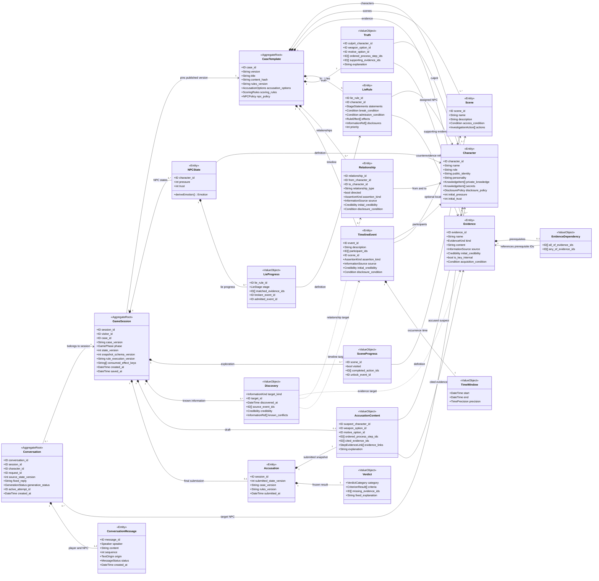

# 核心领域模型设计

本文依据 [项目范围与 MVP](01-project-scope.md)、[软件需求分析](02-requirements-analysis.md)、[总体技术架构设计](03-architecture-design.md) 和 [项目设计原则](AI_rules.md)，采用领域驱动设计的思路分析核心对象、聚合边界及静态剧本与玩家运行时数据的分离方式。

建议把系统划分为**剧本定义、单局调查、对话表达**三个领域边界，分别以 `CaseTemplate`、`GameSession`、`Conversation` 为聚合根。该划分延续已有文档中的固定定义与可变状态要求，以及固定案件版本、会话快照、独立对话记录的存储方案。领域对象不要求逐一对应数据库表，也不要求拆分为独立服务。

## 1. CaseTemplate 与 GameSession 分离

`Case` 容易同时表示“案件剧本”和“玩家正在玩的案件”。领域代码统一使用 `CaseTemplate` 表示固定版本剧本，不再增加一个含义重叠的 `Case` 类。

- `CaseTemplate`：定义人物、场景、证据、谎言、真相和评分规则，发布后不可变。
- `GameSession`：某个玩家的一次游戏实例，引用一个确定版本的 `CaseTemplate`。
- 一个剧本版本可以对应多个游戏实例，各实例的进度互相隔离。
- 重新开始创建新的 `GameSession`；修改剧本发布新版本，已有会话继续绑定旧版本。

例如，两名玩家调查同一剧本中的 `E01`，共享证据定义，但各自独立记录是否获得它。

`CaseTemplate` 的身份由 `(case_id, version)` 确定。版本内的人物、证据和规则等对象使用局部 ID；运行时引用必须结合会话绑定的剧本版本解释，不能误用另一个版本中的同名 ID。

## 2. 对象分类与核心字段

Entity 根据身份识别，Value Object 根据完整内容比较；聚合根本身也是 Entity。静态对象即使不可变，只要需要被持续引用和区分，也可以是 Entity。

下表中的静态对象 ID 均限定在所属剧本版本内。

| 对象 | 建议分类 | 最重要的字段 | 数据归属 |
| --- | --- | --- | --- |
| `Case` → `CaseTemplate` | **Entity、Aggregate Root** | `case_id`、`version`、`title`、`synopsis`、`content_hash`、`rules_version`、评分规则、指控候选项、NPC 数值与情绪规则 | 静态 |
| `GameSession` | **Entity、Aggregate Root** | `session_id`、`visitor_id`、`case_id`、`case_version`、`phase`、`state_version`、`snapshot_schema_version`、规则执行兼容版本、`consumed_effect_keys`、创建与保存时间 | 运行时 |
| `Character` | **Entity**，属于剧本聚合 | `character_id`、`name`、`role`、公开身份、性格、私有知识条目、秘密条目、披露条件、固定回避文本、初始压力与信任 | 静态 |
| `NPCState` | **Entity**，属于会话聚合 | `character_id`、`pressure`、`trust`、各谎言进度；`emotion` 由规则派生。身份为所属会话与角色的组合 | 运行时 |
| `Scene` | **Entity**，属于剧本聚合 | `scene_id`、名称、授权描述、进入条件、预设调查动作及结果引用 | 静态 |
| `Evidence` | **Entity**，属于剧本聚合 | `evidence_id`、名称、`kind`、预设内容、来源、初始可信度、内部关键证据标记、获取条件 | 静态 |
| `EvidenceDependency` | **Value Object**，属于证据定义 | 必须全部持有的 `all_of_evidence_ids`、至少持有一个的 `any_of_evidence_ids` | 静态 |
| `LieRule` | **Entity**，属于剧本聚合 | `lie_rule_id`、`character_id`、分阶段说法、反证条件、击破条件、承认条件、数值效果、披露条目、一次性效果键、优先级 | 静态 |
| `Conversation` | **Entity、Aggregate Root** | `conversation_id`、`session_id`、`character_id`、`request_id`、`source_state_version`、固定回复、生成状态、当前尝试标识、创建时间 | 运行时 |
| `ConversationMessage` | **Entity**，属于对话聚合 | `message_id`、`speaker`、`content`、顺序号、文本来源、有效性状态、创建时间 | 运行时 |
| `Accusation` | **Entity**，属于会话聚合 | `session_id`、正式提交内容、提交时状态版本、案件与规则版本、`verdict`、提交时间 | 运行时 |
| `Truth` | **Value Object**，属于剧本聚合 | 真凶角色 ID、凶器选项 ID、动机选项 ID、真实作案步骤与顺序、事实说明、支持证据引用 | 静态 |
| `Relationship` | **Entity**，属于剧本聚合 | `relationship_id`、起点角色、终点角色、关系类型、方向、描述、来源、事实或证词属性、初始可信度、披露条件 | 静态 |
| `TimelineEvent` | **Entity**，属于剧本聚合 | `event_id`、内容、参与角色、场景、`time_window`、来源、事实或证词属性、初始可信度、披露条件 | 静态 |

### 2.1 分类依据

- **`Truth` 不需要独立身份。** MVP 每个剧本版本只有一份真相，与所属剧本共同发布，因此适合作为值对象。评分标准另存于剧本，避免把“事实是什么”和“如何给分”混在一起。
- **`LieRule` 需要身份。** 会话要按规则 ID 保存谎言进度，事件记录也要引用它，因此采用 Entity。
- **`Relationship` 采用 Entity。** 同一对角色可能有多条关系，甚至存在来源不同、互相矛盾的关系说法；不能只按两个人的 ID 合并。
- **`ConversationMessage` 采用 Entity。** 两条内容相同的消息仍是不同的发生记录，需要独立追踪顺序、生成来源和有效性。
- **`NPCState` 采用 Entity。** 压力、信任和谎言状态变化后，它仍然是同一会话中同一 NPC 的状态，身份由 `(session_id, character_id)` 确定。
- **`Accusation` 采用 Entity。** 正式提交是可追溯、不可覆盖的业务记录。每局只有一份，可以直接用 `session_id` 识别，无需额外引入指控编号。

### 2.2 EvidenceDependency 的边界

`EvidenceDependency` 只描述证据之间的前置依赖，不需要独立身份：

- `all_of_evidence_ids`：必须全部持有。
- `any_of_evidence_ids`：至少持有一个。
- 两个集合同时配置时，需要同时满足；空集合不施加限制。

例如，某条证据要求先获得 `E01`，并在 `E02`、`E03` 中至少获得一个，则分别配置为 `all_of_evidence_ids = [E01]` 和 `any_of_evidence_ids = [E02, E03]`。

场景权限、调查动作和谎言条件使用各自明确的配置字段，不必建设通用规则表达式语言。依赖是否满足由本局状态计算，不在静态定义上保存 `is_satisfied`。

## 3. 聚合边界与一致性

| 聚合根 | 聚合内部 | 必须维护的一致性 |
| --- | --- | --- |
| `CaseTemplate` | 人物、场景、证据及依赖、谎言规则、关系、时间线、真相与规则配置 | 引用属于同一剧本版本；配置完整；无阻断通关的循环依赖；发布后整体不可变 |
| `GameSession` | NPC 状态、场景进度、证据持有与已知信息、谎言进度、指控草稿、正式指控及判定 | 一次规则操作的全部效果原子保存；数值有界；效果不重复；每局最多一次正式结案 |
| `Conversation` | 一轮交互中的消息与表达生成状态 | 请求与目标角色固定；回复绑定来源状态版本；失败与重试不重复执行业务效果 |

### 3.1 Conversation 表示一轮交互

这里将 `Conversation` 定义为**一次提问或一次证据出示对应的一轮交互**，与架构文档中的 `conversation_turns` 对齐。同一 NPC 的聊天历史按 `(session_id, character_id)` 查询多轮记录组成，不把不断增长的全部历史放进一个聚合。

类图聚焦 NPC 交互，一轮包含玩家输入或出示动作的文本记录，以及 NPC 回复；生成期间可以只有玩家消息。可选的 Host、Review 表达不要求复用这组 NPC 消息数量约束。

`ConversationMessage` 的文本来源区分玩家输入、模型表达和固定降级文本；消息是否有效与本局业务操作是否成功分别记录。模型尝试、用量和错误沿用架构文档中的独立调用记录，不要求全部嵌入消息对象。

对话创建和有效回复保存仍需由应用层校验会话归属、阶段及版本；划分为独立聚合不代表可以绕过这些约束。

### 3.2 Accusation 属于 GameSession

`Accusation` 虽然可以独立存储，但仍属于 `GameSession` 聚合，因为“保存正式指控、保存判定、切换为已结案”必须一起成功。独立数据库表不意味着独立聚合根。

指控草稿采用可整体替换的 `AccusationContent` 值对象；正式提交时保存该内容的冻结快照，并产生唯一的 `Accusation`。合法但错误的推理正常产生结案结果，非法选项或未持有证据引用则拒绝提交。

## 4. 静态定义与运行状态的对应方式

为避免在静态对象上添加 `is_discovered`、`is_broken` 等玩家状态，补充几个小型值对象：

| 静态定义 | 本局对应数据 | 保存位置 |
| --- | --- | --- |
| `Character` 的初始数值、知识和性格 | 当前压力、信任、谎言进度 | `GameSession.NPCState` |
| `Scene` 的动作与进入条件 | 已访问、已完成动作、解锁依据 | `GameSession.SceneProgress` |
| `Evidence` 的内容与来源 | 本局获得时间、获取事件、当前可信度 | `GameSession.Discovery` |
| `Relationship`、`TimelineEvent` | 本局是否已知、披露来源、当前可信度、已识别矛盾 | `GameSession.Discovery` |
| `LieRule` 的反证和承认条件 | 当前阶段、已匹配反证、承认事件 | `NPCState.LieProgress` |
| 指控候选项、`Truth`、评分规则 | 草稿、正式提交内容与确定性判定 | `AccusationContent`、`Accusation`、`Verdict` |

### 4.1 Discovery 与玩家已知信息

`Discovery` 表示本局已经登记的一条信息，以 `(target_kind, target_id)` 为键保存。目标可以是证据、关系、时间事件或预设知识条目。重复发现合并来源，可信度变化以明确规则结果替换该值对象。

“已经获得的证据集合”直接从证据类型的 `Discovery` 得到，无须再维护一份可能不同步的背包状态。角色说出预设谎言时，可以登记对应的预设证词条目；不能从任意聊天文本自动创建 `Discovery`。

静态定义中的 `InformationSource` 描述物证来自何处、证词由谁提供等内容来源；运行时的 `source_event_ids` 描述本局通过哪些规则执行事件获得或验证了这条信息。两者含义不同。

### 4.2 LieProgress 与 NPC 状态

`LieProgress` 保存：

- `lie_rule_id`。
- `stage`：`UNBROKEN → BROKEN → ADMITTED`。
- `matched_evidence_ids`。
- 击破、承认的规则事件引用。

一次操作同时满足击破和承认条件时，可以在同一事务内完成两次转换，并保留转换依据。已承认进度不能因聊天历史截断或新的否认文本而倒退；承认一条谎言也不等于承认自己是真凶。

`NPCState` 的压力、信任是权威数值；情绪优先按固定规则派生，不再维护一套可独立修改的情绪状态。具体数值范围、阈值和映射优先级由剧本配置确定。

### 4.3 AccusationContent 与 Verdict

`AccusationContent` 保存凶手、凶器、动机、过程步骤、证据关联和补充说明。草稿允许部分字段为空，正式提交必须完整；补充说明不参与评分。

`Verdict` 保存逐项结果、缺失证据、判定依据和结果类别。类别为正确、部分正确、错误；具体权重、阈值和过程匹配方式沿用固定案件配置，不在领域模型中擅自设定。

### 4.4 TimelineEvent 与时间语义

`TimeWindow` 表示案发时间，允许精确时间、区间或未知时间；`Discovery.discovered_at` 表示玩家在本局发现条目的时间。不能用发现时间代替案发时间，也不能把模糊时间转换成未经剧本定义的精确时刻。

矛盾证词分别保存为不同的 `TimelineEvent`，保留各自来源。确认其中一条也不改写另一条的原始内容；当前可信度和已识别矛盾保存在本局已知信息中。

`TimelineEvent` 是案件内容中的时间事件，与审计用的规则执行事件不同。后者用于说明何时出示证据、命中了哪条规则、造成哪些状态变化。

## 5. Mermaid 类图

图中 `*--` 表示聚合内部组成，`-->` 表示引用。跨聚合引用通过 ID 完成；字段为核心字段节选，辅助枚举和基础设施记录省略。`Discovery` 的目标按 `target_kind` 选择，虚线不表示一条发现记录同时关联所有目标类型。

图中的数量关系表达通用模型。MVP 内容校验仍按既有需求要求 4 个可审讯 NPC、4 个场景、12 条证据和 3 条谎言链。只有可审讯角色需要初始化 `NPCState`；受害者等其他角色可以仅保留 `Character` 定义。

`TimeWindow` 的起止值在时间未知时允许为空；`scene_id`、击破与承认事件引用等字段按实际阶段允许为空。正式指控内容必须完整，草稿的同类字段允许尚未填写。

## 6. 必须保持的业务不变量

1. **所有运行时引用都属于会话绑定的剧本版本。** 出示或引用证据，还必须验证本局确实持有。NPC 状态与聊天记录按会话隔离。
2. **NPC 知识、允许表达的信息、玩家已知信息分别管理。** 玩家发现秘密，不意味着所有 NPC 都知道它；NPC 知道秘密，也不意味着当前可以说。未获准透露的秘密原文不进入生成上下文。
3. **规则效果原子提交。** 证据获取、压力与信任变化、谎言进度、信息披露和一次性效果记录必须一起保存。模型失败只影响表达。
4. **时间线保留不同来源的说法。** 案发时间与发现时间分别记录，矛盾证词保留各自原始内容。可信度升级和矛盾识别必须来自明确规则。
5. **正式指控与结案一起冻结。** 每局最多一个正式 `Accusation`。进入指控不要求招供；结案后禁止修改调查状态和判定。重开创建新局，不使原局状态倒退。
6. **对话没有事实写入权。** `ConversationMessage` 中出现“我认罪”或“你获得了证据”，都不能直接更新 `NPCState`、`Discovery` 或 `Verdict`。普通对话保存也不增加游戏的 `state_version`。
7. **请求幂等与一次性规则效果分别控制。** 相同请求重发返回已有结果；换请求重复出示同一证据仍不能重复获得一次性收益。不能把整条 `LieRule` 永久标成已执行，阻断后续新增反证或承认条件检查。
8. **业务状态与表达状态分别保存。** 回复必须绑定会话、角色、请求、生成尝试和来源状态版本。迟到或失效文本不能覆盖新状态，表达重试不重跑已提交规则。

## 7. 与现有架构的落地对应

继续采用架构文档已有的存储方案：`CaseTemplate` 保存为固定案件包，`GameSession` 的小规模调查状态保存为快照，对话和正式结案记录独立存储。

| 领域对象 | 现有逻辑存储 | 落地约束 |
| --- | --- | --- |
| `CaseTemplate` 及静态子对象 | `case_versions` | 案件标识与版本唯一；已发布内容不覆盖；运行时只读 |
| `GameSession` 及调查状态 | `game_sessions` 与 `state_json` | 归属、阶段、版本使用独立列；JSON 内部引用、数值和去重由领域校验 |
| `Conversation`、`ConversationMessage` | `conversation_turns` | 一轮一条记录即可承载输入与回复；不要求另建消息表；按会话和角色读取历史 |
| `Accusation`、提交内容与 `Verdict` | `conclusions` | `session_id` 唯一；与会话关闭在同一事务内保存 |
| 请求、规则事件与模型尝试 | `action_requests`、`rule_events`、`llm_attempts` | 沿用幂等、审计和调用恢复设计；本类图不展开这些支撑记录 |

背包、人物关系图、时间线排序、情绪和授权模型上下文从权威定义与本局状态派生，不成为另一套独立权威数据。完整真相只通过已结案复盘投影输出，不能直接向前端或 NPC 序列化整个 `CaseTemplate`。

领域类用于表达身份、规则与一致性边界，无须逐类拆表，也不需要为了该模型增加通用仓储框架或完整事件溯源。本文为设计文档；案件具体内容、数值配置和评分参数仍需按前述需求补齐后验证。
