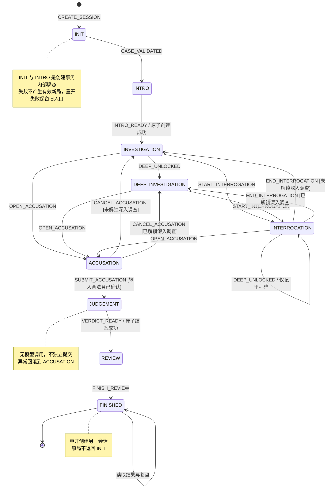
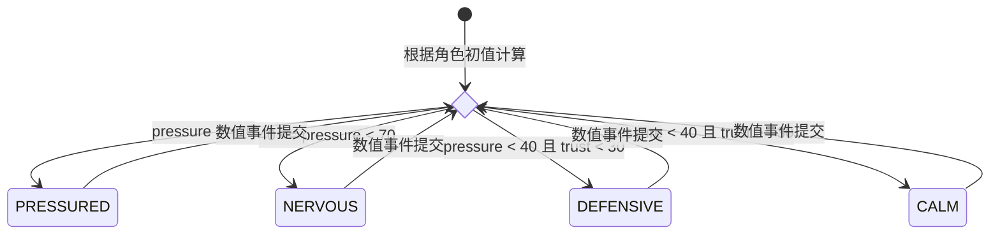
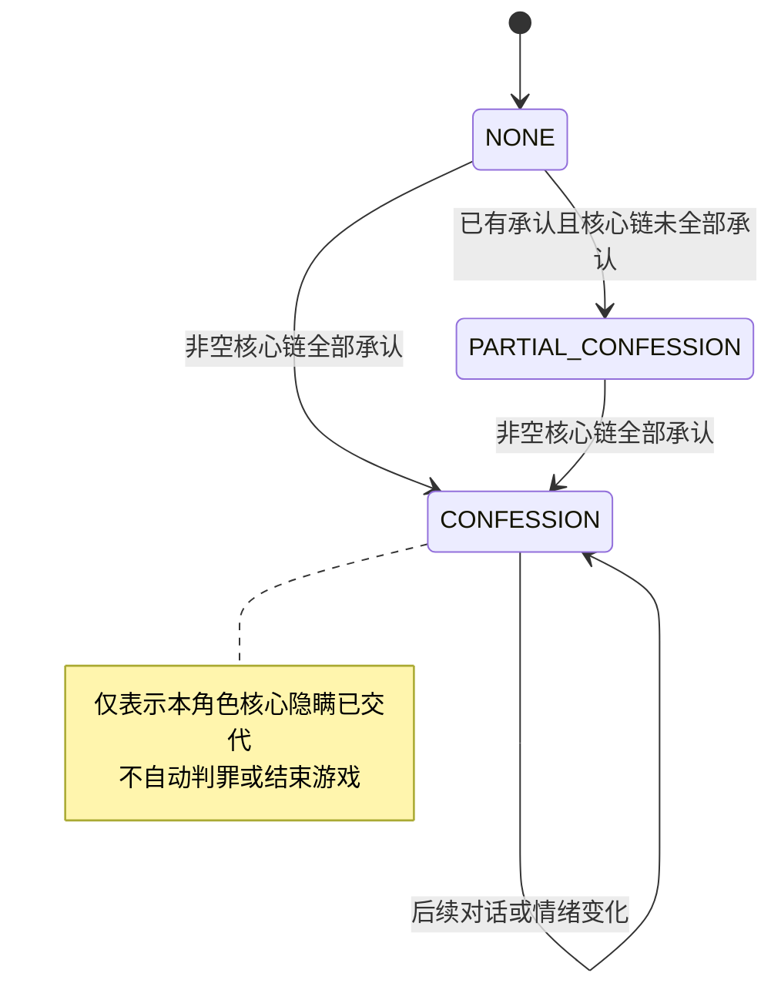
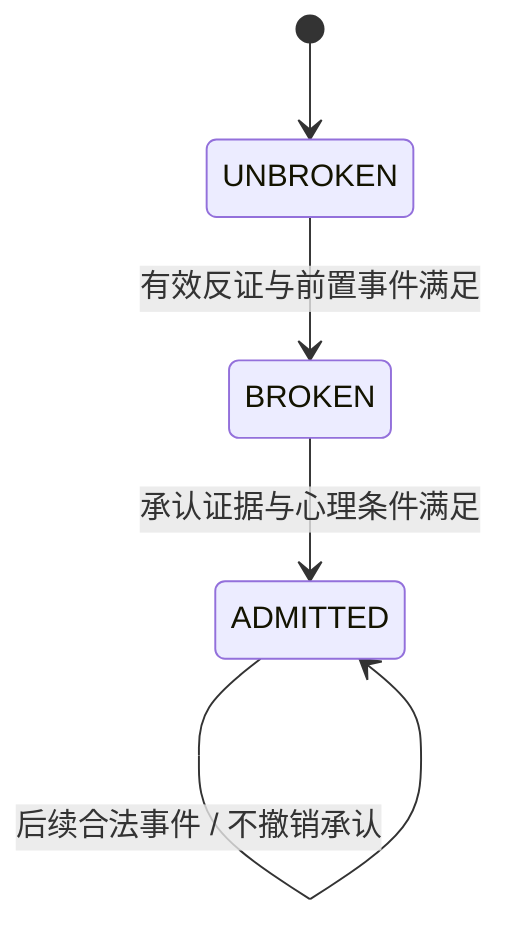

# 游戏与 NPC 状态机设计

本文依据 [项目范围与 MVP](01-project-scope.md)、[软件需求分析](02-requirements-analysis.md)、[总体技术架构设计](03-architecture-design.md)、[核心领域模型设计](04-domain-model.md) 和 [项目设计原则](AI_rules.md)。本次细化游戏阶段、动作权限、转换守卫和 NPC 状态规则，供后续 Python 实现与测试使用。

核心约定：**状态机决定动作与转换是否合法，规则引擎决定业务条件和效果，Game Engine 原子保存结果，Agent 只表达获准内容。** 相同案件与规则版本、相同权威状态、相同规范化事件，必须产生相同业务结果；模型措辞可以不同。

## 1. 状态分层与既有设计的对应

### 1.1 九个游戏阶段的定位

保留本次提出的九个状态，但不把它们设计成必须逐一走完的线性关卡。调查与审讯可以往返，深入调查可以由取证直接解锁，玩家可以提前指控。

| 本文状态 | 对应原架构阶段 | 是否单独持久化 | 设计含义 |
| --- | --- | --- | --- |
| `INIT` | 新建前的初始化过程 | 否，创建事务内部状态 | 校验案件并建立初始快照 |
| `INTRO` | 开局案情展示 | 否，创建事务内部状态 | 准备固定介绍及初始公开信息，不等待模型或动画 |
| `INVESTIGATION` | `INVESTIGATING` | 是 | 基础调查模式 |
| `INTERROGATION` | `INVESTIGATING` | 是 | 正在与一个指定 NPC 交互 |
| `DEEP_INVESTIGATION` | `INVESTIGATING` | 是 | 已解锁深入调查的调查模式 |
| `ACCUSATION` | `ACCUSING` | 是 | 编辑、保存或提交指控 |
| `JUDGEMENT` | 指控到结案的计算过程 | 否，结案事务内部状态 | 按固定规则计算判定 |
| `REVIEW` | `CLOSED` | 是 | 已结案，展示结果与完整复盘 |
| `FINISHED` | `CLOSED` | 是 | 玩家已结束本局体验，仍可读取复盘 |

`INIT → INTRO → INVESTIGATION` 在一次创建事务中完成，提交后返回固定介绍和调查状态。前端可以展示开场遮罩或“开始调查”按钮，关闭遮罩不执行第二次初始化；浏览器刷新不会丢失开局进度。

`ACCUSATION → JUDGEMENT → REVIEW` 在一次结案事务中完成，外部只能读取提交前的 `ACCUSATION` 或提交后的 `REVIEW`。前端的“正在判定”属于请求状态，不能提前保存为游戏已结案。

这延续了需求中“开局成功即可调查”“正式指控与判定同时冻结”的约定。后续实现采用本文细分名称，原文中的三个阶段只作分组解释，不再额外保存一份宏观阶段。`REVIEW → FINISHED` 仅记录体验结束，不修改调查数据、指控或判定。

### 1.2 相互独立的状态维度

| 维度 | 权威数据 | 派生或展示数据 |
| --- | --- | --- |
| 游戏流程 | `GameSession.phase`、`active_npc_id`、深入调查解锁事件 | 可执行动作列表、当前页面 |
| NPC 心理 | 每个 NPC 的 `pressure`、`trust` | `CALM / DEFENSIVE / NERVOUS / PRESSURED` 情绪 |
| NPC 承认 | 每条 `LieProgress` 的阶段、反证集合及事件引用 | `NONE / PARTIAL_CONFESSION / CONFESSION` 承认进度 |
| 信息权限 | `Discovery`、规则披露事件、固定角色知识归属 | 背包、时间线、关系图、授权上下文 |
| 请求与表达 | 请求处理记录、生成尝试状态、来源版本 | 处理中、固定回复、模型文本、过期提示 |

不创建 `INTERROGATION_NERVOUS_PARTIAL_CONFESSION` 等组合枚举。游戏阶段不因 NPC 紧张、模型超时或玩家切换浏览器标签而改变。

## 2. 游戏状态表与动作权限

### 2.1 通用动作与限制

所有有效会话都可以读取获准的本局记录、查询原请求结果和恢复存档；恢复是读取，不重跑规则。完整真相仅在 `REVIEW` 或 `FINISHED` 且存在一致的正式判定时开放。调查期间的查询只返回已知信息。

重新开始必须由玩家明确确认，然后创建新会话并原子切换当前入口；不是原状态回到 `INIT`。退出页面不改变阶段，也不清空 NPC 状态。所有未列入允许表的业务命令默认拒绝，前端隐藏按钮不能代替后端校验。

| 状态 | 允许操作 | 禁止操作 | 进入及退出效果 |
| --- | --- | --- | --- |
| `INIT` | 系统校验固定案件、引用、版本、规则与初值 | 玩家调查、审讯、指控；模型补齐缺失配置 | 建立候选快照；失败回滚，不产生可玩的半成品存档 |
| `INTRO` | 系统登记初始公开信息、准备固定介绍 | 授予未配置证据；等待 Host 同意才开局 | 同一事务进入 `INVESTIGATION`；介绍润色可在提交后执行 |
| `INVESTIGATION` | 访问已开放场景、执行预设调查动作、查看已知信息、开始审讯、进入指控 | 直接提问或出示证据、访问锁定内容、直接提交最终指控 | 规则解锁深入调查时自动转入 `DEEP_INVESTIGATION` |
| `INTERROGATION` | 向当前 NPC 自由提问、出示持有证据、执行已配置的结构化审讯动作、切换可审讯 NPC、结束审讯、进入指控 | 场景调查写操作；向非当前 NPC 发起审讯；直接正式结案 | 进入时保存目标 NPC；离开时清空目标，不清空数值和承认记录 |
| `DEEP_INVESTIGATION` | 基础调查全部操作，以及各自条件已满足的深入调查动作 | 仅凭阶段名称访问所有秘密；直接提问、出示或最终提交 | 基础场景继续可用；不会退回尚未解锁的基础调查模式 |
| `ACCUSATION` | 读取已知信息、编辑并保存合法草稿、返回调查、确认正式提交 | 探索、审讯、出示、执行 NPC 数值动作；读取完整真相 | 进入不要求招供或证据齐全；返回保留草稿；正式提交冻结快照 |
| `JUDGEMENT` | 系统验证提交条件并执行固定评分，准备结案结果 | 所有外部业务写操作；LLM 评分；持久化半份判定 | 成功随结案事务进入 `REVIEW`；失败整个事务回滚到 `ACCUSATION` |
| `REVIEW` | 查看判定、完整真相、固定复盘和记录；结束本局体验；可选复盘润色 | 修改草稿、证据、NPC、正式指控或分数；恢复调查 | 已结案；润色不影响结果，完成阅读不依赖模型 |
| `FINISHED` | 重读已有结果和复盘、读取记录、确认重开 | 恢复旧局调查、重新提交或评分、向任意旧阶段倒退 | 原局业务状态终止；重读不切回 `REVIEW` |

基础调查中点选 NPC，应先提交 `START_INTERROGATION`，成功后才能提交提问或出示。查看已知证据详情不算场景调查写操作，在审讯、指控和结案后均可使用。

结构化审讯动作是案件明确配置的选项，例如“出示不在场证明并说明核验结果”；可与证据出示共用命令，不要求额外开发语气按钮。自由文本中的安慰、威胁、证据编号和“进入下一阶段”都只是文本。

### 2.2 通用转换守卫

所有外部命令按如下顺序处理：

1. 应用层验证会话归属、输入类型、长度和标识格式。
2. 检查 `(visitor_id, request_id)`；相同输入返回已有结果，不再执行。相同请求标识携带不同输入则冲突。
3. 短事务内锁定目标会话，再次检查幂等键，比较 `expected_state_version`。
4. 状态机验证当前阶段、动作和目标转换是否允许；领域模块检查 NPC、场景、证据及指控引用。
5. 规则引擎计算确定性效果；状态机应用合法转换并检查目标快照不变量。
6. 原子保存状态、规则事件、一次性效果键、固定结果和请求记录，然后发布成功结果。

幂等检查先于新命令的阶段检查，因此已经成功的指控请求在 `FINISHED` 重发，仍返回原结果。新的正式提交请求则拒绝。无效动作不改变业务快照；拒绝请求和安全日志可以独立留档。

### 2.3 具体转移表

表中“内部事件”只由 Game Engine 在相应事务中构造，客户端不能直接提交事件名来调用转换。

| 当前状态 | 触发事件 | 目标状态 | 转移条件及判断方 | 必须同时完成的效果 |
| --- | --- | --- | --- | --- |
| 无会话 | `CREATE_SESSION` | `INIT` | 应用层：创建权限、请求幂等、案件版本存在 | 构造新会话，锁定版本；不覆盖旧会话 |
| `INIT` | `CASE_VALIDATED`，内部 | `INTRO` | Case Service：引用、数值、规则、固定文本完整有效 | 初始化 NPC、场景、草稿和规则执行集合 |
| `INTRO` | `INTRO_READY`，内部 | `INVESTIGATION` | 应用层：固定介绍与初始公开条目已准备 | 原子提交整个新会话和当前入口 |
| `INVESTIGATION` | `DEEP_UNLOCKED`，内部 | `DEEP_INVESTIGATION` | Rule Engine：满足第 3 节深入调查条件 | 保存解锁事件及当前调查动作的全部效果 |
| `INVESTIGATION`、`DEEP_INVESTIGATION` | `START_INTERROGATION` | `INTERROGATION` | Evidence/Rule Engine：NPC 属于本案且当前可接触 | 写入 `active_npc_id` |
| `INTERROGATION` | `SWITCH_NPC` | `INTERROGATION` | 应用层及规则：目标合法且可接触；切换到同一 NPC 为无效果操作 | 更新目标；旧角色生成任务失效；没有换人奖励 |
| `INTERROGATION` | `END_INTERROGATION` | `INVESTIGATION` 或 `DEEP_INVESTIGATION` | 状态机：按已保存的深入调查解锁记录唯一确定 | 清空 `active_npc_id`，保留全部 NPC 进度 |
| 三个调查类状态 | `OPEN_ACCUSATION` | `ACCUSATION` | 状态机：尚未结案；不检查证据数量、招供或隐藏分数 | 保留或创建草稿，清空当前 NPC |
| `ACCUSATION` | `CANCEL_ACCUSATION` | `INVESTIGATION` 或 `DEEP_INVESTIGATION` | 状态机：无正式指控；按解锁记录选择目标 | 保留已保存草稿；不自动恢复之前的审讯 |
| `ACCUSATION` | `SUBMIT_ACCUSATION` | `JUDGEMENT` | 应用层确认提交；领域校验字段完整、选项有效、引用证据已持有 | 在事务内冻结评分输入，开始同步确定性计算 |
| `JUDGEMENT` | `VERDICT_READY`，内部 | `REVIEW` | Rule Engine 已生成有效判定；应用层检查单局唯一结案 | 原子保存正式指控、判定、版本、固定复盘和关闭阶段 |
| `REVIEW` | `FINISH_REVIEW` | `FINISHED` | 状态机：正式结果存在；玩家主动结束体验 | 只更新阶段与版本；无需证明阅读完毕 |

合法探索、提问、证据出示、草稿保存通常是当前阶段内的自转换。探索若首次解锁深入调查，则走明确转换；审讯中首次解锁时只保存里程碑，阶段仍为 `INTERROGATION`，避免强制中断谈话。

同一事务可以记录多次内部转换，但 `state_version` 只对最终业务快照递增一次。新会话初始版本为 1；只读、普通问答、无效果重复动作和表达保存不递增。阶段、目标 NPC、草稿或规则输入发生有效变化时递增。

## 3. 深入调查、结案与流程可达性

### 3.1 深入调查解锁规则

深入调查是已获得突破的标记，不能由 Host 判断“剧情差不多了”。建议固定配置为下列条件的逻辑或：

- 至少一条预设谎言到达 `BROKEN` 或 `ADMITTED`。
- 玩家满足案件配置的深入调查证据条件：全部持有 `all_of_evidence_ids`，且在非空 `any_of_evidence_ids` 中至少持有一条。

证据分支至少配置一个证据引用；两个集合都为空时该分支为假，避免开局自动解锁。集合内是否满足仍沿用领域模型的 all/any 语义。该条件所需证据必须在基础调查中可获得，不能反过来依赖深入调查解锁。

首次命中后登记一次性 `deep_unlocked` 里程碑及来源事件；后续不会撤销。实现可以用 `deep_unlock_event_id` 的非空性表示它，无须再保存一个独立布尔值。本次规则结果与里程碑一起提交。

`DEEP_INVESTIGATION` 只开放检查深入调查动作的资格，各场景、证据和秘密仍分别检查自己的规则。关键证据不能只存在于要求招供的路径中；案件须有不触发任何承认也能收齐评分所需证据的路径。

### 3.2 指控和复盘的硬边界

进入指控不设调查时长、对话轮数、证据数量、NPC 数值、深入调查或招供门槛。正式提交检查结构合法性；即使没有证据，只要未伪造引用且字段完整，也可以提交，证据不足由评分规则产生相应结果。

合法但错误的推理正常结案。评分权重、过程顺序规则、证据要求和三类结果阈值仍由固定案件配置提供；本设计不擅自补齐标准答案或决定“凶手错误是否必然判错”。

`REVIEW` 即已结案，无须等到 `FINISHED` 才冻结。复盘披露完整真相通过单独的已结案投影返回，不把遗漏证据补写到调查 `Discovery`，不补改 NPC 招供状态。

### 3.3 游戏 Mermaid 状态图

图中省略各阶段的查询与无阶段变化动作；斜杠后的文字是转换效果。



事务回滚不是一次已成功提交的逆向转换，因此不画 `JUDGEMENT → ACCUSATION` 的业务边。`FINISHED → [*]` 表示业务流程结束，不删除存档或禁用只读接口。

## 4. NPC 状态机

### 4.1 情绪与承认进度分别维护

`CALM`、`DEFENSIVE`、`NERVOUS`、`PRESSURED` 是情绪；`PARTIAL_CONFESSION`、`CONFESSION` 是事实披露进度。一个 NPC 可以已经承认部分事实，但此刻语气平静，两者不能用同一个可逆枚举覆盖。

保留用户提出的六种展示状态，定义 `display_state` 的优先级为：完整承认 → 部分承认 → 当前情绪。当前审讯的角色因连续无关操作回避时，`display_state` 显示为 `EVADING`；回避只持续到本次审讯结束，不改变情绪数值或承认进度。接口同时返回 `emotion` 和承认进度，避免主标签遮蔽心理变化；二者均从权威数据派生。

| 状态 | 确定性进入条件 | 允许的表达和行为 | 禁止的表达或效果 | 退出条件 |
| --- | --- | --- | --- | --- |
| `CALM` | 不满足更高优先级情绪条件 | 按当前说法平静回答；接受合法证据出示 | 因平静推断无罪、主动泄露未授权事实 | 更新后的压力或信任命中其他情绪区间 |
| `DEFENSIVE` | 压力低于紧张阈值，且信任低于戒备阈值 | 预设戒备、回避；已授权条目仍可查看 | 因低信任永久拒绝调查、删除已承认证词 | 压力进入更高区间，或信任恢复 |
| `NERVOUS` | 压力达到紧张阈值但未达到动摇阈值 | 紧张措辞、按规则展示矛盾 | 仅凭紧张击破谎言、自动认罪 | 压力离开该区间后重新映射 |
| `PRESSURED` | 压力达到动摇阈值 | 动摇表达；检查但不跳过证据与承认守卫 | 压力满值代替反证、自动成为真凶 | 压力下降后重新映射；承认记录不倒退 |
| `PARTIAL_CONFESSION` | 至少一条谎言为 `ADMITTED`，且未满足完整承认条件 | 确认已承认条目；对剩余秘密继续使用当前获准说法 | 把部分承认扩展为所有秘密、撤销已承认内容 | 完整承认条件成立后进入 `CONFESSION` |
| `CONFESSION` | 非空的本角色核心承认链集合全部为 `ADMITTED` | 表达该角色已获准披露的完整交代 | 自动结束游戏、直接判罪、获得其他 NPC 私有知识 | 本局不倒退；只会随新局重新初始化 |

本文将 `CONFESSION` 定义为“该角色核心隐瞒已完整交代”。它不必是“承认杀人”。无辜嫌疑人也可能隐瞒关系或不在场证明；只有剧本明确标注为犯罪承认的固定条目才可用认罪措辞，其人物归属必须与案件真相一致。承认全部配置谎言本身不能推导此人有罪。

每个 NPC 配置 `core_admission_lie_ids`，只引用本人的谎言链。空集合不满足完整承认，避免没有谎言的 NPC 开局就 `CONFESSION`；这种 NPC 可以一直只有情绪状态。非核心谎言的承认也会产生部分承认，但完整承认只覆盖事先定义的核心范围。

### 4.2 pressure、trust、emotion 与 evidence

下列数值是**本设计提出的可测试初版参数**，不是已有案件最终平衡结论。正式案件必须显式配置并固定版本，载入时验证；缺失不能靠运行时默认值或模型补齐。

| 参数 | 建议配置或定义 | 规则作用 |
| --- | --- | --- |
| `pressure` | 整数 0～100，示例初值 20 | 反证事件等带来压力；不是“有罪概率” |
| `trust` | 整数 0～100，示例初值 40 | 角色对玩家的信任；可支持证据充分时的合作承认 |
| `emotion` | 由下表优先映射 | 只控制授权说法的表达风格，不作为额外随机输入 |
| `evidence` | 本局持有集合、每条链的 `matched_evidence_ids` | 指定证据 ID、可信度及出示目标的精确匹配；不使用 LLM 置信分 |
| `core_admission_lie_ids` | 每个 NPC 固定配置的集合 | 决定完整承认范围，发布后局内不可改 |

情绪按下表从上往下取第一条，互斥且覆盖全部合法数值：

| 优先级 | 条件 | 情绪 |
| --- | --- | --- |
| 1 | `pressure >= 70` | `PRESSURED` |
| 2 | `40 <= pressure < 70` | `NERVOUS` |
| 3 | `pressure < 40 and trust < 30` | `DEFENSIVE` |
| 4 | `pressure < 40 and trust >= 30` | `CALM` |

高信任与高压力可以共存，此时仍显示较高压力情绪。没有独立的情绪分值，也不让情绪反向修改压力；承认守卫直接读取数值，避免“情绪是结果，又反过来触发自身”的循环。

数值更新先汇总本事件所有获准且未消费的增量，再执行一次 `min(100, max(0, old + delta))`。不按遍历顺序逐条截断。示例事件策略如下，实际增量可按角色配置：

| 事件 | 建议数值效果 | 证据与一次性条件 |
| --- | --- | --- |
| 首次出示匹配反证 | 压力 `+25`，信任 `-5` | 本局持有且向正确角色出示；该角色对该证据的数值效果只触发一次 |
| 首次出示指定澄清证据 | 压力 `-10`，信任 `+20` | 案件明确定义该证据可澄清该角色的误会；不能由文本推断 |
| 已配置的合作动作 | 压力 `-5`，信任 `+15` | 必须有固定动作 ID、非重复前置条目和一次性键；无配置则无该动作 |
| 自由文本提问、模型回复、等待、切换 NPC、结束再开始审讯 | `0`、`0` | 不运行心理收益规则，不基于现实时间衰减；结束审讯清零无关操作计数 |
| 追问案件预设的话题 | `0`、`0` | 把固定回答登记为该角色的未核验证词；重复追问无效果 |
| 首次指出成立的矛盾 | 按配置，例如压力 `+15` | 必须引用本局已记录的该角色证词，并持有预设矛盾表中的对应证据；只触发一次，不改变谎言阶段 |
| 未持有或伪造证据 | 无效果，拒绝 | 不登记反证或消费效果键 |
| 合法但与当前谎言层无关的证据，或指出不成立的矛盾 | 默认 `0`、`0`；案件可配置信任代价，《停电之夜》切片为信任 `-5` | 每个“角色 + 证据”或“证词 + 证据”组合只扣一次；连续计数达到配置次数（切片为 2）后，该角色只给回避说法，直到结束审讯。发布校验按最坏扣减确认承认仍可达，关键路径不会永久不可达 |
| 换请求重复出示同一反证 | 不重复增减 | 仍重新检查击破与承认条件 |

一次证据可以匹配多条链，但共享的数值效果使用 `(session_id, npc_id, evidence_id, effect_key)` 去重，不能按命中链数重复加压。链的反证集合及承认披露使用各自的 `(session_id, lie_rule_id, effect_key)`。这些字段可以编码进既有 `consumed_effect_keys`；不必新增一套存储系统。

### 4.3 每条谎言的不可逆进度

| 当前阶段 | 目标阶段 | 确定性守卫 | 效果 |
| --- | --- | --- | --- |
| `UNBROKEN` | `BROKEN` | 本链有效反证满足配置的 all/any 组合；规定的前置事件已发生 | 保存击破事件，切换到预设“已击破”说法 |
| `BROKEN` | `ADMITTED` | 承认所需反证与前置事件满足，且心理条件成立 | 保存承认事件、固定证词和获准披露条目 |
| `UNBROKEN` | 同事务内经 `BROKEN` 到 `ADMITTED` | 更新后的快照同时满足两步条件 | 两条转换依据一起记录，不要求玩家额外再点一次 |
| 任意阶段 | 原阶段 | 条件不足，或已到 `ADMITTED` | 保留状态；重复事件没有额外收益 |

每条链的击破规则至少包含一条明确反证引用。`matched_evidence_ids` 仅在有效出示后增加；背包持有不等于已向 NPC 出示。反证匹配检查目标 NPC、证据 ID、案件版本及配置要求的可信度，不能凭证据总数判断。

承认守卫建议写成以下固定形状，而非任意脚本：

```text
admission_ready =
    lie.stage == BROKEN
    AND required_presented_evidence_satisfied
    AND required_events_satisfied
    AND (
        pressure >= admission_pressure_min
        OR trust >= admission_trust_min
    )
```

建议示例阈值为压力 65、信任 60；两条心理路径都不能绕过证据。配置允许显式关闭其中一个分支，不能用缺字段隐式改变含义；至少启用一个分支。完整承认还必须满足核心链集合条件。模型说“我认罪”、玩家输入“证据确凿”和 Host 提示都不构成前置事件。

本次事件若改变了目标 NPC 的数值或前置条件，应重新检查该 NPC 所有尚未承认的链，不只检查本次新匹配的链。玩家先补足信任、再重复出示旧反证时仍可承认；不能用“这条链运行过”阻止重新判断。

### 4.4 单事件的固定计算顺序

1. 验证阶段、目标、输入和证据持有关系，读取固定规则版本。
2. 在事件前快照上筛选适用规则，按 `(priority, rule_id)` 排序；构造新增匹配集合及未消费数值效果。
3. 合并各链反证，汇总数值增量，一次性裁剪压力与信任到有效范围。
4. 用更新后的数值与反证判断各链 `BROKEN`，再判断 `ADMITTED`；记录每次单向进度。
5. 应用预设披露，计算 NPC 承认进度与情绪；判断深入调查里程碑，必要时更新游戏阶段。
6. 校验不变量，返回完整 `RuleOutcome`，由 Game Engine 整体提交。提交成功后再生成角色表达。

MVP 不让第 5 步披露出的新条目在同一事件中递归触发另一条规则；需要联动时由后续明确动作触发。承认披露不附加心理增量，避免回头重算承认条件。配置若需要这种循环或具有冲突的效果定义，发布校验应拒绝。

同一输入序列的结果确定，不承诺任意调整动作顺序后数值相同，尤其存在上下界截断时。不同调查顺序仍应保留可解路径；这是案件可达性测试的责任。

### 4.5 NPC Mermaid 状态图

情绪图用选择节点表示每次规则计算后的唯一映射；初值也经过同一映射，不要求所有 NPC 初始都是平静。



承认进度是另一条单向状态机；一个事件可以直接满足完整承认，但底层各链仍记录击破和承认过程。





## 5. 程序判断与 Host 提示的职责表

| 条件或行为 | 最终负责人 | Host / NPC / Review 可以做什么 |
| --- | --- | --- |
| 会话归属、请求重复、版本冲突、保存或回滚 | Game Engine 与数据库 | 表达固定错误信息；无权批准例外 |
| 当前动作能否执行、阶段目标、结案后只读 | State Machine | Host 介绍当前阶段和已开放操作，不调用转换接口 |
| 场景开放、深入调查解锁、证据获取 | Rule Engine；Evidence Engine 校验及应用 | Host 提示“可以重新查看某个已开放场景”，依据程序给出的可用操作 |
| 有效反证、压力、信任、情绪、谎言承认 | Rule Engine | NPC 用对应语气表达获准说法；Host 可复述已登记的变化 |
| 指控完整性、候选项、引用合法性 | 输入模型及领域校验 | Host 提醒填写缺项、提示“提交后本局结束” |
| 凶手、过程、证据要求、分数与结果 | Rule Engine | Review 解释保存的逐项结果；不设置模型 Judge |
| 已结案完整真相访问 | 应用层与玩家可见投影 | Review 在授权后讲解；Host 在调查期间不能提前拿到答案 |
| 卡关或下一步建议 | 程序根据已知信息与合法动作给出候选 | Host 可润色已批准提示；MVP 只需基础固定提示，分级提示留到后续 |

Host 可以说明“现在可以出示持有的证据”“你可以继续调查，也可以准备指控”，不能决定“证据已经足够”“此人一定是凶手”或“现在必须认罪”。它可接收当前阶段、已公开案情、固定结果和筛选后的 `available_actions`，不接收完整 `CaseTemplate`、隐藏解锁条件或其他 NPC 私有知识。

建议操作只返回文本或程序预先批准的动作标识；点击后仍走普通命令校验。玩家不采纳建议不会触发额外状态变化。提示、开场和过渡都提供固定文本，模型失败不阻断任何转换。

## 6. Python 层面的设计建议

### 6.1 最小落地方式

使用标准库 `Enum`、`dataclass`、`frozenset`、普通映射和纯函数即可。沿用已有架构的 `backend/src/backend/domain/`，先把枚举、动作允许表和转换函数放在 `state_machine.py`，证据、数值和谎言逻辑放在已有职责的 `rules.py`；应用层负责事务。无需第三方状态机库、通用工作流框架或每个状态一个类。

权威会话只需在原领域字段上补充 `active_npc_id` 和 `deep_unlock_event_id`。前者仅在 `INTERROGATION` 非空；后者单向从空变为事件引用。返回调查的目标从里程碑派生，无需维护容易失效的 `previous_phase`。NPC 的情绪和六态展示值不单独写入数据库。

接口传动作及业务输入，不接受客户端提交 `target_phase`、`pressure`、`emotion`、`deep_unlocked` 或“守卫已通过”标志。应用层从权威快照计算守卫；内部转换事件与公开命令使用不同入口白名单。

### 6.2 转换与派生函数示例

以下可直接执行的标准库示例演示转换边、动态返回目标和 NPC 派生，不是完整后端实现。`guard_passed` 只能来自服务端领域校验；身份、动作载荷、证据、幂等、事务和第 2 节动作允许表仍必须由用例入口执行，不能将此函数直接暴露为 API。

```python
from dataclasses import dataclass
from enum import Enum


class GamePhase(str, Enum):
    INIT = "INIT"
    INTRO = "INTRO"
    INVESTIGATION = "INVESTIGATION"
    INTERROGATION = "INTERROGATION"
    DEEP_INVESTIGATION = "DEEP_INVESTIGATION"
    ACCUSATION = "ACCUSATION"
    JUDGEMENT = "JUDGEMENT"
    REVIEW = "REVIEW"
    FINISHED = "FINISHED"


P = GamePhase
TRANSITIONS = {
    (P.INIT, "CASE_VALIDATED"): P.INTRO,
    (P.INTRO, "INTRO_READY"): P.INVESTIGATION,
    (P.INVESTIGATION, "DEEP_UNLOCKED"): P.DEEP_INVESTIGATION,
    (P.INTERROGATION, "DEEP_UNLOCKED"): P.INTERROGATION,
    (P.INVESTIGATION, "START_INTERROGATION"): P.INTERROGATION,
    (P.DEEP_INVESTIGATION, "START_INTERROGATION"): P.INTERROGATION,
    (P.INTERROGATION, "SWITCH_NPC"): P.INTERROGATION,
    (P.INVESTIGATION, "OPEN_ACCUSATION"): P.ACCUSATION,
    (P.INTERROGATION, "OPEN_ACCUSATION"): P.ACCUSATION,
    (P.DEEP_INVESTIGATION, "OPEN_ACCUSATION"): P.ACCUSATION,
    (P.ACCUSATION, "SUBMIT_ACCUSATION"): P.JUDGEMENT,
    (P.JUDGEMENT, "VERDICT_READY"): P.REVIEW,
    (P.REVIEW, "FINISH_REVIEW"): P.FINISHED,
}
RETURN_TO_INVESTIGATION = {
    (P.INTERROGATION, "END_INTERROGATION"),
    (P.ACCUSATION, "CANCEL_ACCUSATION"),
}


def next_phase(phase, event, *, deep_unlocked, guard_passed):
    if not guard_passed:
        raise ValueError("GUARD_NOT_MET")
    key = (phase, event)
    if key in RETURN_TO_INVESTIGATION:
        return P.DEEP_INVESTIGATION if deep_unlocked else P.INVESTIGATION
    if key not in TRANSITIONS:
        raise ValueError("ACTION_NOT_ALLOWED")
    return TRANSITIONS[key]


@dataclass(frozen=True)
class EmotionPolicy:
    pressure_min: int
    pressure_max: int
    trust_min: int
    trust_max: int
    nervous_at: int
    pressured_at: int
    defensive_below: int


def derive_emotion(pressure, trust, policy):
    if not (policy.pressure_min <= pressure <= policy.pressure_max
            and policy.trust_min <= trust <= policy.trust_max):
        raise ValueError("INVALID_NPC_STATE")
    if pressure >= policy.pressured_at:
        return "PRESSURED"
    if pressure >= policy.nervous_at:
        return "NERVOUS"
    if trust < policy.defensive_below:
        return "DEFENSIVE"
    return "CALM"


def derive_admission(admitted_lie_ids, core_lie_ids):
    if core_lie_ids and core_lie_ids <= admitted_lie_ids:
        return "CONFESSION"
    return "PARTIAL_CONFESSION" if admitted_lie_ids else "NONE"


def demo():
    policy = EmotionPolicy(0, 100, 0, 100, 40, 70, 30)
    for key, expected in TRANSITIONS.items():
        assert next_phase(*key, deep_unlocked=False,
                          guard_passed=True) == expected
    for key in RETURN_TO_INVESTIGATION:
        for unlocked in (False, True):
            expected = P.DEEP_INVESTIGATION if unlocked else P.INVESTIGATION
            assert next_phase(*key, deep_unlocked=unlocked,
                              guard_passed=True) == expected
    for phase, event, guard in (
        (P.FINISHED, "OPEN_ACCUSATION", True),
        (P.INVESTIGATION, "SUBMIT_ACCUSATION", True),
        (P.ACCUSATION, "SUBMIT_ACCUSATION", False),
    ):
        try:
            next_phase(phase, event, deep_unlocked=False, guard_passed=guard)
        except ValueError:
            pass
        else:
            raise AssertionError("illegal transition accepted")
    for pressure, trust, expected in (
        (39, 29, "DEFENSIVE"), (39, 30, "CALM"),
        (40, 100, "NERVOUS"), (69, 0, "NERVOUS"),
        (70, 100, "PRESSURED"), (100, 0, "PRESSURED"),
    ):
        assert derive_emotion(pressure, trust, policy) == expected
    assert derive_admission(frozenset(), frozenset()) == "NONE"
    assert derive_admission({"L1"}, {"L1", "L2"}) == "PARTIAL_CONFESSION"
    assert derive_admission({"L1", "L2"}, {"L1", "L2"}) == "CONFESSION"
    print("state machine examples: OK")


if __name__ == "__main__":
    demo()
```

正式实现将动作、情绪、承认阶段和错误码也定义为枚举，案件载入时验证数值为整数、阈值位于范围内且紧张阈值小于动摇阈值。集合引用必须属于当前 NPC 和案件版本。规则函数返回新值，不原地修改调用方的嵌套集合。

阶段内命令单独用 `ALLOWED_ACTIONS[phase]` 校验；查询、普通提问和无效果重复动作不调用 `next_phase`。示例中的转换表只负责流程边，不能替代规则引擎或目标快照校验。

### 6.3 规则函数与事务边界

建议保持以下职责清楚的函数契约；类型沿用原架构的领域对象：

| 函数 | 输入 → 输出 | 必须保证 |
| --- | --- | --- |
| `ensure_action_allowed` | 阶段、动作 → 允许或领域错误 | 默认拒绝；只按动作权限判断，不调用模型 |
| `evaluate_event` | 固定案件、快照、规范化事件 → `RuleOutcome` | 相同输入结果相同；不写库，不使用模型、随机数或当前时间决定玩法 |
| `apply_outcome` | 快照、`RuleOutcome` → 新快照 | 数值、反证、披露与效果键一起应用；不接受模型构造的效果 |
| `validate_snapshot` | 案件、新快照、必要结案记录 → 成功或错误 | 引用、阶段、数值和承认单调性合法 |
| `judge_accusation` | 固定答案与评分规则、结构化提交、冻结证据快照 → `Verdict` | 不读自由文本计分；只返回配置定义的结果 |

Game Engine 用已有 SQLAlchemy 事务和数据库行锁提交，不增加内存锁或队列。结案事务保存 `conclusions`、`REVIEW`、规则依据和请求结果；`conclusions.session_id` 唯一。提交失败时所有变化一起回滚，不发布尚未保存的判定。

规则事件至少保留请求与事件标识、案件与规则版本、规范化输入、前后 `state_version`、阶段转换、命中规则、实际数值增量、反证变化、披露条目、一次性效果键和原因码。时间戳只用于审计，不决定 NPC 数值；状态恢复读取快照，不要求建设事件溯源平台。

### 6.4 必须校验的目标快照不变量

- 持久化阶段不允许为 `INIT`、`INTRO` 或 `JUDGEMENT`；恢复时出现这些值视为版本或数据异常，不猜测推进。
- `phase == INTERROGATION` 当且仅当 `active_npc_id` 非空，且目标属于本案可接触角色。
- `DEEP_INVESTIGATION` 必须有深入调查解锁记录；提交后 `INVESTIGATION` 不应同时有该记录。
- `REVIEW`、`FINISHED` 必须存在完整正式指控与判定；其他稳定阶段没有正式结案记录。
- 结案后调查快照、NPC、正式指控、判定不可变；仅允许明确的阅读完成阶段变化及独立表达记录。
- 数值有界；反证来自实际有效出示；谎言只前进；已授权承认条目不因数值下降撤销。
- 消费效果键、对应事件、数值与信息披露一致提交；每个目标 NPC 的状态相互隔离。

### 6.5 异常与表达生成

| 情况 | 游戏与 NPC 状态处理 | 表达或恢复处理 |
| --- | --- | --- |
| 开局配置或保存失败 | 不生成有效新局 | 固定错误提示；重开保留旧入口 |
| 非法转换、未持有证据、版本冲突 | 拒绝，无业务副作用 | 返回固定原因码和当前可用操作；不泄露隐藏守卫 |
| 规则计算或结案保存异常 | 整个事务回滚 | 保留原阶段；按请求标识核查提交结果 |
| 已提交规则后 LLM 超时、预算耗尽或输出违规 | 保留已提交证据、数值、承认和阶段 | 显示固定结果与固定回复；不补跑规则 |
| 审讯中切换 NPC、进入指控或重开后旧回复迟到 | 不改变当前权威状态 | 按会话、目标、请求、尝试、来源版本判定过期；保留用量 |
| 同一会话已有 NPC 生成任务 | 不阻止退出审讯、进入指控等非生成命令 | 新的生成请求按已有忙碌规则处理；阶段或目标改变后旧任务失效 |
| 已失效生成任务仍在上游运行 | 不能撤销已提交规则或假设调用免费 | 逻辑失效释放当前生成占位，保留尝试与额度占用；迟到只记录用量 |
| 恢复或刷新 | 读取最后提交快照，冻结数值不随等待衰减 | 不自动再次调用模型；过期任务用固定回复 |

表达重试只在原轮次仍匹配当前会话、NPC、阶段和来源版本时新建尝试；若上下文已变化，旧轮保留固定结果，玩家可在合法阶段发起新问题。重试从不再次执行原证据或承认规则。

## 7. 确定性示例与验收建议

### 7.1 一条谎言链的演算

假设 NPC A 初始压力 20、信任 40；`L1` 要求出示 `E01` 和 `E02` 才击破，承认阈值为压力 65 或信任 60。两条证据各自首次出示产生压力 `+25`、信任 `-5`；没有额外披露前置事件。该 NPC 的核心链为 `L1`、`L2`，示例中 `L2` 尚未承认。

| 步骤 | 压力 / 信任 | 情绪 | L1 与承认进度 | 游戏影响 |
| --- | --- | --- | --- | --- |
| 开始审讯 | 20 / 40 | `CALM` | `UNBROKEN`，`NONE` | 进入 `INTERROGATION` |
| 自由文本声称“我有 E02” | 20 / 40 | `CALM` | 不变，反证集合仍空 | 无规则收益 |
| 合法出示已持有的 E01 | 45 / 35 | `NERVOUS` | 仅匹配 E01，仍 `UNBROKEN` | 阶段不变 |
| 新请求再次出示 E01 | 45 / 35 | `NERVOUS` | 条件仍不足；不重复增值 | 阶段不变 |
| 合法出示已持有的 E02 | 70 / 30 | `PRESSURED` | 同事务 `BROKEN → ADMITTED`；`PARTIAL_CONFESSION` | 首次击破解锁深入调查，但保持审讯 |
| 模型未回应或说“我什么都没承认” | 70 / 30 | `PRESSURED` | 已承认不可倒退 | 固定承认卡片有效；违规表达降级 |
| 结束审讯 | 70 / 30 | `PRESSURED` | 不变 | 返回 `DEEP_INVESTIGATION` |

若 E02 尚未持有，出示请求直接拒绝。如果压力已经达到 100 但没有满足 E01、E02 的出示组合，L1 仍不能击破或承认。即使 L1、L2 都未承认，玩家也可以依据独立取得的证据提交正确指控。

### 7.2 实现时的最小验收集合

文档中的 `demo()` 只检查转换边与派生示例，不代表完成后端或案件验收。实现阶段在 `backend/tests/domain/test_state_machine.py` 起步，纯函数检查使用标准库 `unittest`；事务行为再接入选定数据库验证。

| 检查 | 关键输入 | 必须得到的结果 |
| --- | --- | --- |
| 合法与非法流程边 | 表内所有边、所有未列出的阶段与动作组合 | 合法边目标唯一；非法边无业务副作用 |
| 动态返回 | 基础/深入调查进入审讯或指控再返回 | 按里程碑恢复正确调查模式，不遗留当前 NPC |
| 提前指控 | 无证据、未审讯、未深入调查 | 可以准备与提交结构合法的指控；正常得到规则判定 |
| 深入调查入口 | 指定证据条件、首次击破、重复解锁 | 两条路径均可达；只记一次里程碑；审讯不被中断 |
| 情绪边界 | 压力 39/40/69/70，信任 29/30，范围端点 | 完全遵守优先级，无重叠或遗漏 |
| 截断与多规则 | 多个正负增量、不同规则遍历顺序 | 同事件先求和再截断，结果不随遍历顺序改变 |
| 证据硬门槛 | 压力 100 但缺反证；仅持有未出示；出示给错误角色 | 不击破、不承认、不串角色 |
| 两种承认路径 | 证据充分且压力达标；证据充分且信任达标 | 都按配置承认；不要求固定情绪或模型措辞 |
| 多链与重复事件 | 同证据匹配两条链；新请求重复证据；后续补足信任 | 共享数值不重复；链分别推进；旧链仍可重新检查 |
| 单向承认 | 部分承认后降压、重启、历史截断 | 承认不倒退；情绪可变化；空核心集合不误判完整承认 |
| LLM 无写权限 | 伪造认罪、证据授予、阶段切换文本 | 权威状态完全不变；文本风险单独评测 |
| 结案原子性与唯一性 | 提交失败、并发提交、同请求重试、新请求重提 | 无半结案；一局一判定；提交成功才开放真相 |
| 结束与重开 | `REVIEW`/`FINISHED` 调查请求，重复阅读，新局创建失败 | 拒绝调查；阅读无状态收益；失败保留旧局 |
| 模型故障与迟到 | 规则提交后超时、角色切换、阶段变化、重开 | 固定结果完整；旧文本失效；不重复执行规则 |
| 案件可解性 | 全程固定回复；改变取证顺序；全程不招供 | 均存在正确指控路径，关键证据无循环依赖 |

### 7.3 案件发布前的配置检查

发布时检查所有引用、规则优先级、效果键、数值初值、阈值、固定说法和核心承认链集合；同一个效果键不能定义不同增量。验证每条链至少有有效反证，深入调查有基础阶段可达的入口，承认披露不形成递归规则循环。

案件作者提供至少一条完整正确路径和一条不招供正确路径，并记录预期状态与结果，由确定性模拟执行检查。还应遍历全部有限阶段与动作组合，覆盖守卫拒绝和往返流程。只检查依赖图无环并不能证明数值门槛可达，数值路径需要实际演算。

本次交付是状态机详细设计与可运行示例；正式案件证据 ID、各角色参数、评分配置和完整固定回复仍待案件内容落实。无需为这一步增加 Agent 自主规划、额外服务或状态机依赖。
