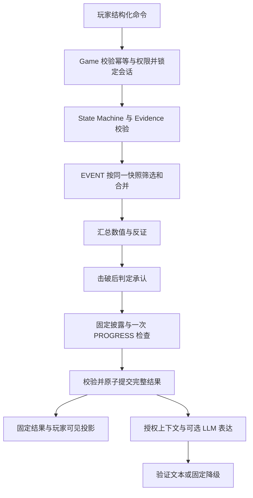

# Evidence Engine 与 Rule Engine 设计

本文承接 [需求分析](02-requirements-analysis.md)、[总体架构](03-architecture-design.md)、[领域模型](04-domain-model.md) 和 [状态机设计](05-state-machine.md)。采用固定版本案件包、会话快照与确定性规则；阶段名称及 NPC 计算顺序以状态机设计为准。

**案件作者用 JSON 定义证据、条件和效果；程序实现有限的条件判断与动作处理器；LLM 只表达已经提交的结果。** 不执行 JSON 中的 Python、SQL、模板表达式或模型生成的规则。

下文 E07、NPC01 及数值均为设计示例，不代表已完成正式案件。示例展示部分证据和一条谎言链；发布完整案件仍须满足 12 条证据、5 条关键证据、4 个场景、4 个 NPC、3 条谎言链的内容要求。

## 1. 模块边界

| 模块 | 负责 | 输入与输出 |
| --- | --- | --- |
| Evidence Engine | 校验证据引用、持有关系；应用获准的证据与信息效果；生成玩家可见投影 | 固定定义、快照、内部批准效果 → 新 Discovery、背包、固定结果卡片 |
| Rule Engine | 判断前置条件、反证、数值、谎言、解锁与评分 | 固定规则、快照、规范化事件 → RuleOutcome 或 Verdict |
| State Machine | 限制当前阶段的命令，执行合法阶段转换 | 阶段、命令、程序算出的守卫 → 允许或拒绝、目标阶段 |
| Game Engine | 身份与幂等校验、行锁、事务、调用编排 | 玩家命令 → 原子保存的动作结果 |
| Case Service | 校验并读取不可变案件版本 | 案件包 → 通过结构与业务检查的定义 |
| Agent / Conversation | 使用授权上下文生成、验证或降级文本 | 已提交固定结果 → 候选表达；无权产生业务效果 |

Evidence Engine 不自行判断“这句话像证据”，Rule Engine 不直接写库。应用层只能提交服务端规则计算得到的结果，不能把客户端或模型 JSON 反序列化成 `RuleOutcome` 后应用。

## 2. Evidence 数据结构

### 2.1 静态定义与本局状态分离

证据定义属于 `CaseTemplate`，其身份是 `(case_id, case_version, evidence_id)`。关键证据与普通证据共用一种结构和获取流程。

| 字段 | 类型 | 含义与约束 |
| --- | --- | --- |
| `evidence_id` | string | 案件版本内唯一，例如 E07 |
| `name`、`content` | string | 预先审核的名称和固定内容；获得后才可展示 |
| `kind` | enum | `PHYSICAL`、`DOCUMENT`、`TESTIMONY`、`DIGITAL`；不代替可信度 |
| `source` | object | 固定内容来源，类型为 `SCENE` 或 `NPC`，引用对应对象 |
| `initial_credibility` | enum | `UNVERIFIED`、`VERIFIED`、`DISPUTED`、`REFUTED` |
| `is_key_internal` | boolean | 作者标记的核心推理证据；不自动加分，不自动披露 |
| `show_key_badge` | boolean | 获得后是否展示关键标签；默认配置为 false，不能向客户端发送内部标记再隐藏 |
| `prerequisites` | EvidenceDependency | 只表达前置证据持有关系 |
| `acquisition_condition` | Condition | 除前置证据外的获取守卫；获取路径由引用此证据的 Rule 定义 |

`prerequisites.all_of_evidence_ids` 必须全部持有；非空 `any_of_evidence_ids` 至少持有一个；两组同时满足。两组均为空表示没有证据前置。这与领域模型一致，不能把空的 any 集合误判为不可获取。

可信度是预设核验状态，不是 LLM 置信度，也不是按枚举顺序比较的分数。`TESTIMONY` 即使已记录仍然是某人的说法；谎言被击破不能改写原证词内容。关键标记不等于 `VERIFIED`，普通证据也可以改变信任或成为评分依据。

### 2.2 普通证据与关键证据 JSON

以下为案件包 `evidence` 数组中的两个条目。E03 是另行预设、可在基础调查取得的“监控时钟核验记录”，证明本案监控时钟无需校正。

```json
[
  {
    "evidence_id": "E01",
    "name": "监控检索索引",
    "kind": "DOCUMENT",
    "content": "值班桌上记录了走廊摄像头编号及当晚录像的检索编号。",
    "source": {"type": "SCENE", "scene_id": "S01"},
    "initial_credibility": "VERIFIED",
    "is_key_internal": false,
    "show_key_badge": false,
    "prerequisites": {
      "all_of_evidence_ids": [],
      "any_of_evidence_ids": []
    },
    "acquisition_condition": {"type": "scene_unlocked", "scene_id": "S01"}
  },
  {
    "evidence_id": "E07",
    "name": "21:10 的走廊录像",
    "kind": "DIGITAL",
    "content": "经校时核验的录像清楚显示 NPC01 于案发当晚 21:10 出现在楼内走廊。",
    "source": {"type": "SCENE", "scene_id": "S02"},
    "initial_credibility": "VERIFIED",
    "is_key_internal": true,
    "show_key_badge": false,
    "prerequisites": {
      "all_of_evidence_ids": ["E01", "E03"],
      "any_of_evidence_ids": []
    },
    "acquisition_condition": {"type": "scene_unlocked", "scene_id": "S02"}
  }
]
```

依赖、类型和内容都由案件作者确定。程序不从录像描述中自行推导 NPC 身份或时间；该核验结论是已审核案件内容。

### 2.3 Discovery 与生命周期

沿用 `GameSession.Discovery`，不在 Evidence 上保存 `is_discovered`，也不额外维护一份权威背包数组。证据是否持有，等价于本局是否存在对应的 `EVIDENCE` Discovery。

```json
{
  "target_kind": "EVIDENCE",
  "target_id": "E07",
  "discovered_at": "2026-09-22T10:00:00Z",
  "source_event_ids": ["EVT-120"],
  "credibility": "VERIFIED",
  "known_conflicts": []
}
```

- `discovered_at` 是首次取得的审计时间，不是录像的案发时间，也不参与玩法判断。
- `(target_kind, target_id)` 在本局快照内唯一。再次经过不同的有效获取或核验路径可以合并来源；纯重复无效果操作不追加来源、时间或状态版本。
- “未获得 → 可获取”由当前快照及合法调查动作推导，不持久化 `AVAILABLE`，也不自动授予；玩家仍须执行动作。
- “已获得 → 已出示”不是证据的全局状态。向不同 NPC 出示分别校验，有效反证登记在目标的 `LieProgress.matched_evidence_ids`。
- 获得证据是单向增加，MVP 不消耗或删除关键证据。核验、争议状态只能按显式规则更新。
- 获得新前置证据后，之前失败的调查可以重试；条件不足不能把调查动作永久标记为已完成。

### 2.4 证据之间的关联

前置依赖与推理关联分开：`prerequisites` 控制能否获取，`EvidenceLink` 描述预设的支持、矛盾或相互印证关系。EvidenceLink 是本次对领域模型的小幅补充，存于案件包 `evidence_links`，不与人物 `Relationship` 混用。

```json
{
  "link_id": "EL01",
  "from_evidence_id": "E03",
  "to_evidence_id": "E07",
  "relation": "SUPPORTS",
  "description": "校时核验记录支持录像中 21:10 时间标记的可靠性。",
  "disclosure_condition": {
    "type": "evidence_owned",
    "all_of_evidence_ids": ["E03", "E07"],
    "any_of_evidence_ids": []
  }
}
```

`relation` 只允许 `SUPPORTS`、`CONTRADICTS`、`CORROBORATES`。支持与矛盾按定义方向解释；相互印证对两端对称，发布时禁止重复反向定义。

两端均持有是披露关联的硬守卫，还须满足 `disclosure_condition`。通过 `reveal_information` 登记 `target_kind = EVIDENCE_LINK` 后才进入玩家投影；规则 ID、隐藏端点与未披露关系不返回前端。得到两条证据并不自动证明任意关联，只有预设关系可被披露。玩家自写的关联是推理假设，不创建官方 EvidenceLink。

## 3. Rule 数据结构

案件包至少保存 `schema_version`、`case_id`、`case_version`、`rules_version`、`rule_execution_version`，以及 `evidence`、`evidence_links`、`rules`、`lie_rules` 和评分配置。发布内容带摘要，已有会话绑定旧版本；不能热改进行中会话的规则。

普通规则统一采用下面的结构。数组 `actions` 表达一个原子结果中的多个效果；不同时支持含义重叠的 `action` 单值字段。

```json
{
  "rule_id": "R_FIND_E01",
  "stage": "EVENT",
  "priority": 100,
  "exclusive_group": null,
  "trigger": {
    "event_type": "INVESTIGATE",
    "match": {"scene_id": "S01", "action_id": "INSPECT_DESK"}
  },
  "condition": {"type": "evidence_acquirable", "evidence_id": "E01"},
  "actions": [
    {"type": "grant_evidence", "evidence_id": "E01"}
  ]
}
```

| 字段 | 规则 |
| --- | --- |
| `rule_id` | 案件版本内唯一，审计使用；不是“已执行就永久跳过”的标记 |
| `stage` | `EVENT`、`PROGRESS` 或 `JUDGE`；只允许该阶段的动作类型 |
| `priority` | 必填整数，数值越小越先；同值按 `rule_id` 字典序稳定排序 |
| `exclusive_group` | null 表示可合并；非空时只在同组适用规则中选一条 |
| `trigger` | 规定何时检查，类型及精确载荷过滤；不解析聊天文本 |
| `condition` | 有限类型的布尔条件树；假则不产生效果 |
| `actions` | 非空的带类型效果数组；全部获批效果一起提交或回滚 |

已有 `LieRule` 保留身份与分阶段说法，使用相同 Condition、Action 类型表达击破与承认。它作为受限专用规则在固定步骤运行，不另建一套解释器，也不把同一份谎言条件同时复制到 `rules` 与 `lie_rules`。

## 4. Trigger 与可信事件

### 4.1 事件白名单

| 事件类型 | 可信来源与载荷 | 执行时机 |
| --- | --- | --- |
| `INVESTIGATE` | Game Engine 校验后的 `scene_id`、`action_id` | 基础或深入调查中执行预设动作 |
| `PRESENT_EVIDENCE` | 校验后的 `npc_id`、`evidence_id` | 审讯当前 NPC，证据必须已持有 |
| `INTERROGATION_ACTION` | 已配置且合法的 `npc_id`、`action_id` | 合作等结构化审讯动作；自由文本不产生该事件 |
| `PROGRESS_CHECK` | 引擎内部生成，无玩家载荷 | 每个有效调查、出示、结构化审讯事件的末尾，最多一次 |
| `SUBMIT_ACCUSATION` | 已验证的结构化指控与冻结快照 | 指控事务内执行专用评分阶段 |

初始化由已有开局用例加载固定初始配置，不借助模型或任意规则事件。普通提问、LLM 回复、刷新、恢复、查看详情、等待和切换 NPC 都不触发上述调查收益规则。

`trigger.match` 只允许对应事件的白名单字段，全部精确相等才匹配；省略过滤字段表示不限该字段，不支持通配符、正则或表达式。`stage = EVENT` 只能监听前三种事件，`PROGRESS` 只能监听 `PROGRESS_CHECK`，`JUDGE` 只能监听 `SUBMIT_ACCUSATION`。

### 4.2 玩家命令与内部事件分离

玩家只提交操作意图，例如：

```json
{
  "request_id": "REQ-121",
  "expected_state_version": 12,
  "command": "PRESENT_EVIDENCE",
  "npc_id": "NPC01",
  "evidence_id": "E07"
}
```

服务器核验会话归属、阶段、当前 NPC、案件引用和持有关系后，内部构造：

```json
{
  "event_id": "EVT-121",
  "request_id": "REQ-121",
  "session_id": "SESSION-01",
  "case_id": "CASE-DEMO",
  "case_version": "1",
  "rules_version": "1",
  "rule_execution_version": "1",
  "state_version_before": 12,
  "event_type": "PRESENT_EVIDENCE",
  "payload": {"npc_id": "NPC01", "evidence_id": "E07"}
}
```

事件 ID、案件版本、来源状态及内部触发器均由服务器填写。公开 API 不接收 `actions`、`condition`、`rule_id`、`trusted`、`grant_evidence` 或 `PROGRESS_CHECK`。客户端自称“可信事件”没有权限意义。

## 5. Condition 表达方式

### 5.1 布尔组合与求值约定

Condition 必须是以下三种之一：`{"all": [...]}`、`{"any": [...]}`、带 `type` 的固定叶节点。一个节点不能同时出现多个形式；MVP 不引入通用 `not`、变量、路径取值、函数调用或脚本。

- `all` 要求子条件全部成立，`any` 要求至少一个成立；二者数组必须非空。需要无条件时显式用 `{"type": "always"}`。
- 不进行字符串与数字的隐式转换；整数不接受布尔值，不接受浮点阈值。
- 允许使用短路计算，但审计必须能标明失败节点或“未求值”，不能把后者记为通过。
- 未持有、未解锁、尚未完成动作属于正常 false；未知类型、引用缺失、字段错拼属于配置错误，拒绝载入。运行时发现则整次回滚，不能默认为 true。
- 建议结构限制为最多 8 层、每棵树最多 128 个节点；拒绝超限，防止错误配置造成无限或巨量求值。
- 时间、随机数、模型输出和玩家自由文本均不能作为条件输入。

### 5.2 叶节点白名单

| `type` | 必要字段 | 判定含义 |
| --- | --- | --- |
| `always` | 无 | 恒真；不能用于绕过动作本身的硬守卫 |
| `phase_in` | `values` | 当前游戏阶段在非空集合内 |
| `scene_unlocked` | `scene_id` | 场景已按初始配置或规则开放 |
| `action_completed` | `scene_id`、`action_id` | 指定调查动作曾成功完成 |
| `evidence_owned` | 两个 all/any 证据 ID 数组 | 从 Discovery 检查持有；空集合规则沿用 EvidenceDependency |
| `evidence_credibility` | `evidence_id`、`allowed` | 已持有，且当前可信度属于非空允许集合 |
| `evidence_acquirable` | `evidence_id` | 检查该定义的 prerequisites 与 acquisition_condition；不授予证据 |
| `lie_matched` | `lie_rule_id`、两个 all/any 证据 ID 数组 | 只检查这条链中实际有效出示过的反证；至少配置一个 ID |
| `lie_stage_in` | `lie_rule_id`、`values` | 当前链阶段在明确枚举集合内 |
| `any_lie_broken` | 无 | 至少一条链处于 BROKEN 或 ADMITTED |
| `npc_stat` | `npc_id`、`stat`、`op`、`value` | `stat` 仅 pressure/trust，`op` 仅 eq/gte/lte，value 为整数 |
| `information_known` | `target_kind`、`target_id` | 本局有对应已披露条目 |
| `accusation_field_equals` | `field`、`value` | 仅 JUDGE，检查 suspect_character_id、weapon_option_id 或 motive_option_id |
| `accusation_steps_match` | `step_ids`、`mode` | 仅 JUDGE；exact 为数组完全相同，ordered_subsequence 为保序子序列 |
| `evidence_cited` | 两个 all/any 证据 ID 数组 | 仅 JUDGE，检查本次实际引用集合，不以背包持有代替引用 |
| `step_evidence_linked` | `step_id`、`evidence_id` | 仅 JUDGE，检查提交中的明确步骤与证据配对 |

`acquisition_condition` 不允许包含 `evidence_acquirable`，从结构上禁止递归调用自己或其他证据的获取守卫。EvidenceDependency 只查持有，不尝试自动获取前置。调查动作是否允许、场景是否开放、出示对象是否正确等硬校验始终由入口执行，不依赖作者有没有重复写这些条件。

### 5.3 组合条件 JSON

例如先完成现场核查，持有 E01，再在 E02、E03 中持有至少一条：

```json
{
  "all": [
    {"type": "action_completed", "scene_id": "S01", "action_id": "CHECK_ENTRY"},
    {
      "type": "evidence_owned",
      "all_of_evidence_ids": ["E01"],
      "any_of_evidence_ids": ["E02", "E03"]
    }
  ]
}
```

Condition 是只读判断，不能消费效果、增加信任、保存“已满足”或调用模型。规则所在的执行步骤决定读取哪一份快照，不能由作者任意指定未来状态。

## 6. Action 与一次性效果

### 6.1 动作白名单

| `type` | 核心字段 | 允许阶段与硬约束 |
| --- | --- | --- |
| `grant_evidence` | `evidence_id` | EVENT 或承认披露；只能授予固定定义，必须再次通过该步的获取守卫 |
| `match_counterevidence` | `lie_rule_id`、`evidence_id` | EVENT；仅实际 PRESENT_EVIDENCE，目标角色、证据及可信度必须符合该链定义 |
| `adjust_npc_stats` | `npc_id`、`pressure_delta`、`trust_delta`、`once` | EVENT；增量为固定整数，只影响当前目标 NPC |
| `reveal_information` | `target_kind`、`target_id` | EVENT、承认披露或 PROGRESS；仅固定知识、人物关系、时间线、EvidenceLink，不能借此绕过 grant_evidence |
| `set_evidence_credibility` | `evidence_id`、`from`、`to`、`basis_evidence_ids` | EVENT；目标与依据都已持有，明确合法旧值和目标值，不改定义内容 |
| `unlock_scene` | `scene_id` | PROGRESS；单向解锁已定义场景，不授予该场景内证据 |
| `unlock_deep_investigation` | 无 | PROGRESS；写一次里程碑，合法阶段转换交给 State Machine |
| `record_criterion` | `criterion_id`、`points` | JUDGE；记录固定评分项，禁止修改调查状态 |

谎言的 `UNBROKEN → BROKEN → ADMITTED` 由专用调度步骤执行，不开放任意 `set_lie_stage`。同样不提供 `set_phase`、`set_emotion`、`set_truth`、`execute_sql`、`emit_event` 等通用动作。

`grant_evidence` 和 `reveal_information` 不能携带内容原文；只能引用固定条目。披露必须通过目标自己的披露条件、知识归属与可见性检查。明确规则更新证据可信度时，若要让它成为反证，玩家需在之后重新出示；本事件反证有效性按事件前可信度判断，历史匹配不自动撤销。依赖可能被否定证词的谎言规则应要求先取得 VERIFIED 反证，避免破坏单向谎言进度。

先识别已消费或已达目标的无效果动作，再校验待应用动作的守卫。例如可信度已经等于 to 时不重复核验；否则必须等于 from，并满足依据条件。规则 Condition 为假是正常无收益；条件成立却产生无法合法应用的动作，属于规则定义不一致，整次回滚并记录配置错误，不静默执行剩余动作。案件作者应把可能尚未满足的业务前置写入 Condition，承认披露的额外前置还须进入 admission_condition。

### 6.2 幂等范围

| 效果 | 去重身份，均隐含 session_id | 重复时行为 |
| --- | --- | --- |
| 证据获取 | `(EVIDENCE, evidence_id)` | 已有 Discovery；相同路径不重复授予 |
| 信息披露 | `(target_kind, target_id)` | 合并真正新增来源，不生成重复条目 |
| 反证匹配 | `(lie_rule_id, evidence_id)` | 集合并集，不阻止重新检查链条件 |
| 证据心理收益 | `(npc_id, evidence_id, effect_key)` | 一次消费；不能按命中谎言条数重复增值 |
| 结构化审讯收益 | `(npc_id, action_id, effect_key)` | 一次消费；要求明确的动作前置 |
| 击破、承认披露 | `(lie_rule_id, transition, effect_key)` | 单向阶段及效果键共同约束 |
| 场景与深入调查解锁 | `scene_id` 或 `deep_unlocked` | 已解锁无收益，保留首次解锁事件 |

`adjust_npc_stats.once` 使用固定结构，例如 `{"scope":"NPC_EVIDENCE","effect_key":"COUNTEREVIDENCE_REACTION"}`；另一个允许 scope 为 `NPC_ACTION`。键中的会话、NPC、证据或动作来自已验证事件，不接受格式模板或客户端提供的完整键。同 NPC、同证据的共享心理反应只定义一次，其他匹配链复用，不能换 rule_id 来规避去重。

消费键只跳过对应收益，不跳过整条规则的判断。增量因到达上限而实际为零时仍消费一次性键，避免玩家降压后重刷。请求级幂等另由 `(visitor_id, request_id)` 处理，不能替代上述效果级幂等。

## 7. 一条完整证据链的 JSON 示例

### 7.1 场景调查与前置证据

示例初始开放 S01 值班室、S02 监控室；S03 走廊待解锁。E01 通过第 3 节的 `INSPECT_DESK` 取得；E03 通过 S02 的预设校时核验动作取得，路径不依赖招供或深入调查。获得二者后，玩家主动检索录像：

```json
{
  "rule_id": "R_FIND_E07",
  "stage": "EVENT",
  "priority": 100,
  "exclusive_group": null,
  "trigger": {
    "event_type": "INVESTIGATE",
    "match": {"scene_id": "S02", "action_id": "SEARCH_VIDEO"}
  },
  "condition": {"type": "evidence_acquirable", "evidence_id": "E07"},
  "actions": [
    {"type": "grant_evidence", "evidence_id": "E07"}
  ]
}
```

缺少 E01 或 E03 时条件为假，显示预设、不会泄露隐藏答案的调查反馈，不获得 E07、不登记动作成功。补齐前置后可再次执行。`completed_action_ids` 只在调查成功时登记；同一 action_id 成功后可直接返回原固定结果。若还需后续追加调查，应定义新的动作 ID，不在已完成动作里偷偷挂新奖励。

### 7.2 获取证据后解锁场景与关联

以下在 EVENT 效果和承认披露处理完后执行，因此可在取得 E07 的同一事务里开放 S03，并展示 E03 与 E07 的预设联系。

```json
{
  "rule_id": "R_E07_OPEN_CORRIDOR",
  "stage": "PROGRESS",
  "priority": 100,
  "exclusive_group": null,
  "trigger": {"event_type": "PROGRESS_CHECK", "match": {}},
  "condition": {
    "type": "evidence_owned",
    "all_of_evidence_ids": ["E03", "E07"],
    "any_of_evidence_ids": []
  },
  "actions": [
    {"type": "unlock_scene", "scene_id": "S03"},
    {"type": "reveal_information", "target_kind": "EVIDENCE_LINK", "target_id": "EL01"}
  ]
}
```

场景解锁只开放调查入口。S03 内的证据仍需要自己的动作与获取条件，不能一并装入背包或发送隐藏内容。

深入调查独立于某个场景权限，沿用状态机的两条可达路径：

```json
{
  "rule_id": "R_UNLOCK_DEEP",
  "stage": "PROGRESS",
  "priority": 200,
  "exclusive_group": null,
  "trigger": {"event_type": "PROGRESS_CHECK", "match": {}},
  "condition": {
    "any": [
      {"type": "any_lie_broken"},
      {
        "type": "evidence_owned",
        "all_of_evidence_ids": ["E07"],
        "any_of_evidence_ids": []
      }
    ]
  },
  "actions": [{"type": "unlock_deep_investigation"}]
}
```

深入调查的证据分支必须至少引用一条证据。开局不能通过空集合自动满足；该业务限制由案件校验检查。调查中解锁时进入 `DEEP_INVESTIGATION`；审讯中只保存 `deep_unlock_event_id`，结束审讯后返回深入调查。

### 7.3 E07 击破 NPC01 的案发时间谎言

以下 LieRule 保存于案件包 `lie_rules`。`counterevidence` 定义允许登记到本链的反证及可信度；`break_condition` 指定所需组合；`admission_condition` 表达进一步承认的条件。

```json
{
  "lie_rule_id": "L01",
  "character_id": "NPC01",
  "priority": 100,
  "statements": {
    "UNBROKEN": "我在 21:00 前就离开了大楼，之后没有回来。",
    "BROKEN": "录像和我的说法有冲突，但我暂时不想解释。",
    "ADMITTED": "我承认 21:10 还在楼内，之前关于离开时间的说法不实。"
  },
  "counterevidence": [
    {"evidence_id": "E07", "allowed_credibility": ["VERIFIED"]}
  ],
  "break_condition": {
    "type": "lie_matched",
    "lie_rule_id": "L01",
    "all_of_evidence_ids": ["E07"],
    "any_of_evidence_ids": []
  },
  "admission_condition": {
    "any": [
      {"type": "npc_stat", "npc_id": "NPC01", "stat": "pressure", "op": "gte", "value": 65},
      {"type": "npc_stat", "npc_id": "NPC01", "stat": "trust", "op": "gte", "value": 60}
    ]
  },
  "on_admitted": [
    {"type": "reveal_information", "target_kind": "KNOWLEDGE", "target_id": "K_NPC01_REAL_TIME"}
  ]
}
```

`K_NPC01_REAL_TIME` 是另行预设、归属 NPC01 的固定承认条目，内容与 ADMITTED 说法一致，其披露条件为 L01 已承认。若要把它加入证据背包，应另外预设 `kind = TESTIMONY` 的 Evidence 并配置 `grant_evidence`；知识条目不自动变成物证。

专用调度器硬性要求 `stage == BROKEN` 且本链 `break_condition` 仍满足，再计算 `admission_condition`。后者必须包含至少一条明确启用的心理分支；需要承认专属前置条目时用 `all` 加入。禁用压力路径时只配置信任分支，而非缺省一个阈值。不能以 `always` 或满压力绕开反证要求。

L01 的击破只说明离开时间的说法失实，不足以证明 NPC01 杀人。人物是否有罪仍由固定真相和最终结构化指控判定。

### 7.4 出示 E07 的反证与心理效果

```json
{
  "rule_id": "R_PRESENT_E07_NPC01",
  "stage": "EVENT",
  "priority": 100,
  "exclusive_group": null,
  "trigger": {
    "event_type": "PRESENT_EVIDENCE",
    "match": {"npc_id": "NPC01", "evidence_id": "E07"}
  },
  "condition": {
    "all": [
      {"type": "phase_in", "values": ["INTERROGATION"]},
      {"type": "evidence_credibility", "evidence_id": "E07", "allowed": ["VERIFIED"]}
    ]
  },
  "actions": [
    {"type": "match_counterevidence", "lie_rule_id": "L01", "evidence_id": "E07"},
    {
      "type": "adjust_npc_stats",
      "npc_id": "NPC01",
      "pressure_delta": 25,
      "trust_delta": -5,
      "once": {"scope": "NPC_EVIDENCE", "effect_key": "COUNTEREVIDENCE_REACTION"}
    }
  ]
}
```

Evidence Engine 先检查本局持有。触发器限定 NPC01，动作还会检查 L01 的角色归属与反证清单，不能把同一张证据出示给 NPC02 来推进 L01。仅获得 E07、聊天声称看过录像、模型主动提到录像，都不会登记有效出示。

一张证据若同时匹配两条谎言，可增加第二个 `match_counterevidence` 动作，心理效果仍只有一次。不能将 `pressure_delta` 复制到每条谎言上累计。

### 7.5 普通证据提高信任并重新检查旧谎言

假设普通证据 E02 为“私人信件核验记录”，只澄清 NPC01 的另一处误会，不推翻 E07；E02 在其他基础调查动作取得。其首次出示可以提升信任：

```json
{
  "rule_id": "R_PRESENT_E02_NPC01",
  "stage": "EVENT",
  "priority": 100,
  "exclusive_group": null,
  "trigger": {
    "event_type": "PRESENT_EVIDENCE",
    "match": {"npc_id": "NPC01", "evidence_id": "E02"}
  },
  "condition": {"type": "evidence_credibility", "evidence_id": "E02", "allowed": ["VERIFIED"]},
  "actions": [
    {
      "type": "adjust_npc_stats",
      "npc_id": "NPC01",
      "pressure_delta": -10,
      "trust_delta": 30,
      "once": {"scope": "NPC_EVIDENCE", "effect_key": "CLARIFY_MISUNDERSTANDING"}
    }
  ]
}
```

这里的数值用于演示，与正式平衡参数分开。NPC01 初始 pressure 20、trust 40，执行结果如下：

| 操作 | pressure / trust | L01 进度 | 权威结果 |
| --- | --- | --- | --- |
| 取得 E07，尚未出示 | 20 / 40 | UNBROKEN | 获得录像、开放 S03 和深入调查 |
| 向 NPC01 首次出示 E07 | 45 / 35 | BROKEN | E07 登记为有效反证，尚未达到承认阈值 |
| 换请求重复出示 E07 | 45 / 35 | BROKEN | 不重复收益；仍检查承认条件 |
| 首次出示 E02 | 35 / 65 | ADMITTED | 重新检查 L01，以信任路径承认，披露 K_NPC01_REAL_TIME |
| 承认后模型超时或否认 | 35 / 65 | ADMITTED | 显示固定承认条目，已提交状态不撤销 |

反过来先出示 E02，再出示 E07，也可以达到 35 / 65，并在第二次出示的同一事务完成 `BROKEN → ADMITTED`。压力 100 但从未有效出示 E07 时，L01 仍为 UNBROKEN。

### 7.6 证据参与最终推理

正式提交引用持有的证据，并明确步骤配对；以下是请求业务内容，外层仍须携带 request_id、expected_state_version 和确认提交信息：

```json
{
  "suspect_character_id": "NPC01",
  "weapon_option_id": "W01",
  "motive_option_id": "M01",
  "ordered_process_step_ids": ["P_ENTER", "P_ATTACK", "P_LEAVE"],
  "cited_evidence_ids": ["E03", "E07"],
  "evidence_links": [
    {"step_id": "P_ENTER", "evidence_id": "E07"}
  ],
  "explanation": "录像与校时核验支持其案发当晚 21:10 仍在楼内。"
}
```

`evidence_links` 在此是已有 `AccusationContent.StepEvidenceLink`，代表玩家的步骤引用；不是官方 EvidenceLink 的 ID。每个步骤必须属于本次选定步骤，每个引用必须属于 `cited_evidence_ids`，后者全部必须已持有。合法但关联错误可提交，由评分判错；伪造引用或结构缺失在评分前拒绝。

下面是一条“进入现场步骤及证据依据”评分项，示例权重为 25。它只说明证据如何参与评分，不构成完整案件评分表，也不宣称上述凶手、凶器、动机选择正确。

```json
{
  "rule_id": "R_JUDGE_ENTRY",
  "stage": "JUDGE",
  "priority": 100,
  "exclusive_group": null,
  "trigger": {"event_type": "SUBMIT_ACCUSATION", "match": {}},
  "condition": {
    "all": [
      {"type": "accusation_steps_match", "step_ids": ["P_ENTER", "P_ATTACK"], "mode": "ordered_subsequence"},
      {"type": "evidence_cited", "all_of_evidence_ids": ["E03", "E07"], "any_of_evidence_ids": []},
      {"type": "step_evidence_linked", "step_id": "P_ENTER", "evidence_id": "E07"},
      {"type": "evidence_credibility", "evidence_id": "E07", "allowed": ["VERIFIED"]}
    ]
  },
  "actions": [
    {"type": "record_criterion", "criterion_id": "ENTRY_WITH_SUPPORT", "points": 25}
  ]
}
```

JUDGE 中每条规则只对应一个 `record_criterion`，每个 criterion_id 恰好一条规则。评分前将全部项初始化为未命中、0 分；条件满足才记录配置分值，未命中保留 0 分和失败依据。因此缺证据仍产生正常 Verdict，而不是整条评分项消失。MVP 评分项不用互斥组，不允许多个规则覆盖同一分值。

完整评分配置还必须显式给出各项权重、过程顺序策略、正确／部分正确／错误阈值，以及“凶手错误是否直接判错”的策略；无默认补齐。JUDGE 读取冻结的证据与可信度，不能授予漏收证据或补跑调查规则。关键证据标记本身不加分，NPC 是否招供也不构成隐含门槛；不引用证据的合法指控仍允许结案。自由文本 explanation 和模型评价不参与计算。

## 8. Rule Engine 执行流程

### 8.1 固定步骤与快照边界

使用事件前快照 `S0`，以及明确步骤产生的候选快照。相同步骤内所有条件读取相同输入，先收集效果再合并；不能上一条规则修改状态后让下一条规则偷读到不同输入。

| 步骤 | 读取 | 工作与输出 |
| --- | --- | --- |
| 0. 入口校验 | 权威数据库与 S0 | 校验归属、幂等、预期版本、阶段、目标和持有；构造可信事件 |
| 1. EVENT 匹配 | S0 | 按 Trigger、Condition 收集规则；处理互斥组、效果键与写冲突 |
| 2. 基础效果合并 | S0 与获批效果 | 取得证据、合并反证、核验信息、完成调查；心理增量求和后各截断一次，形成 S1 |
| 3. 击破判定 | S1 | 检查所有可能受影响且未击破的链，批量标记 BROKEN，形成 S2 |
| 4. 承认判定 | S2 | 检查所有 BROKEN 链的反证硬门槛和 admission_condition，批量标记 ADMITTED，形成 S3 |
| 5. 承认披露 | S3 | 检查并应用各条新承认链的 on_admitted，形成 S4 |
| 6. PROGRESS | S4 | 内部检查一次，批量披露关联、解锁场景与里程碑，形成 S5；状态机处理合法阶段变化 |
| 7. 校验与提交 | 最终候选快照 | 派生情绪与承认展示值，验证不变量；返回 RuleOutcome，由 Game Engine 原子持久化 |
| 8. 表达 | 已提交的授权投影 | 固定卡片立即可见；需要时在事务外调用模型 |

只有 3 条谎言链，MVP 可以每个有效规则事件都检查全部未完成链；各链始终读取自己的 NPCState。这样也能处理“调查取得前置条目后，之前已击破的谎言满足承认条件”，不必维护复杂依赖订阅。自由文本提问仍不触发检查或收益。

步骤 3 不读取其他链在步骤 3 新产生的变化；步骤 4 可读取全部已批量击破结果，但不读取同一步中新承认链的结果。披露动作及其守卫也只读该步输入；例如某次承认同时授予 A、B，而 B 依赖本次刚授予的 A，不合法，须改成后续明确调查动作。

PROGRESS 只检查一次。它可以看见本次 EVENT 或承认披露出的证据，但它自己的新披露不能再次触发 EVENT、谎言检查或另一轮 PROGRESS。需要后续联动时配置可见、明确的调查或出示动作，并验证不存在死锁。承认披露和 PROGRESS 不允许心理增量；规则 JSON 也不能发送自定义事件。

最终指控走独立 JUDGE 分支，冻结输入后只计算评分；不运行上述调查流水线。查询、普通问答、恢复和表达重试均不运行规则。



### 8.2 RuleOutcome 与可解释性

RuleOutcome 至少包含命中规则、跳过原因、获批效果、新消费键、链阶段转换、实际数值变化、披露目标、里程碑、固定结果引用。它只是领域计算结果，未提交时不能向玩家报告成功。

审计记录关联 event_id、request_id、session_id、案件与规则执行版本、规范化输入、前后 state_version。对数值同时记录请求增量、合计增量及截断后的实际变化；对无效反证、条件不足、重复收益分别记录 `NO_COUNTEREVIDENCE_MATCH`、`CONDITION_NOT_MET`、`EFFECT_ALREADY_CONSUMED`。

新增 Discovery 的来源引用当前规则事件，事件中保存授权规则 ID 和效果；由此可以追溯“E07 为什么发放”。日志与调试接口需要权限，不能把未满足条件里的隐藏 ID、承认阈值和评分答案直接返回玩家。对玩家只提供预设安全原因和已公开的结果。

### 8.3 事务、并发与恢复

1. 校验会话归属后先查已有请求结果；同请求同输入返回原结果，同请求不同输入报冲突。
2. 短事务中锁定 `game_sessions` 行，再检查幂等键及 expected_state_version。
3. 读取绑定版本并运行纯函数。无匹配规则是合法的无收益结果；输入违法、配置错误、效果冲突则拒绝或回滚。
4. 同事务保存快照、规则事件、一次性键、固定结果、请求结果及必要对话占位。有效业务变化只使 state_version 增加一次。
5. 提交成功后才返回新证据和解锁结果，并在事务外生成表达。零变化的重复操作不增加 state_version。

保存失败不能留下“已消费效果键但未获得证据”，也不能留下“拿到证据但无来源事件”。网络超时后查原请求结果；恢复从快照读取，不能重放所有规则来“补进度”。模型超时只影响文本，不能再次发放证据、再次加压或撤销承认。

## 9. 冲突规则处理

### 9.1 合并、互斥与拒绝

| 情况 | 处理方式 |
| --- | --- |
| 多条规则授予同一证据或披露同一信息 | 按目标合并，记录所有有效授权依据，只生成一条 Discovery |
| 多条规则匹配同一反证 | 集合合并，不重复心理收益 |
| 不同合法效果同时增加和降低同一 NPC 数值 | 先按效果键去重，再求和，最后对每项数值截断一次 |
| 相同规范化效果键、相同增量 | 合并为一个效果；审计保留来源规则 |
| 相同规范化效果键、不同增量或目标 | 案件配置错误；发布拒绝，运行时发现则整体回滚 |
| 同一可信度字段被写为两个不同值 | 不用后写覆盖；发布拒绝，遗漏到运行时则整体回滚 |
| 同一场景多条规则解锁 | 单向解锁合并，首次事件不覆盖 |
| 同事件既满足击破又满足承认 | 按固定阶段顺序执行两次合法转换，不视为冲突 |
| 同事件的固定回复相互矛盾 | 数值合并与说法选择分离；说法按最终链阶段选取，无法一致则视为配置错误 |
| 调查规则试图结案、披露阶段试图加压 | 阶段与动作不兼容，拒绝载入；priority 不能越权 |

例如 pressure 为 95，一个有效效果为 +10，另一个为 -20，则结果为 85。若先截到 100 再减会得到 80，换顺序又不同，因此禁止逐条截断。稳定排序只服务于选取、审计和可复现输出，不能成为解决矛盾写入的“最后一条赢”。

### 9.2 互斥组的精确定义

仅当作者明确希望“多条适用路径只选一种结果”时配置 `exclusive_group`。同一阶段、同一事件中，先筛选 Trigger 与 Condition 成立的规则，再在组内选 priority 最小的一条；未选中的规则及效果都不执行。普通证据规则通常使用 null，可以自然合并。

同组同阶段相同 priority 在发布时直接拒绝，即使作者声称条件不会同时满足；不靠 rule_id 打破业务歧义。选择在一次性消费检查之前，赢家收益已消费也不自动回退到下一条，防止重复请求轮流刷取互斥奖励。同组规则不能跨阶段，否则读到的快照不同，无法合理比较。

### 9.3 循环与隐藏冲突

没有递归事件派发，也不运行“直到所有条件稳定”的循环。发布检查检测证据、场景、动作、承认披露的依赖，并拒绝没有外部入口的闭环。例如 E07 需要进入 S03，而 S03 仅凭 E07 解锁，则案件不可发布。

any 分支存在其他入口时，图上有环不一定不可达；应从初始状态模拟作者给定的完整路径，验证实际 all/any 语义和数值门槛。反之，无环也不证明承认数值可达。必须保留一条完全不依赖招供的正确指控路径。

## 10. 防止 LLM 自行发放关键证据

### 10.1 权限与调用路径上的强约束

| 防线 | 具体机制 |
| --- | --- |
| 固定内容 | 关键及普通证据均来自已发布案件版本；运行时数据库账号只能读案件定义 |
| 无写工具 | Agent Manager、LLM Gateway 不持有 ORM Session、Game Engine 引用或数据库凭据，不注册授予证据工具 |
| 事件白名单 | 只有通过命令校验的 Game Engine 可以构造规则事件；模型输出不进入事件总线或规则入口 |
| 输出契约 | 模型只返回候选文本；若适配为对象则只允许 text，拒绝额外 actions、evidence_ids、state_patch 或工具调用字段 |
| 授予守卫 | grant_evidence 必须来自已载入规则，目标预设且版本匹配，满足当前步骤的获取条件；不能提交证据原文 |
| 权威来源 | 每条获得记录必须有同事务的授权规则事件；背包只读取 Discovery，不扫描聊天或前端消息 |
| 固定结果 | 新证据、有效反证、承认条目、解锁与评分由程序固定卡片呈现，模型漏说也不丢失进度 |
| 持久化隔离 | 表达保存路径只能写 conversation_turns / llm_attempts 等表达记录，不接受调查快照补丁 |

关键证据没有“让 LLM 先建议、再由格式校验批准”的快捷通道。即使模型给出了完全符合规则 JSON 格式的内容，也不能调用规则解释器。普通证据同样不能由模型创建，避免其后续作为关键证据前置间接越权。

### 10.2 上下文与文本风险

只将本轮 NPC 的当前说法、已授权条目、必要出示内容及有限本角色历史传给模型。隐藏关键证据原文、获取条件、评分答案、其他 NPC 秘密及完整案件包都不进入上下文。玩家已知不代表每个 NPC 都知道；出示给当前 NPC 的获准信息也不自动传播。

玩家问题与历史文本保持不可信消息边界，不能作为系统指令或权限依据。模型若说“你获得了 E07”，但本轮无 grant_evidence，则背包、场景、数值、谎言及评分输入完全不变。检测到越权表达时丢弃该候选，使用固定回复；文本按普通文本渲染。

这些机制能确保模型没有状态写入通道，不能保证自然语言绝对不编造或泄密。文本一致性单独用正常与攻击题集评估，不以“状态没变”替代文本安全验收，也不靠另一个 LLM 的同意来授权关键效果。

## 11. JSON 与数据库存储

### 11.1 MVP 存储方式

沿用现有架构，不要求为 Condition 树的每个节点建表，也不新增规则编辑后台。

| 位置 | 保存内容 | 约束 |
| --- | --- | --- |
| `assets/cases/` 的离线 JSON | 证据、场景动作、规则、谎言与评分等作者配置 | 只供后端导入，不能作为前端静态目录公开 |
| `case_versions` | 完整案件包 JSON、case_id、版本、摘要、结构及执行版本 | `(case_id, version)` 唯一，发布后只读 |
| `game_sessions.state_json` | Discovery、SceneProgress、NPCState、LieProgress、consumed_effect_keys | 单局唯一快照；只在会话行锁事务中整体更新 |
| `action_requests` | 请求、规范化输入摘要、固定结果、处理状态 | `(visitor_id, request_id)` 唯一 |
| `rule_events` | 授权事件、规则依据、条件结果、增量和版本 | 与快照一起保存，不用于驱动递归事件消费 |
| `conclusions` | 冻结的提交、评分输入版本、逐项结果和判定 | session_id 唯一，与进入 REVIEW 一起提交 |

若 rule_events 一行保存一个根事件及其 JSON 效果数组，SQL 普通唯一约束不能检查数组内的效果键。要落实总体架构提出的效果键数据库唯一性，可增加最小的 `rule_effects(session_id, effect_key, event_id)` 子表，以 `(session_id, effect_key)` 为主键，与事件、快照同事务插入。已有消费键的效果应先在领域层跳过；事务内插入冲突表示一致性异常，不能吞掉异常后继续提交其他效果。

快照的 consumed_effect_keys 为规则纯函数提供输入，rule_effects 用于数据库约束与来源追踪，两者同事务更新并可核对。普通无收益审计事件不插入新消费键。Discovery 的内部唯一性、引用和合法范围仍由领域校验负责，不能声称 JSON 自动获得所有外键约束。

数据库选 PostgreSQL 时使用 JSONB，若选 MySQL 则使用 JSON；这是相同逻辑设计的存储选项，本阶段不引入双库实现。

### 11.2 确需拆表时的映射

只有后续需要按规则单独编辑或大量跨案件查询时再拆，保持同一 JSON 协议与版本语义：

| 表 | 建议列 |
| --- | --- |
| `evidence_definitions` | case_id、case_version、evidence_id、kind、is_key_internal、definition_json |
| `rule_definitions` | case_id、case_version、rule_id、stage、priority、exclusive_group、trigger_json、condition_json、actions_json |
| `lie_rule_definitions` | case_id、case_version、lie_rule_id、character_id、definition_json |
| `evidence_link_definitions` | case_id、case_version、link_id、definition_json |

每张定义表使用案件版本与局部 ID 组成唯一键。拆表是替换固定包的权威存储，不能长期同时维护包内规则和表内规则两套答案；复杂 JSON 内引用仍需案件级校验。

## 12. 配置校验与实现验收

### 12.1 发布前校验

- 采用按 `type` 区分的结构模型，拒绝未知字段、缺字段、类型错误、重复 ID、未知枚举和过深条件树。JSON Schema 或现有输入验证模型均可表达，不新增通用规则库。
- 所有证据、场景、NPC、动作、信息、链和评分引用属于同一案件版本；动作存在于指定场景或 NPC 配置中。
- Rule 的 Trigger、Condition、Action 与 stage 兼容；一次性数值效果有正确 scope；同键没有矛盾效果；互斥组不跨阶段且优先级无歧义。
- 每条链有非空的合法反证，break_condition 必须强制至少一个本链 lie_matched 条件，不能通过 any 的 always 分支绕过；承认有显式心理条件和合法披露。
- 依赖检查覆盖所有可行获取路径；每条关键证据至少有合法 grant 路径，不能仅凭作者标记可用而无实际触发动作。
- 所有固定结果、阶段说法、披露内容、数值范围与评分策略齐全；NPC 犯罪承认内容必须与真相一致。
- 作者提供完整正确路径、无招供正确路径及三类结案样例，由固定回复模式模拟。路径校验包含实际数值、引用、顺序和终态，不能只检查 JSON 能解析。

### 12.2 实现时必须覆盖的检查

| 场景 | 预期结果 |
| --- | --- |
| 锁定场景、错误动作、未持有证据、错误当前 NPC | 拒绝且无业务副作用，不消费键 |
| 缺 E01 或 E03 调查录像，之后补齐再调查 | 第一次不完成动作，第二次合法取得 E07 |
| 两个依赖集合同时配置，分别测试空与非空 | 正确执行 all/any 组合；无通配或隐式补齐 |
| 仅持有 E07；向错误角色出示；可信度不符 | 都不能推进 L01；合法无关出示默认无数值惩罚 |
| 首次与重复出示 E07 | 首次 20/40 → 45/35，L01 BROKEN；之后数值不重复变化 |
| 出示 E02 后检查旧 L01 | 45/35 → 35/65，L01 ADMITTED，固定条目已保存 |
| 压力满但无反证 | 仍不能击破或承认 |
| 同证据匹配多链；同键重复或不同增量 | 匹配分别生效、心理效果一次；矛盾定义拒绝 |
| 同事件 +10、-20，初值 95；打乱规则数组顺序 | 始终为 85，审计与状态确定 |
| 互斥组多命中、同优先级、赢家效果已消费 | 仅优先赢家；歧义配置拒绝；不回退刷奖励 |
| 本次新证据解锁场景与关联 | 固定步骤一次生效；不授予场景内其他证据，不递归 |
| 关系两端未都持有，或未满足披露条件 | 前端与 NPC 上下文无隐藏关系或端点泄露 |
| 同请求重试、新请求重做、两个并发写入 | 请求结果可重读、效果不重复、版本冲突无覆盖 |
| 在保存证据后、消费键前模拟事务失败 | 全部回滚；数据库与快照一致 |
| 模型返回授予 E07 的文本、动作 JSON 或工具调用 | 不进入规则入口，状态无变更，违规表达降级 |
| 规则提交后模型超时、迟到、表达重试 | 业务效果保留且仅一次，旧文本不覆盖新状态 |
| 指控引用未持有证据；持有但未引用；步骤引用错误 | 分别拒绝结构、正常失分、正常失分 |
| 修改 explanation，或补写模型评价 | 分数不变；未招供也存在正确指控路径 |
| 已结案后请求调查或打开复盘 | 拒绝调查；复盘不补写未获得证据 |

后续代码放在既有 `src/backend/domain/`，起步只需 `evidence.py` 处理引用与投影、`rules.py` 处理条件和固定流水线，事务仍在应用层。用普通函数与类型白名单实现，无需类层次、脚本沙箱、消息队列或通用工作流框架。测试放入 `tests/backend/domain/`，按公共行为验证；事务与唯一约束再用选定数据库验证。

本文交付结构和执行契约，JSON 片段可独立解析，但引用的是示例案件的部分条目，不能直接当作完整可发布案件。正式实现后才能报告规则执行、事务及完整通关验收通过。
