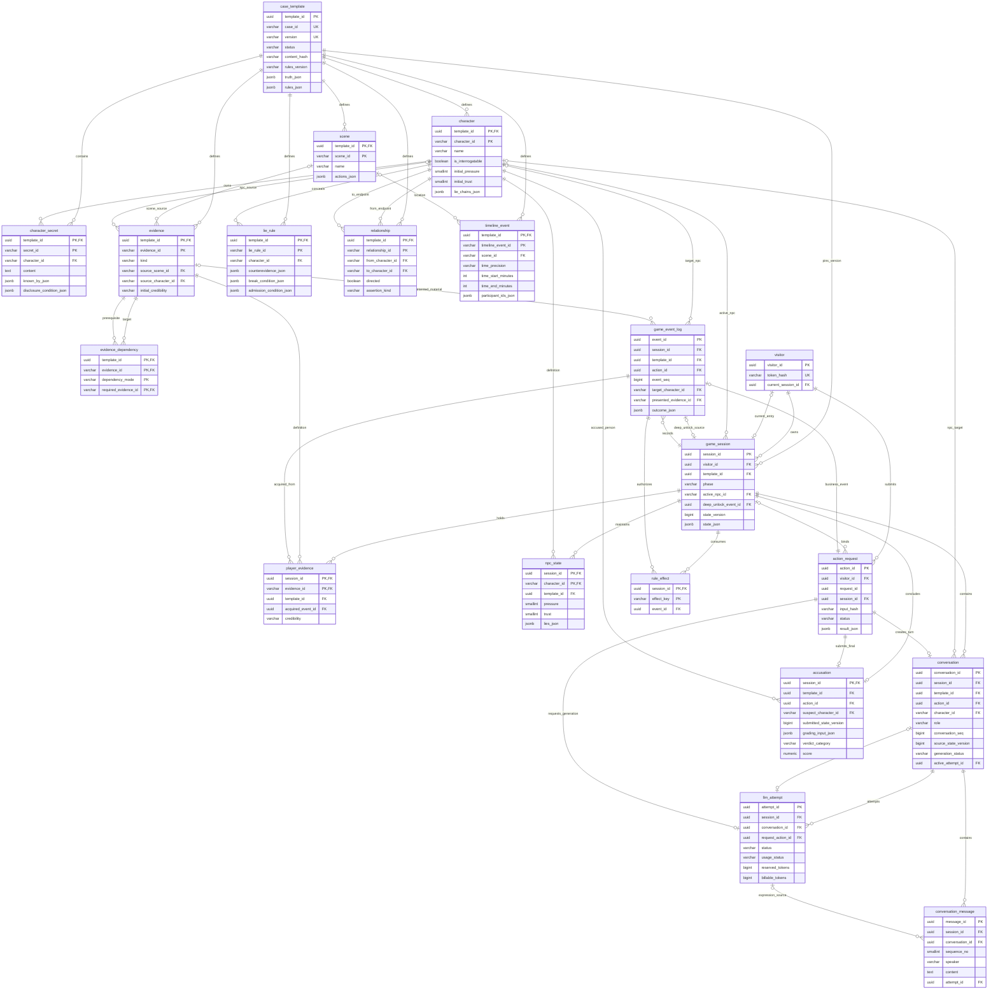

# 数据库设计

本文依据 [项目范围](01-project-scope.md)、[需求分析](02-requirements-analysis.md)、[总体架构](03-architecture-design.md)、[领域模型](04-domain-model.md)、[状态机](05-state-machine.md)、[证据与规则引擎](06-evidence-engine.md)、[Agent 设计](07-agent-design.md) 和 [谎言机制](08-lie-system.md)。设计面向单人、固定案件版本、少量并发的 MVP，不增加账号系统、运行时案件编辑后台或事件溯源平台。

**建议采用 PostgreSQL，以关系表保存身份、归属、核心状态和持续增长的记录，以 JSONB 保存有限规则与小规模嵌套结构。静态案件发布后只读，每次游戏动作的全部状态变化在一个事务内保存。**

## 1. 设计范围与前文映射

前文使用案件包和整局 `state_json`，并明确领域对象不必逐一建表。本次按要求将指定对象落实为物理表，是对存储方案的细化与调整；玩法、知识隔离、领域对象和规则执行顺序保持前文约定。后续持久化实现以本章为准，不同时实现两套可写存储。

| 既有逻辑存储 | 本章物理存储 | 调整说明 |
| --- | --- | --- |
| `case_versions` 完整案件包 | `case_template` 与 8 张静态子表 | 分表后的定义是数据库内唯一权威来源；读取时组装 CaseTemplate，不再存可独立修改的完整包副本 |
| `game_sessions.state_json` | `game_session`、`player_evidence`、`npc_state`，以及剩余小型 JSON | 从关系表和剩余 JSON 组装 GameSnapshot；证据、NPC 不再重复放进 state_json |
| `conversation_turns` | `conversation`、`conversation_message` | conversation 仍表示一轮交互，不是某 NPC 的全部聊天历史 |
| `conclusions` | `accusation` | 一局最多一次正式指控及冻结判定；草稿另存 |
| `rule_events`、`rule_effects` | `game_event_log`、`rule_effect` | 前者解释发生了什么，后者约束一次性效果；不靠日志重新计算普通存档 |
| `visitors`、`action_requests`、`llm_attempts` | `visitor`、`action_request`、`llm_attempt` | 保留匿名归属、请求幂等、生成恢复与计量所必需的支撑记录 |

总计 20 张表：用户指定的 16 张，加上已有设计要求的 4 张支撑表。`TruthFact`、普通规则、EvidenceLink、LieChain 等有限结构继续使用明确位置的 JSON，不为条件树节点或情绪展示值另建表。

## 2. 类型、键与约束约定

### 2.1 通用字段约定

以下字段类型以 PostgreSQL 为基线。字段表中的“可空”为“否”即 `NOT NULL`；未明确给出默认值的必填字段必须显式填写。

| 项目 | 约定 |
| --- | --- |
| 表与列名 | 小写 `snake_case`，表名单数；`character` 等可能与 SQL 关键字冲突的名称由 SQLAlchemy 正确引用，禁止手拼未引用标识符 |
| 全局标识 | `uuid`，由服务端用标准 UUID 生成；标识不是访问凭据 |
| 版本内标识 | `varchar(64)`，例如 NPC01、E07、L_LAB_VISIT；按大小写敏感规则比较，只接受约定的 ASCII 字母、数字、下划线和连字符 |
| 静态身份 | `case_template.template_id` 唯一标识一个具体版本；`UNIQUE(case_id, version)` 对应领域中的版本身份 |
| 静态子表主键 | 通常为 `(template_id, 局部 ID)`，不同版本可以复用 E07，不能跨版本引用 |
| 审计时间 | `timestamptz`，写入和 API 输出统一为 UTC；只作记录，不驱动压力变化或规则条件 |
| 状态与枚举 | `varchar` 配合 `CHECK` 白名单；避免为仍在演进的业务枚举建立数据库原生 ENUM |
| JSON | `jsonb`，禁止把 JSON 再序列化成字符串存进去；对象/数组形状另加 CHECK 和领域校验 |
| 分数与计量 | 整数数值用 `integer/bigint`；需要小数的分数、费用用 `numeric`，不使用浮点数累计费用 |
| 默认集合 | 只有确实允许为空的集合才可默认 `[]` 或 `{}`；缺失规则、初值、固定回复不能靠默认空值通过发布 |
| 更新时间 | 应用在所属事务内写入；`game_session.saved_at` 只随有效业务状态变化更新，不因查看页面而改变 |

### 2.2 同版本、同会话的复合外键

只分别外键到“会话存在”和“证据存在”，不能阻止把另一案件的证据写入本局。运行表中保留必要的 `template_id`，并采用以下模式：

```text
game_session:
  PRIMARY KEY (session_id)
  UNIQUE (session_id, template_id)
  UNIQUE (visitor_id, session_id)

player_evidence:
  PRIMARY KEY (session_id, evidence_id)
  FOREIGN KEY (session_id, template_id)
    REFERENCES game_session (session_id, template_id)
  FOREIGN KEY (template_id, evidence_id)
    REFERENCES evidence (template_id, evidence_id)
```

`npc_state`、`conversation`、`accusation`、`game_event_log` 同样用 `(session_id, template_id)` 锁定本局版本。所有静态对象间的外键包含 `template_id`。SQLAlchemy 使用 `ForeignKeyConstraint` 声明复合关系，不能拆成两个无关的单列外键。

为同局引用提供以下候选键；它们虽包含全局唯一 ID，仍需显式声明，供复合外键引用：

- `action_request`：`UNIQUE(session_id, action_id)`。
- `game_event_log`：`UNIQUE(session_id, event_id)`。
- `conversation`：`UNIQUE(session_id, conversation_id)`。
- `llm_attempt`：`UNIQUE(session_id, conversation_id, attempt_id)`。

这些外键保证归属；“确实持有证据”“角色当前可接触”“引用的是一次承认事件”等业务语义仍由 Game Engine 和领域校验检查。普通 CHECK 不能验证另一张表的业务状态，JSON 数组里的 ID 也不会自动获得外键约束。[PostgreSQL 约束文档](https://www.postgresql.org/docs/18/ddl-constraints.html)

## 3. 表说明总览

| 表 | 数据类别 | 一行代表什么 |
| --- | --- | --- |
| `case_template` | 静态 | 一个不可变的已发布案件版本，或尚未发布的草稿版本 |
| `character` | 静态 | 该版本中的一个人物，包括嫌疑人和受害者 |
| `character_secret` | 静态 | 一个归属明确的私有知识或秘密条目，不是本局是否已坦白 |
| `scene` | 静态 | 一个场景及其预设调查动作 |
| `evidence` | 静态 | 一条预设证据或证词的定义 |
| `evidence_dependency` | 静态 | 一条证据对另一条证据的 ALL 或 ANY 前置边 |
| `lie_rule` | 静态 | 一层可以独立击破、承认的隐瞒规则 |
| `relationship` | 静态 | 一条带来源的预设人物关系断言 |
| `timeline_event` | 静态 | 一条带时间精度与来源的案件时间事件或证词 |
| `visitor` | 运行支撑 | 一个匿名访问者的令牌摘要和当前游戏入口 |
| `game_session` | 运行 | 一次独立游戏的阶段、版本和剩余小型调查状态 |
| `player_evidence` | 运行 | 本局已取得的一条证据及当前可信度 |
| `npc_state` | 运行 | 本局某个 NPC 的数值和各层谎言进度 |
| `conversation` | 表达 | 一轮 NPC、Host 或 Review 表达任务 |
| `conversation_message` | 表达 | 一条玩家输入或可展示回复 |
| `accusation` | 运行 | 本局唯一的正式指控、评分输入和确定性判定 |
| `game_event_log` | 运行审计 | 一次已提交业务动作的根事件及其规则依据 |
| `action_request` | 运行支撑 | 一个客户端命令的幂等记录和固定结果 |
| `rule_effect` | 运行支撑 | 一个已经消费的一次性效果键 |
| `llm_attempt` | 表达支撑 | 一次模型生成尝试、额度占用和可得用量 |

## 4. 静态案件表

### 4.1 case_template

保存版本元数据、唯一真相以及不需要独立关系查询的有限配置。每局固定引用一个 `template_id`，发布新版不会改变旧局。

| 字段 | 类型 | 可空 | 说明与约束 |
| --- | --- | --- | --- |
| `template_id` | uuid | 否 | 主键 |
| `case_id` | varchar(64) | 否 | 案件业务编号，多个版本共用 |
| `version` | varchar(32) | 否 | 版本号，不能按字符串最大值选择“最新版” |
| `title` | varchar(200) | 否 | 案件标题 |
| `synopsis` | text | 否 | 已审核、不剧透的案情简介 |
| `status` | varchar(16) | 否 | DRAFT、PUBLISHED、RETIRED；初始 DRAFT |
| `definition_schema_version` | integer | 否 | 定义结构版本，正整数 |
| `rules_version` | varchar(32) | 否 | 固定规则内容版本 |
| `rule_execution_version` | varchar(32) | 否 | 所需规则解释与执行语义版本 |
| `content_hash` | char(64) | 是 | 发布时必填；完整规范化案件定义的 SHA-256 摘要 |
| `truth_json` | jsonb | 否 | 唯一 Truth、TruthFact 集合、标准答案、事实说明和支持引用；仅服务端 |
| `accusation_options_json` | jsonb | 否 | 凶手、凶器、动机、过程步骤候选项，包含干扰项，不含正确答案标记 |
| `scoring_policy_json` | jsonb | 否 | 评分项声明、阈值、过程策略、错误凶手策略；具体 JUDGE 规则只在 rules_json 定义 |
| `npc_policy_json` | jsonb | 否 | 数值范围、情绪映射和优先级；本版数据库数值硬边界为 0～100 |
| `initial_state_json` | jsonb | 否 | 初始开放场景、公开信息/证据引用及固定介绍；不包含运行时事件 ID、角色初值副本或证据正文 |
| `rules_json` | jsonb | 否 | 第 06 篇 EVENT、PROGRESS、JUDGE 规则；不复制 lie_rule 中的专用规则 |
| `evidence_links_json` | jsonb | 否 | 预设 EvidenceLink 定义，允许空数组 |
| `public_knowledge_json` | jsonb | 否 | 共同/公开 KnowledgeItem 定义；含 known_by、来源及披露条件，允许空数组 |
| `timeline_origin_label` | varchar(128) | 否 | 案内相对时间零点，例如“案发当日 00:00” |
| `created_at` | timestamptz | 否 | 创建时间 |
| `published_at` | timestamptz | 是 | 首次发布时间，发布后不改写 |
| `retired_at` | timestamptz | 是 | 下架时间；下架不阻断旧局读取 |

主键为 `template_id`；唯一约束为 `(case_id, version)`，本表无外键。`status` 为 PUBLISHED 或 RETIRED 时，`content_hash`、`published_at` 必须非空；RETIRED 时 `retired_at` 非空。开局仅选择服务端指定的 PUBLISHED 版本，不直接相信客户端传来的草稿版本。

开局根据 initial_state_json 的引用生成各类 Discovery，可信度从静态定义取得，来源统一指向本局新建的初始化事件；静态配置不预先填写另一局的来源或发现时间。

摘要覆盖本表业务配置及所有静态子表，排除 template_id 等数据库代理标识、发布时间、状态等存储与运营元数据。导入器先拒绝重复 JSON 键，再按固定规范序列化：对象键排序，集合按标识排序，有序步骤和链层顺序保留。不能直接对 `jsonb::text` 或原文件空白计算内容身份；JSONB 不保留对象键顺序及重复键。[PostgreSQL JSON 类型](https://www.postgresql.org/docs/18/datatype-json.html)

### 4.2 character

保存角色定义。是否有罪在 `truth_json` 中定义，不在公开角色档案增加 `is_murderer`。

| 字段 | 类型 | 可空 | 说明与约束 |
| --- | --- | --- | --- |
| `template_id` | uuid | 否 | 主键组成；外键 → case_template |
| `character_id` | varchar(64) | 否 | 主键组成，版本内人物 ID |
| `name` | varchar(100) | 否 | 名称，不要求全案唯一 |
| `role` | varchar(24) | 否 | SUSPECT、VICTIM、WITNESS 等明确白名单 |
| `is_interrogatable` | boolean | 否 | 是否需要初始化 NPCState |
| `public_identity` | text | 否 | 审核过的公开身份 |
| `personality` | text | 否 | 性格，不夹带隐藏真相 |
| `speech_style` | text | 否 | 语言风格，不是可执行 Prompt 模板 |
| `initial_pressure` | smallint | 是 | 可审讯人物必填，0～100；其他人物为空 |
| `initial_trust` | smallint | 是 | 同上 |
| `access_condition_json` | jsonb | 否 | 何时可接触该人物 |
| `known_evidence_ids_json` | jsonb | 否 | 本角色预设可知证据引用，不表示当前可说 |
| `core_admission_lie_ids_json` | jsonb | 否 | 本角色核心承认层集合，允许为空；空集合不构成完整承认 |
| `lie_chains_json` | jsonb | 否 | 本角色 LieChain 分组、层顺序、partial/full reveal 和固定降级配置 |
| `safe_fallback` | text | 否 | 通用安全回应；发生承认后优先用链的当前固定回复 |

主键为 `(template_id, character_id)`。对数值设置 CHECK，并校验 `is_interrogatable` 与初值是否成对存在。链数组引用 `lie_rule`，由案件发布校验保证同版本、同角色、每层只属于一条链及线性依赖；JSON 中的层引用不声明为 SQL 外键。

### 4.3 character_secret

承载第 04、07、08 篇中需要受限披露的 KnowledgeItem，包括普通私有知识和深层秘密。它保存“这个人物知道、但未必能说的内容”，不保存运行时 `is_revealed`。

| 字段 | 类型 | 可空 | 说明与约束 |
| --- | --- | --- | --- |
| `template_id` | uuid | 否 | 主键组成；外键 → case_template |
| `secret_id` | varchar(64) | 否 | 主键组成；映射为领域 knowledge_id，例如 K_LAB_VISIT |
| `character_id` | varchar(64) | 否 | 主要归属人物；复合外键 → character |
| `secrecy` | varchar(16) | 否 | PRIVATE 或 SECRET，只是定义分类 |
| `content` | text | 否 | 预设知识/承认证词正文；不等于直接公开的 TruthFact |
| `known_by_json` | jsonb | 否 | 非空角色 ID 集合，必须包含主要归属人物 |
| `asserted_fact_ids_json` | jsonb | 否 | 对应 truth_json.facts 的事实引用，按条目类型校验 |
| `assertion_kind` | varchar(16) | 否 | FACT 或 TESTIMONY；不能因作者知道它真实就把证词视为已核验 |
| `source_json` | jsonb | 否 | 固定内容来源，遵循有限 InformationSource 协议 |
| `initial_credibility` | varchar(16) | 否 | UNVERIFIED、VERIFIED、DISPUTED、REFUTED |
| `disclosure_condition_json` | jsonb | 否 | 当前允许披露的确定性条件 |
| `safe_deflection` | text | 否 | 未授权时的安全回避文本，不包含秘密暗示 |

主键为 `(template_id, secret_id)`；外键 `(template_id, character_id)` → `character`。同一秘密允许多个人物知晓，正文只存一次；`known_by_json` 中的附加人物由发布校验检查，不依靠主要归属外键推断共享知识。

Case Service 将 `secret_id` 映射为 KnowledgeItem 的 `knowledge_id`，与 `public_knowledge_json` 合并为只读索引；两处 ID 必须全案唯一且不能重复正文定义。`on_admitted` 的 `target_kind=KNOWLEDGE` 可引用这里的 ID。玩家获知、NPC 获准表达、客观事实仍分别由 Discovery、披露规则、TruthFact 表达。

### 4.4 scene

| 字段 | 类型 | 可空 | 说明与约束 |
| --- | --- | --- | --- |
| `template_id` | uuid | 否 | 主键组成；外键 → case_template |
| `scene_id` | varchar(64) | 否 | 主键组成 |
| `name` | varchar(100) | 否 | 场景名称 |
| `description` | text | 否 | 场景获准进入后展示的固定描述 |
| `sort_order` | integer | 否 | 展示顺序，同值按 scene_id 排序 |
| `access_condition_json` | jsonb | 否 | 场景访问条件；不是运行时 unlocked 标志 |
| `actions_json` | jsonb | 否 | 预设 action_id、名称、安全反馈等；实际效果只定义在 rules_json |

主键为 `(template_id, scene_id)`。动作 ID 在场景内唯一，`(scene_id, action_id)` 才是完整动作引用。初始开放场景只在 `initial_state_json` 指定，后续解锁写入本局场景进度，不修改 scene。

### 4.5 evidence

| 字段 | 类型 | 可空 | 说明与约束 |
| --- | --- | --- | --- |
| `template_id` | uuid | 否 | 主键组成；外键 → case_template |
| `evidence_id` | varchar(64) | 否 | 主键组成 |
| `name` | varchar(200) | 否 | 固定名称 |
| `kind` | varchar(16) | 否 | PHYSICAL、DOCUMENT、TESTIMONY、DIGITAL |
| `content` | text | 否 | 获得后才可查看的正文 |
| `source_type` | varchar(8) | 否 | SCENE 或 NPC |
| `source_scene_id` | varchar(64) | 是 | 场景来源；复合外键 → scene |
| `source_character_id` | varchar(64) | 是 | 人物来源；复合外键 → character |
| `initial_credibility` | varchar(16) | 否 | 四种可信度枚举之一 |
| `is_key_internal` | boolean | 否 | 作者内部关键标记，不能直接输出给玩家 |
| `show_key_badge` | boolean | 否 | 获得后是否展示关键标签，可默认 false |
| `acquisition_condition_json` | jsonb | 否 | 除前置证据外的获取守卫 |

主键为 `(template_id, evidence_id)`。设置来源异或 CHECK：SCENE 时仅 `source_scene_id` 非空，NPC 时仅 `source_character_id` 非空。两列各自与 template_id 组成外键。初始可信度属于定义，当前可信度属于 player_evidence；不存全局 `is_discovered`、`is_presented` 或 evidence_count。

### 4.6 evidence_dependency

| 字段 | 类型 | 可空 | 说明与约束 |
| --- | --- | --- | --- |
| `template_id` | uuid | 否 | 主键组成，限定同一版本 |
| `evidence_id` | varchar(64) | 否 | 主键组成，待取得的目标证据 |
| `dependency_mode` | varchar(8) | 否 | 主键组成，ALL 或 ANY |
| `required_evidence_id` | varchar(64) | 否 | 主键组成，必须先持有的证据 |

主键为 `(template_id, evidence_id, dependency_mode, required_evidence_id)`；两组 `(template_id, evidence_id)`、`(template_id, required_evidence_id)` 均外键到 evidence。CHECK 禁止自依赖。

一个目标的全部 ALL 行都要满足；全部 ANY 行中至少满足一行；二者同时存在时取 AND。没有某组行表示该组不限制，没有依赖行表示没有证据前置。例：E07 的 ALL 前置为 E01，ANY 前置为 E02、E03，需持有 E01 且持有后两者之一。Case Service 可将行重组为前文 all/any 数组，不再在 evidence JSON 内复制依赖。

本表只表达一个 ALL 集合与一个 ANY 集合，不新增组号或通用布尔表达式。引用存在、自依赖可由数据库检查；可达性、跨场景循环和数值条件需发布时模拟通关路径，不能仅靠外键或“图无环”证明可解。

### 4.7 lie_rule

| 字段 | 类型 | 可空 | 说明与约束 |
| --- | --- | --- | --- |
| `template_id` | uuid | 否 | 主键组成；外键 → case_template |
| `lie_rule_id` | varchar(64) | 否 | 主键组成，一个独立隐瞒层 |
| `character_id` | varchar(64) | 否 | 复合外键 → character，仅允许可审讯人物 |
| `priority` | integer | 否 | 稳定排序，数值越小越先，同值按规则 ID |
| `truth_fact_ids_json` | jsonb | 否 | 非空，引用被本层隐瞒的固定事实 |
| `statements_json` | jsonb | 否 | UNBROKEN、BROKEN、ADMITTED 三个非空固定说法 |
| `counterevidence_json` | jsonb | 否 | 非空，证据 ID 与允许可信度列表 |
| `break_condition_json` | jsonb | 否 | 必须包含有效反证硬门槛；后续层还依赖前层 ADMITTED |
| `admission_condition_json` | jsonb | 否 | 额外承认条件，包含明确的压力或信任分支 |
| `on_admitted_json` | jsonb | 否 | 固定信息引用效果，不含模型生成正文或心理增量 |

主键为 `(template_id, lie_rule_id)`；外键 `(template_id, character_id)` → character。一个 LieChain 可以包含多行 lie_rule，MVP 的“3 条谎言链”不等于只有 3 行规则。链分组只在 `character.lie_chains_json` 保存，不再给每层维护另一份链顺序。

心理增量与一次性 scope 沿用 `rules_json` 的 EVENT 规则，不能在每条命中链重复加压。当前阶段、匹配反证、击破和承认事件只在 `npc_state.lies_json` 保存。

### 4.8 relationship

| 字段 | 类型 | 可空 | 说明与约束 |
| --- | --- | --- | --- |
| `template_id` | uuid | 否 | 主键组成；外键 → case_template |
| `relationship_id` | varchar(64) | 否 | 主键组成，区分来源不同的关系说法 |
| `from_character_id` | varchar(64) | 否 | 复合外键 → character |
| `to_character_id` | varchar(64) | 否 | 复合外键 → character |
| `relationship_type` | varchar(32) | 否 | 经案件协议允许的关系类型 |
| `directed` | boolean | 否 | 是否有方向 |
| `description` | text | 否 | 预设关系说明 |
| `assertion_kind` | varchar(16) | 否 | FACT 或 TESTIMONY |
| `source_json` | jsonb | 否 | 来源及必要引用，不解析聊天生成关系 |
| `initial_credibility` | varchar(16) | 否 | 初始核验状态 |
| `disclosure_condition_json` | jsonb | 否 | 允许登记/展示的条件 |

主键为 `(template_id, relationship_id)`；两个端点分别以 template_id 组成外键。CHECK 禁止同一角色与自身建立本项目中的人物关系。无向关系由导入器按端点 ID 规范顺序；不对“人物对”设置唯一约束，允许不同类型、不同来源甚至互相矛盾的说法并存。

本局是否已知、当前可信度和已识别矛盾在 `state_json.known_information` 中保存；图布局是前端展示，不写为关系事实。

### 4.9 timeline_event

| 字段 | 类型 | 可空 | 说明与约束 |
| --- | --- | --- | --- |
| `template_id` | uuid | 否 | 主键组成；外键 → case_template |
| `timeline_event_id` | varchar(64) | 否 | 主键组成；映射领域 TimelineEvent.event_id |
| `title` | varchar(200) | 否 | 事件名称 |
| `description` | text | 否 | 固定事实或证词内容 |
| `scene_id` | varchar(64) | 是 | 已定义地点；复合外键 → scene；位置未知时为空 |
| `participant_ids_json` | jsonb | 否 | 已定义参与人物 ID 集合；角色未知可为空集合 |
| `time_precision` | varchar(12) | 否 | EXACT、RANGE、UNKNOWN |
| `time_start_minutes` | integer | 是 | 相对 timeline_origin_label 零点的案内分钟数 |
| `time_end_minutes` | integer | 是 | 案内结束分钟数，可跨日或为负数 |
| `time_label` | varchar(128) | 否 | 作者的原始时间表述，如“约九点”“时间不明” |
| `assertion_kind` | varchar(16) | 否 | FACT 或 TESTIMONY |
| `source_json` | jsonb | 否 | 该事件或说法的固定来源 |
| `initial_credibility` | varchar(16) | 否 | 初始核验状态 |
| `disclosure_condition_json` | jsonb | 否 | 披露条件 |

主键为 `(template_id, timeline_event_id)`。时间 CHECK：UNKNOWN 时两个边界均为空；EXACT 时均非空且相等；RANGE 时均非空且起点不大于终点。参与人物数组由发布校验检查同版本引用。

这里将前文 TimeWindow 落实为案内相对分钟，支持“案发当日 21:30”即 1290、跨午夜区间及无真实日期的剧本。MVP 内容按分钟表达，不额外引入现实日期或秒级精度；若案件需要秒级线索，应升级定义协议，不能四舍五入。模糊说法只有作者给出边界才编码 RANGE，不能由程序臆造区间。玩家发现时间另存 Discovery.discovered_at。

矛盾证词保留不同 timeline_event_id，不覆盖成同一“正确时间”。`game_event_log` 则记录真实游戏操作时间，两种事件不能混用。

## 5. 会话与玩家运行表

### 5.1 visitor

| 字段 | 类型 | 可空 | 说明与约束 |
| --- | --- | --- | --- |
| `visitor_id` | uuid | 否 | 主键 |
| `token_hash` | char(64) | 否 | 高熵匿名令牌的摘要，唯一；不存原始令牌 |
| `current_session_id` | uuid | 是 | 当前入口，无会话时为空 |
| `created_at` | timestamptz | 否 | 创建时间 |
| `last_seen_at` | timestamptz | 否 | 最近访问时间，只用于维护，不影响游戏状态 |

主键 `visitor_id`；`UNIQUE(token_hash)`；复合外键 `(visitor_id, current_session_id)` → `game_session(visitor_id, session_id)`，确保入口只能指向自己的存档。先创建 visitor，再建 game_session，最后在同一创建事务中更新入口；无须延迟外键检查。

沿用同源、HttpOnly/Secure Cookie 的访问方案。每次查询仍验证 visitor 归属，UUID 难猜不能替代授权。匿名令牌丢失不承诺跨设备找回。

### 5.2 game_session

| 字段 | 类型 | 可空 | 说明与约束 |
| --- | --- | --- | --- |
| `session_id` | uuid | 否 | 主键，新开/重开均生成新值 |
| `visitor_id` | uuid | 否 | 外键 → visitor，所属访问者 |
| `template_id` | uuid | 否 | 外键 → case_template，整局不可更换 |
| `phase` | varchar(24) | 否 | INVESTIGATION、INTERROGATION、DEEP_INVESTIGATION、ACCUSATION、REVIEW、FINISHED |
| `active_npc_id` | varchar(64) | 是 | 复合外键 `(template_id, active_npc_id)` → character |
| `deep_unlock_event_id` | uuid | 是 | 复合外键 `(session_id, deep_unlock_event_id)` → game_event_log |
| `state_version` | bigint | 否 | 正整数，初始化为 1；有效业务变化递增一次 |
| `snapshot_schema_version` | integer | 否 | 组装 GameSnapshot 及残余 JSON 的结构版本，正整数 |
| `state_json` | jsonb | 否 | 只存场景进度、非证据 Discovery、指控草稿，结构见第 7 节 |
| `llm_budget_json` | jsonb | 否 | 开局固定的调用数、总 token、单次输入输出及超时上限 |
| `created_at` | timestamptz | 否 | 创建时间 |
| `saved_at` | timestamptz | 否 | 最近业务状态保存时间 |
| `closed_at` | timestamptz | 是 | 正式结案时间，REVIEW/FINISHED 时必填 |
| `finished_at` | timestamptz | 是 | 玩家结束复盘时间，仅 FINISHED 时非空 |

主键与候选键见第 2.2 节。CHECK 要求 `phase=INTERROGATION` 当且仅当 `active_npc_id` 非空；INIT、INTRO、JUDGEMENT 不允许持久化。结案时间与稳定阶段对应，finished_at 不早于 closed_at。

跨表/跨动作不变量由锁内应用校验：当前 NPC 必须可审讯且可接触；DEEP_INVESTIGATION 必须有解锁事件；有解锁事件时不能保存为 INVESTIGATION；REVIEW/FINISHED 必须有唯一正式 accusation，其余阶段没有。`state_version` 不作为对话序号，普通提问、表达保存、额度结算不递增。

预算使用量从 llm_attempt 汇总，不再在会话内保存另一份可漂移计数。单局调用受上限约束，MVP 在会话锁内汇总即可。

### 5.3 player_evidence

| 字段 | 类型 | 可空 | 说明与约束 |
| --- | --- | --- | --- |
| `session_id` | uuid | 否 | 主键组成 |
| `template_id` | uuid | 否 | 与 session_id、evidence_id 分别组成同版本外键 |
| `evidence_id` | varchar(64) | 否 | 主键组成 |
| `discovered_at` | timestamptz | 否 | 首次取得时间，不被重复获取覆盖 |
| `acquired_event_id` | uuid | 否 | 复合外键 `(session_id, acquired_event_id)` → game_event_log |
| `additional_source_event_ids_json` | jsonb | 否 | 后续真正新增的获取/核验来源，去重且不包含 acquired_event_id |
| `credibility` | varchar(16) | 否 | 本局当前核验状态，使用四值枚举 |
| `known_conflicts_json` | jsonb | 否 | 本局已识别的矛盾 InformationRef，允许空数组 |
| `updated_at` | timestamptz | 否 | 最近真实获取来源或可信度变化时间 |

主键 `(session_id, evidence_id)`；其余外键按第 2.2 节。存在一行就表示已经持有，不设置 quantity、is_owned 或 AVAILABLE 状态。额外来源里的事件、矛盾引用由领域校验验证同局存在及披露范围。

背包直接查询本表并连接本局 evidence；领域层需要 Discovery 时组装 `target_kind=EVIDENCE` 及完整来源数组。纯重复无变化时不写 updated_at、不新增来源、不增加 state_version。正常游戏不消费或删除证据。

### 5.4 npc_state

| 字段 | 类型 | 可空 | 说明与约束 |
| --- | --- | --- | --- |
| `session_id` | uuid | 否 | 主键组成 |
| `template_id` | uuid | 否 | 与 session_id、character_id 分别组成同版本外键 |
| `character_id` | varchar(64) | 否 | 主键组成，只为可审讯人物初始化 |
| `pressure` | smallint | 否 | CHECK 0～100，来自对应角色显式初值 |
| `trust` | smallint | 否 | CHECK 0～100 |
| `lies_json` | jsonb | 否 | 按 lie_rule_id 为键的 LieProgress，初始 UNBROKEN |
| `updated_at` | timestamptz | 否 | 最近规则状态变化时间 |

主键 `(session_id, character_id)`；外键 `(session_id, template_id)` → game_session，`(template_id, character_id)` → character。不保存独立 emotion、display_state、confession 或 LieChain.stage，它们按固定配置派生。

`lies_json` 每层包含 stage、matched_evidence_ids、broken_event_id、admitted_event_id。反证集合去重且稳定排序，只来自本角色合法有效出示；UNBROKEN 的两个事件为空，BROKEN 必须有击破事件，ADMITTED 必须同时有两者。一次操作完成两步时可引用同一根事件，outcome_json 仍保存两次转换。

所有层必须属于当前角色与版本；阶段不可倒退。JSON 内的事件引用和合法出示语义由领域校验，不能声称数据库外键已经验证。每次事务整体替换该 NPC 的 lies_json；仅有几条链，不为 JSON 内部设置通用节点表。

### 5.5 accusation

只存正式提交。草稿位于 game_session.state_json，允许合法但不完整；正式指控必须完整且与进入 REVIEW 同时提交。

| 字段 | 类型 | 可空 | 说明与约束 |
| --- | --- | --- | --- |
| `session_id` | uuid | 否 | 主键，保证一局一份正式结果 |
| `template_id` | uuid | 否 | 复合外键 → game_session，锁定评分案件 |
| `action_id` | uuid | 否 | 同局复合外键 → action_request；正式提交请求 |
| `submitted_state_version` | bigint | 否 | 本次评分读取的提交前版本 |
| `rules_version` | varchar(32) | 否 | 冻结的评分规则版本，必须与模板一致 |
| `rule_execution_version` | varchar(32) | 否 | 冻结的执行版本 |
| `suspect_character_id` | varchar(64) | 否 | 同版本复合外键 → character；另验证属于指控候选 |
| `weapon_option_id` | varchar(64) | 否 | 指控凶器，校验 accusation_options_json 中引用 |
| `motive_option_id` | varchar(64) | 否 | 指控动机，同上 |
| `ordered_process_step_ids_json` | jsonb | 否 | 有序步骤数组，按案件约定校验顺序结构与重复 |
| `cited_evidence_ids_json` | jsonb | 否 | 实际引用证据，全部属于本局已持有集合；允许空数组 |
| `step_evidence_links_json` | jsonb | 否 | 步骤与引用证据配对；不是官方 EvidenceLink |
| `explanation` | text | 否 | 玩家补充说明，可为空字符串，不参与评分 |
| `grading_input_json` | jsonb | 否 | 冻结的评分相关状态：当时持有证据、可信度及 JUDGE 实际所需字段 |
| `verdict_category` | varchar(20) | 否 | CORRECT、PARTIALLY_CORRECT、INCORRECT |
| `score` | numeric(10,2) | 否 | 规则总分，CHECK 非负；不擅自固定满分为 100 |
| `criteria_results_json` | jsonb | 否 | 全部评分项、命中与未命中依据、分值、缺失证据 |
| `fixed_review` | text | 否 | 完整固定复盘，不依赖模型 |
| `submitted_at` | timestamptz | 否 | 正式提交时间，与 closed_at 一致 |

主键 `session_id`；`action_id` 唯一，并以 `(session_id, action_id)` 外键到 action_request。凶器、动机、步骤和 JSON 证据引用的合法性由领域校验，不能伪称为列外键。步骤关联中，步骤须在本次步骤数组内，证据须在 cited_evidence_ids 中。

合法但推理错误会正常结案；未持有证据、非法选项属于拒绝。正式记录只插入和读取，禁止业务 UPDATE/DELETE。AI 复盘另存 REVIEW conversation，不放进 verdict 或覆盖 fixed_review。冻结的评分输入是历史凭据，不是第二份可继续修改的游戏存档。

## 6. 对话、幂等与审计表

### 6.1 action_request

| 字段 | 类型 | 可空 | 说明与约束 |
| --- | --- | --- | --- |
| `action_id` | uuid | 否 | 服务端主键 |
| `visitor_id` | uuid | 否 | 外键 → visitor |
| `request_id` | uuid | 否 | 客户端幂等键；与 visitor_id 联合唯一 |
| `session_id` | uuid | 是 | 绑定的有效会话；创建成功后指向新局，未建立合法归属的拒绝记录可为空 |
| `command_type` | varchar(40) | 否 | 创建、探索、提问、出示、指控、表达重试等白名单命令 |
| `expected_state_version` | bigint | 是 | 新局创建可为空，已有局命令必须有预期版本 |
| `input_hash` | char(64) | 否 | 规范化请求的摘要，包含动作、原目标、预期版本及业务载荷 |
| `input_json` | jsonb | 否 | 校验后的命令快照；不包含令牌、密钥、客户端状态补丁 |
| `status` | varchar(16) | 否 | COMMITTED、NOOP、REJECTED，表示业务结果，不表示模型生成状态 |
| `result_state_version` | bigint | 是 | 有合法会话结果时保存版本 |
| `result_json` | jsonb | 否 | 玩家可见固定结果、原因码和关联记录 ID，不含完整隐藏规则 |
| `created_at` | timestamptz | 否 | 接收时间 |
| `completed_at` | timestamptz | 否 | 业务结果提交时间，不等待模型 |

主键 `action_id`；`UNIQUE(visitor_id, request_id)`；同局候选键见第 2.2 节。复合外键 `(visitor_id, session_id)` → game_session，防止把请求绑定到别人的会话。原请求目标保留在 input_json；创建请求成功后 session_id 的绑定变化不改变原输入摘要。

相同请求同输入返回已存固定结果，并读取关联 conversation 的最新表达状态；同键异输入返回冲突。拒绝后想基于新状态重试，应使用新 request_id。认证失败不创建含他人 session_id 的幂等记录，另走最小安全日志。

此表不保存长时间 PROCESSING 状态：请求记录、规则状态、固定结果一起提交，事务未提交的临时记录不可见。需要生成时只在 conversation 标记处理中。表达重试有自己的 action_request，返回原 conversation_id，不修改原业务请求或重跑规则。

### 6.2 game_event_log

| 字段 | 类型 | 可空 | 说明与约束 |
| --- | --- | --- | --- |
| `event_id` | uuid | 否 | 主键，程序生成 |
| `session_id` | uuid | 否 | 所属会话 |
| `template_id` | uuid | 否 | 同局版本复合外键 → game_session |
| `action_id` | uuid | 否 | 同局复合外键 → action_request |
| `event_seq` | bigint | 否 | 本局严格递增的事件序号，正整数 |
| `event_type` | varchar(40) | 否 | 初始化、阶段切换、INVESTIGATE、PRESENT_EVIDENCE、SUBMIT_ACCUSATION 等 |
| `target_character_id` | varchar(64) | 是 | 角色相关事件的目标；同版本外键 → character |
| `presented_evidence_id` | varchar(64) | 是 | 仅合法出示事件填写；同版本外键 → evidence |
| `state_version_before` | bigint | 否 | 动作前版本，初始化事件为 0 |
| `state_version_after` | bigint | 否 | 动作后版本，只能等于前值或前值 + 1 |
| `rules_version` | varchar(32) | 否 | 事件使用的固定规则版本 |
| `rule_execution_version` | varchar(32) | 否 | 事件使用的执行版本 |
| `input_json` | jsonb | 否 | 规范化可信事件输入；不复制完整聊天原文 |
| `outcome_json` | jsonb | 否 | 命中规则、条件依据、阶段变化、数值前后值、披露和安全结果引用 |
| `created_at` | timestamptz | 否 | 真实操作时间，不能替代案内 TimelineEvent 时间 |

主键 `event_id`；唯一约束 `(session_id, event_seq)`、`(session_id, action_id)` 及同局事件候选键。一个业务动作存一个根事件，内部多次转换和多个规则效果在 outcome_json 中按固定顺序列出。序号在会话行锁内取下一值，不用时间戳排序，也不拿 state_version 当事件序号。

合法但没有数值收益的出示也保留事件；MVP 从事件中按 NPC 去重派生“曾看过的证据”。首次向该 NPC 出示一份合法材料会改变其获知范围，因此递增 state_version，即使没有谎言匹配；已有出示且所有效果均无变化时，前后版本相同。非法出示只留拒绝请求，不创建可被当成已见证据的出示事件。

`presented_evidence_id` 的外键验证定义存在，持有关系在事务中查 player_evidence；不反向外键到 player_evidence，避免与获得事件形成删除环。日志只追加，不单独裁剪有效存档所需的出示和来源记录。完整日志仅维护端可读，玩家只取安全投影。

### 6.3 rule_effect

| 字段 | 类型 | 可空 | 说明与约束 |
| --- | --- | --- | --- |
| `session_id` | uuid | 否 | 主键组成；外键 → game_session |
| `effect_key` | varchar(384) | 否 | 主键组成，服务器按白名单 scope 和规范化引用构造 |
| `event_id` | uuid | 否 | 复合外键 `(session_id, event_id)` → game_event_log |

主键 `(session_id, effect_key)`。scope 沿用第 06 篇，键包含 NPC/证据/动作或谎言层/转换及效果名；不能只用 rule_id，也不能接受客户端提供完整键。字段长度与大小写规则在入口固定，不能截断后入库。

例如一次反证的数值收益以 `NPC_EVIDENCE:NPC01:E07:COUNTEREVIDENCE_REACTION` 去重；另一条链命中同一证据也复用这份收益。达到数值上限、实际增量为零时仍消费键。已消费仅跳过该收益，不跳过整层重新判断。

从本表加载 `consumed_effect_keys` 供纯函数使用，不再把相同集合写入 state_json。若领域层认为是新键而插入发生唯一冲突，整个事务回滚并核查状态，不吞异常继续提交其余效果。

### 6.4 conversation

| 字段 | 类型 | 可空 | 说明与约束 |
| --- | --- | --- | --- |
| `conversation_id` | uuid | 否 | 主键，一轮交互 |
| `session_id` | uuid | 否 | 所属会话 |
| `template_id` | uuid | 否 | 同局版本复合外键 → game_session |
| `action_id` | uuid | 否 | 创建本轮的业务请求，同局复合外键 → action_request |
| `conversation_seq` | bigint | 否 | 会话锁内分配的本局轮次序号，正整数 |
| `role` | varchar(8) | 否 | NPC、HOST、REVIEW |
| `character_id` | varchar(64) | 是 | NPC 必填；HOST/REVIEW 为空；同版本外键 → character |
| `purpose_key` | varchar(96) | 是 | NPC 为空；HOST 为固定事件键，REVIEW 固定 FINAL_REVIEW |
| `source_state_version` | bigint | 否 | 本轮获准表达依据的已提交状态版本 |
| `response_plan_json` | jsonb | 否 | 服务端冻结的安全表达计划、授权引用及历史截止轮号；不保存未授权秘密 |
| `fixed_reply` | text | 否 | 本轮状态对应的固定回复，不可用初始否认覆盖已承认状态 |
| `generation_status` | varchar(16) | 否 | PREPARING、GENERATING、COMPLETED、FALLBACK、STALE |
| `active_attempt_id` | uuid | 是 | 当前/最近有效尝试；复合外键见下文 |
| `generation_deadline_at` | timestamptz | 是 | PREPARING/GENERATING 必须有截止时间，处理构建前崩溃或外部超时 |
| `fallback_reason` | varchar(64) | 是 | 超时、预算不足、输出拒绝、已过期等稳定原因码 |
| `created_at` | timestamptz | 否 | 创建时间 |
| `completed_at` | timestamptz | 是 | 本轮表达完成、降级或失效时间 |

主键 `conversation_id`；唯一约束 `(session_id, conversation_seq)`、`(session_id, action_id)`、`(session_id, role, purpose_key)`，以及第 2.2 节候选键。角色与 character_id/purpose_key 用 CHECK 约束；多个 NPC 轮次的 purpose_key 为 NULL，不受用途唯一键限制。用途键确保刷新复盘或换 request_id 不重复创建同一可选润色任务。

`(session_id, conversation_id, active_attempt_id)` 外键到 llm_attempt 对应候选键，保证不能挂别局或别轮尝试。先插入 active_attempt_id 为空的轮次，再插入 attempt，最后更新指针，无须延迟约束。

增加“同一会话最多一个 PREPARING/GENERATING NPC 轮次”的部分唯一索引，见第 8 节。切换角色、阶段变化和重开在相应事务内让旧 NPC 轮次变为 STALE，释放逻辑占位；外部请求可能仍在运行，其计量记录保留。

### 6.5 conversation_message

| 字段 | 类型 | 可空 | 说明与约束 |
| --- | --- | --- | --- |
| `message_id` | uuid | 否 | 主键，历史引用使用 |
| `session_id` | uuid | 否 | 与 conversation_id 组成同局外键 |
| `conversation_id` | uuid | 否 | 复合外键 → conversation |
| `sequence_no` | smallint | 否 | 轮内顺序；NPC 玩家为 1、回复为 2；HOST/REVIEW 单回复为 1 |
| `speaker` | varchar(8) | 否 | PLAYER、NPC、HOST、REVIEW |
| `content` | text | 否 | 输入或通过校验的表达/固定文本，不保存模型思维过程 |
| `origin` | varchar(8) | 否 | PLAYER、LLM、FIXED |
| `validity` | varchar(8) | 否 | VALID、STALE；历史有效不等于当前仍适合进入 Prompt |
| `attempt_id` | uuid | 是 | 模型来源必填；固定降级可关联导致降级的尝试 |
| `created_at` | timestamptz | 否 | 首次形成该消息的时间 |
| `updated_at` | timestamptz | 否 | 显式失败重试替换固定回复时更新 |

主键 `message_id`；`UNIQUE(conversation_id, sequence_no)`。消息外键 `(session_id, conversation_id)` → conversation；可空外键 `(session_id, conversation_id, attempt_id)` → llm_attempt。CHECK 校验枚举和 sequence_no 为 1 或 2；角色、序号、父轮次之间的跨表匹配由应用验证。

NPC 生成期间可只有玩家消息；FALLBACK 保存本轮固定回复。只允许对失败/降级轮次显式重试，成功后替换第 2 个消息槽并更新尝试引用；已有成功回答不自动重新生成。原始固定文本仍在 conversation.fixed_reply，所有 attempt 保留。被拒或迟到候选不写入可读消息，仅记录尝试状态、原因及摘要。

历史查询按 session_id、character_id、conversation_seq 取有限完整轮次，再检查当前授权范围；不能只按 `validity=VALID` 或 state_version 选历史。第 07 篇要求授权变化后丢弃之前的自然语言上下文，旧记录仍可用于玩家回看。

### 6.6 llm_attempt

| 字段 | 类型 | 可空 | 说明与约束 |
| --- | --- | --- | --- |
| `attempt_id` | uuid | 否 | 主键，每次显式尝试不同 |
| `session_id` | uuid | 否 | 与 conversation_id 组成同局外键 |
| `conversation_id` | uuid | 否 | 外键 → conversation；首次生成与重试均关联原轮 |
| `request_action_id` | uuid | 否 | 同局外键 → action_request；首次或本次重试的请求 |
| `attempt_no` | integer | 否 | 本轮尝试序号，正整数 |
| `status` | varchar(24) | 否 | RESERVED、DISPATCHING、SUCCEEDED、FAILED、UNKNOWN、CANCELLED_NOT_SENT |
| `usage_status` | varchar(16) | 否 | RESERVED、KNOWN、UNKNOWN、NOT_SENT，独立于文本是否有效 |
| `validation_status` | varchar(16) | 否 | PENDING、ACCEPTED、REJECTED、STALE、NOT_APPLICABLE |
| `provider` | varchar(64) | 否 | 服务标识，不是可由玩家指定的 URL |
| `model` | varchar(128) | 否 | 实际配置模型 |
| `prompt_version` | varchar(32) | 否 | 本次模板版本 |
| `context_digest` | char(64) | 否 | 最终获准消息的摘要，不等于可完整重现模型输出 |
| `context_refs_json` | jsonb | 否 | 实际纳入的授权条目、历史消息 ID、裁剪统计等，不含完整 Prompt |
| `estimated_input_tokens` | integer | 否 | 本次输入估算，非负 |
| `count_is_exact` | boolean | 否 | 是否有可靠的精确输入计数 |
| `max_output_tokens` | integer | 否 | 输出上限，正整数 |
| `reserved_tokens` | bigint | 否 | 输入预算、输出上限及必要余量的原始预留，非负 |
| `input_tokens` | integer | 是 | 实际用量，未知为 NULL，非负 |
| `output_tokens` | integer | 是 | 实际用量，未知为 NULL，非负 |
| `billable_tokens` | bigint | 是 | 按接入模型计量协议归一化的预算用量；未知为 NULL |
| `usage_json` | jsonb | 是 | 供应商额外用量维度，如缓存或其他计费项；只存白名单字段 |
| `pricing_snapshot_json` | jsonb | 是 | 有费用估算时的币种、单价和口径，不保存密钥 |
| `estimated_cost` | numeric(18,8) | 是 | 估算费用，非负；无法估算时为 NULL |
| `error_code` | varchar(64) | 是 | 稳定错误分类，不记录包含秘密的原始堆栈/响应 |
| `latency_ms` | integer | 是 | 可得耗时，非负 |
| `created_at` | timestamptz | 否 | 预留时间 |
| `deadline_at` | timestamptz | 否 | 本次截止时间 |
| `dispatch_started_at` | timestamptz | 是 | 发出前持久化的派发标记，不保证上游确实收到 |
| `finished_at` | timestamptz | 是 | 本次可确定完成时间 |

主键 `attempt_id`；唯一约束 `(conversation_id, attempt_no)`、`request_action_id`，以及同局同轮候选键。每个生成命令最多登记一次尝试，关闭客户端隐式自动重试。校验 KNOWN 时计量字段满足接入协议；NOT_SENT 时不伪造实际 token 为零，而是在汇总中明确排除。

预算检查在 game_session 行锁内执行：调用占用数为所有非 NOT_SENT 尝试数；token 占用为 KNOWN 的 billable_tokens，加 RESERVED/UNKNOWN 的 reserved_tokens。额度检查通过才插入预留。供应商返回可靠用量后结算；未知用量不能当零。实际用量超过保守预留时如实登记并停止后续超限调用，不宣称预算估计能阻止供应商多计费。

调用前用条件更新将 RESERVED 改为 DISPATCHING 并提交，只有成功取得该尝试的执行方才发起网络调用。恢复时，仍为 RESERVED 且已过期的记录可在锁内取消为 NOT_SENT；执行方必须检查条件更新结果。DISPATCHING 后崩溃则按可能已发出处理为 UNKNOWN，不能释放额度并偷偷重发。

迟到结果可补充用量和错误状态，但只有 active_attempt_id、会话、角色、来源状态及当前入口等均匹配时才更新有效表达。一个调用成功返回但文本被拒，可以同时是 SUCCEEDED、KNOWN、REJECTED，不应混成“调用失败所以免费”。

## 7. JSON 使用边界与唯一数据来源

### 7.1 剩余 state_json 的结构

以下只示意结构，不代表完整可导入存档。所有引用都由服务端从本局定义和已提交事件构造。

```json
{
  "scene_progress": {
    "S01": {
      "visited": true,
      "unlock_event_id": "00000000-0000-4000-8000-000000000001",
      "completed_action_ids": ["INSPECT_DESK"]
    }
  },
  "known_information": {
    "KNOWLEDGE": {},
    "RELATIONSHIP": {},
    "TIMELINE_EVENT": {},
    "EVIDENCE_LINK": {}
  },
  "accusation_draft": null
}
```

`scene_progress` 覆盖案件全部场景；未解锁场景的 unlock_event_id 为 null。已知信息按类型、目标 ID 两层键保存，每个值包含 discovered_at、source_event_ids、credibility、known_conflicts。新局的初始公开条目也引用初始化事件。只有已开放的条目可通过 API 输出。

草稿非空时使用前文 AccusationContent 字段；字段可未填写，但已有值仍须校验候选及持有关系。正式提交后本局草稿冻结，不因复盘补填正确答案。

本结构**不包含** evidence 持有列表、NPC 数值/谎言、阶段、版本或 consumed_effect_keys；这些分别来自 player_evidence、npc_state、game_session 列、rule_effect。Save/Load Service 组装普通领域 GameSnapshot 后再执行规则，不要求规则函数理解 SQL 表。

### 7.2 哪些 JSON 合理

| 内容 | 是否适合 JSON | 原因与校验责任 |
| --- | --- | --- |
| Condition 树、Action 数组、固定规则 | 适合 | 有限嵌套协议，整体随版本发布；按第 06 篇白名单校验，拒绝脚本及未知字段 |
| TruthFact、评分配置与候选项 | 适合 | 每个版本一份、体量小、整体读取；引用、评分完整性与自然语言一致性需发布审核 |
| 分阶段说法、LieChain 视图 | 适合 | 固定字段及有序层集合；必须校验同角色、前缀披露与安全回避 |
| NPC 的少量 LieProgress | 适合 | 跟随单局事务一起保存；ID、阶段单调性与来源事件由领域校验 |
| 场景进度、非证据 Discovery、指控草稿 | 适合 MVP | 量小且按局整体读取；禁止客户端直接提交权威快照 |
| 冻结评分输入、逐项依据、事件详情 | 适合 | 作为不可变历史记录，允许结构按 schema 演进 |
| 身份、归属、案件版本、会话阶段、幂等键 | 不适合只放 JSON | 需要外键、唯一约束、锁定、过滤与稳定索引 |
| 证据持有与 NPC 核心数值 | 本章独立成表 | 可显式约束同局同案、持有唯一与数值边界，不在 JSON 重复维护 |
| 消费效果键 | 必须有关系键 | 普通唯一索引不能检查 JSON 数组中每个效果的全局唯一性 |
| 完整聊天与模型尝试 | 不嵌入存档 JSON | 持续增长、需要分页、独立重试和用量结算 |

JSON 列至少检查顶层类型。应用用带版本的数据模型校验字段、整数范围、重复集合、引用和条件树深度；读取旧结构同样校验。SQLAlchemy 更新 JSON 时优先赋予一个新的完整对象，避免仅修改深层字典却没有被 ORM 识别为脏数据。

这里接受有限 JSON 引用由程序维护的取舍：当前每案仅数个人物、十余条证据。若之后确实需要跨局按谎言层统计或独立更新大量条目，再将对应结构迁移成表，并删除原可写位置；不先做双写。

### 7.3 静态数据与运行数据的隔离

1. 案件作者在仅供后端使用的 `backend/assets/cases/` 编写版本包。导入器验证引用、规则白名单、完整及无招供通关路径，将定义写入 DRAFT 版本。
2. 发布前组装所有静态行与 JSON，计算摘要并校验；在同一事务完成发布。发布之后，正文、规则、层顺序与答案均不更新，修订创建新 template_id。
3. 运行时账号对静态 9 表只有 SELECT；独立导入/维护账号负责发布与下架。AgentManager 和 LLMClient 不持有任何数据库 Session 或凭据。
4. 每局只引用固定版本，并创建独立状态行。新局不能复制旧局的 Discovery、NPC 数值、出示记录或模型任务。
5. 前端和 NPC 只得到白名单投影；严禁直接序列化 case_template、character_secret、lie_rule 或 ORM 关联集合。完整真相只在一致的 REVIEW/FINISHED 复盘用例开放。

导入文件是审核和交付来源，运行时读取数据库定义；不轮询文件覆盖已发布内容。可以按 template_id 和 content_hash 在服务端缓存不可变定义，缓存不是第二套可写答案。

## 8. 索引建议与约束落点

所有主键、唯一约束和第 2.2 节候选键都要落地。以下是额外索引建议，优先使用已有索引的左前缀，避免重复建立相同索引。PostgreSQL 不自动为引用端外键建立索引，应按实际查询和删除检查需要补充。[PostgreSQL 外键与索引](https://www.postgresql.org/docs/18/ddl-constraints.html)

| 表 | 额外索引或已有索引的用途 |
| --- | --- |
| case_template | `(status, published_at DESC)` 用于可用版本列表；单案件可暂缓，`(case_id, version)` 唯一键必需 |
| character、scene、evidence | 主键 template_id 前缀足以加载整案；不对 boolean/低基数枚举单独建索引 |
| character_secret | `(template_id, character_id, secret_id)` 按当前人物取私有条目 |
| evidence_dependency | `(template_id, required_evidence_id)` 检查反向依赖；主键覆盖读取目标的全部前置 |
| lie_rule | `(template_id, character_id, priority, lie_rule_id)` 加载角色规则 |
| relationship | 按版本全量读取即可；出现端点筛选需求后再加 `(template_id, from_character_id)` 和 to 端索引 |
| timeline_event | 主键足够小案查询；先按本局已知 ID 过滤再内存排序，无需为十余条事件提前优化排序 |
| visitor | token_hash 唯一索引用于认证；current_session_id 属于同局外键，不作为凭据查询 |
| game_session | `(visitor_id, saved_at DESC)` 支持继续/维护；`(template_id)` 支持版本引用检查 |
| player_evidence | 主键支持持有查询；`(template_id, evidence_id)`、`(session_id, acquired_event_id)` 支持外键与来源追踪 |
| npc_state | 主键支持单局/角色读取；`(template_id, character_id)` 支持定义引用检查 |
| action_request | `(visitor_id, request_id)` 唯一键支持幂等；`(session_id, created_at, action_id)` 支持请求记录分页 |
| game_event_log | `(session_id, event_seq)` 唯一键支持事件顺序；`(session_id, target_character_id, event_type, presented_evidence_id)` 支持 NPC 曾见证据查询 |
| rule_effect | 主键支持去重/加载全部消费键；`(session_id, event_id)` 反查来源事件 |
| conversation | `(session_id, character_id, conversation_seq DESC)` 取本角色最近轮次；部分唯一索引约束生成占位 |
| conversation_message | `(conversation_id, sequence_no)` 唯一键支持轮内读取；需要追踪尝试消息时加 `(session_id, conversation_id, attempt_id)` |
| accusation | session_id 主键即每局唯一；小规模不额外索引 score、类别或 JSON 明细 |
| llm_attempt | `(session_id)` 支持锁内预算汇总；`(status, deadline_at)` 支持过期清理；轮次及请求唯一键防重复尝试 |

PostgreSQL 部分唯一索引可直接表达“只对处理中 NPC 轮次唯一”，不限制历史轮次。[PostgreSQL 部分索引](https://www.postgresql.org/docs/18/indexes-partial.html)

```sql
CREATE UNIQUE INDEX uq_conversation_active_npc
ON conversation (session_id)
WHERE role = 'NPC'
  AND generation_status IN ('PREPARING', 'GENERATING');
```

此索引不能替代会话行锁及迟到响应检查。PREPARING 也占位，避免两次同时构建上下文后各自调用模型；轮次失效后允许新任务，旧 attempt 的计量继续保存。

MVP 不给所有 JSON 建 GIN、不全文索引秘密或聊天、不建分区。先按会话和版本缩小到很小的数据集；出现真实 JSON 路径检索需求，再通过查询计划决定表达式索引或 GIN。

## 9. 事务、并发与数据库不变量

### 9.1 普通业务写入

1. 校验访问凭据与请求结构，查询幂等结果；同键异输入拒绝。不要先以新阶段拒绝一个已成功的旧请求。
2. 开启短事务，对 game_session 执行 `SELECT ... FOR UPDATE`，锁内再次查请求并比较 expected_state_version。
3. 读取本局状态表与绑定定义，构造 GameSnapshot，执行状态机、领域校验及固定规则。所有修改本局子表的写路径都必须先取得同一会话锁。
4. 在同一事务保存 action_request、根事件、player_evidence、npc_state、剩余 state_json、rule_effect 和需要的 conversation 占位。事件先于其来源外键引用插入；解锁事件先插入再更新会话指针。
5. 有业务变化才将 state_version 增加一次、更新 saved_at。所有写入成功提交后才能返回新证据、承认或阶段成功。
6. 构造授权上下文，在另一个短事务复核版本并预留模型额度；事务外调用模型。返回后再锁内结算并保存表达，不能更新调查状态。

写事务可显式使用 READ COMMITTED，依靠唯一的会话锁串行化本局写入；取得会话锁之前不读取并缓存可变子表作为规则输入。所有写路径都遵守此协议，否则单锁不能保护绕过它的写操作。创建尚无会话时锁 visitor；重开同时需要 visitor 和旧/新 session 时统一按 visitor → session 的顺序取锁。死锁或版本冲突返回可重试结果，重试仍沿用原请求查幂等。

LLM 网络等待期间不持有事务或锁。PostgreSQL 与 MySQL InnoDB 都能提供所需事务及锁定读；本设计不依赖模型调用与数据库形成跨系统事务。[MySQL 锁定读](https://dev.mysql.com/doc/refman/8.4/en/innodb-locking-reads.html)

### 9.2 结案与重开

正式指控在会话锁内校验持有与候选、冻结评分输入，执行 JUDGE，插入唯一 accusation，记录结案事件，并更新 phase=REVIEW、closed_at 和版本。任一步失败全部回滚；不能先更新 phase，再异步算分。REVIEW → FINISHED 仅允许结束体验，保留同一判定和调查状态。

重开锁定 visitor 和旧局，校验请求，创建独立新局及初始 NPC/Discovery/事件，再更新 current_session_id；同时使旧局处理中 NPC 轮次失效。失败时整个事务回滚，入口仍是旧局。旧会话保留可读记录，业务写入口还须检查它是否仍是当前会话，避免旧页面继续修改已被替换的局。

### 9.3 数据库与应用分别保证什么

| 不变量 | 数据库负责 | 应用/领域负责 |
| --- | --- | --- |
| 本局证据、人物属于同一案件版本 | 复合外键 | 验证当前阶段和动作引用语义 |
| 持有记录、请求、效果不重复 | 主键及唯一键 | 规范化输入、构造效果键、重复收益跳过 |
| 一局最多一次正式指控 | accusation.session_id 主键 | 结案与判定同事务，关闭后禁止调查 |
| 数值和稳定枚举合法 | NOT NULL、CHECK | 先汇总增量再截断、具体阈值与单调进度 |
| 同一会话最多一个有效 NPC 生成任务 | 部分唯一索引 | 失效、截止、目标、版本、当前入口及尝试校验 |
| JSON 引用正确、规则可解 | 不由普通外键保证 | 发布检查、写前校验、恢复检查和路径模拟 |
| 模型无权改变案件/规则结果 | 静态表只读权限、正式结果限制更新权限 | 表达调用路径无状态写接口，安全投影 |
| 保存完整 | 单库事务 | 不绕过事务服务、不提前向客户端宣布成功 |

## 10. 删除策略与保留边界

**默认所有外键采用 `ON DELETE RESTRICT`、`ON UPDATE RESTRICT`，不把删除案件或访问者设计成一条自动清空所有存档的级联操作。** 本项目数据量小，显式维护事务比多条级联路径和循环引用更容易审查。

| 对象 | 正常业务策略 | 允许物理删除的条件 |
| --- | --- | --- |
| 已发布 case_template 及静态子表 | 内容不可变；下架标记 RETIRED，旧局仍能读取 | MVP 保留；确需清理时先确认无任何存档引用并按完整版本清理，不能单删证据/角色 |
| DRAFT 版本 | 可由离线导入器修改或重建 | 尚无会话引用，维护事务按依赖顺序删除子表后删除模板 |
| visitor | 令牌撤销后拒绝访问，不自动抹除其他记录 | 显式清理其全部会话和无会话请求后删除 |
| game_session | 重开建立新局，旧局不覆盖、不自动删除 | 用户明确清理或部署已公布的保留策略触发；独立维护权限执行 |
| player_evidence、npc_state、Discovery | 游戏中只按规则更新，不单独删除取得的证据或承认 | 跟随整局清理，不作为“修复状态”的快捷方式 |
| accusation、game_event_log、rule_effect | 完成后只追加/读取，不随聊天裁剪而删除 | 跟随整局清理，必须保留可恢复存档依赖的全部事件与效果 |
| conversation/message、llm_attempt、action_request | 有效存档期间保留；Prompt 裁剪不等于删数据库历史 | 整局清理；不单删幂等记录，否则原请求可能重新产生副作用 |

不在每张表添加 deleted_at、is_deleted 双字段。仅下架与完成等实际业务状态有对应列；需要物理删除时使用受控维护流程，不能把所有查询都变成猜测“这行是否软删除”。

整局物理清理按以下顺序，在一个事务内执行并禁止并发派发：锁 visitor → session；清空指向该局的 current_session_id、deep_unlock_event_id，失效生成任务并清空 active_attempt_id；删除 conversation_message → llm_attempt → conversation；删除 accusation、player_evidence、npc_state、rule_effect；再删除 game_event_log → action_request → game_session。无 SQL 外键的 state_json 随会话删除。

清空指针是维护事务内的临时状态，不能作为普通游戏写入提交。待上游可能运行的任务已完成或按 UNKNOWN 结算后再清理计量记录；任何晚到回调发现记录不存在只结束处理，不能用 upsert 重新创建存档。备份中历史副本按部署保留期清理，不能把一次在线删除说成所有备份已立即删除。

## 11. 自动存档与恢复

### 11.1 存档的单位

本局全部权威状态的最新已提交版本就是自动存档：game_session + player_evidence + npc_state + rule_effect + 有效来源事件，结案时还包括 accusation。对话和调用记录独立增长并关联本局。不存在每次动作后异步复制的第二份“save 表”。

规则接口仍接收组装后的 GameSnapshot；“快照”是同一事务版本的数据视图，不要求物理上必须是一列完整 JSON。业务版本、定义结构版本、快照结构版本、规则内容版本、规则执行版本和 prompt_version 各管不同兼容问题，不能用一个 version 字段混代。

### 11.2 读取和继续

1. 验证匿名令牌摘要和会话归属，确定要读取的 session_id；继续入口默认取 visitor.current_session_id。
2. 使用一个显式 REPEATABLE READ 的只读事务读取会话及所有相关状态。不要在默认逐语句快照下分别读 NPC、证据和阶段，否则可能拼出跨提交版本的数据；事务开始前设置隔离级别。
3. 读取固定 template_id，核对摘要与定义结构；确认后端支持该 rule_execution_version、snapshot_schema_version。已下架版本可恢复；缺少版本或不兼容时保留原数据并返回明确错误，不套用最新案件。
4. 组装 GameSnapshot，核对 NPC 初始化完整、所有 JSON 引用、来源事件、效果键、谎言单调进度与披露状态、稳定阶段和 accusation 是否一致。必要时通过事件的前后版本及转换记录验证来源，不重新执行规则。
5. 派生情绪、承认展示值、已见证据、合法操作、背包、关系图和时间线；只输出本局已知内容。不要把未获得的复盘证据补写进背包。
6. 分页读取对话。历史中过期文本不用于新 Prompt；当前授权内容每轮从定义和结构化状态重新构建。

PostgreSQL REPEATABLE READ 为事务提供稳定快照；MySQL InnoDB REPEATABLE READ 的一致性非锁定读取也复用事务快照。不要在恢复中混用不一致的锁定读和普通读，也不要在两个独立事务里拼装一份状态。[PostgreSQL 事务隔离](https://www.postgresql.org/docs/18/transaction-iso.html)、[MySQL 一致性读取](https://dev.mysql.com/doc/refman/8.4/en/innodb-consistent-read.html)

### 11.3 未完成生成任务

恢复本身不重发模型调用。只读事务发现 PREPARING/GENERATING 已过期时，可返回固定回复及待清理状态，再由单独短写事务在会话锁内条件更新；这不改变业务 state_version。

| 恢复发现的状态 | 处理 |
| --- | --- |
| 业务事务未提交 | 数据库回滚；查原 request_id 后再决定是否重试命令 |
| 业务已提交，PREPARING 无 attempt | 超过截止时间后固定降级，释放占位，无模型成本 |
| RESERVED 且尚未进入 DISPATCHING | 锁内取消，派发条件更新随后失败；可确认为 NOT_SENT |
| DISPATCHING 后超时或进程崩溃 | UNKNOWN，保留原额度，固定降级；不能断言上游未执行 |
| 响应成功但表达保存失败 | 固定业务结果保留；按原请求查询，不再次执行业务效果；无可靠持久用量则暂按未知处理 |
| 阶段/角色/当前入口改变，或新 attempt 已取代旧 attempt | 旧候选失效，只允许补充可得用量，不覆盖有效回复 |
| 玩家显式重试失败表达 | 验证原轮仍与当前上下文一致，使用新请求和新 attempt 重新预留；不重跑规则 |

超过截止时间只影响表达，不根据现实经过时间降低压力或撤销承认。模型调用是否已经计费属于外部不确定性，数据库幂等不能实现供应商侧“恰好一次”。

### 11.4 结构迁移与数据库备份

存档结构升级使用明确的 schema 迁移，在备份和验证后执行；可以按原版本纯转换字段格式，但不能将旧局自动换绑新答案、新评分或新规则语义。无法无损转换时保留原数据、支持旧读取器或明确拒绝恢复，不能猜测补值。

数据库备份独立于自动存档：MVP 定期做一致性逻辑备份，范围包含静态版本、全部运行表及约束；在隔离数据库实际恢复并验证一条未结案存档和一条结案记录。应用代码、迁移版本和对应案件版本也要能取回。备份限制读取权限，不把秘密库放入前端资源或公开仓库。

若要求恢复到某个误操作之前的时刻，再配置 PostgreSQL 基础备份加 WAL 归档，或 MySQL 完整备份加 binary log，制定实际 RPO/RTO 并演练。MVP 仅有定期逻辑备份时，应明确最多可能损失一个备份周期内的数据，不能宣称自动存档等于数据库灾备。[PostgreSQL 备份与恢复](https://www.postgresql.org/docs/18/backup.html)、[MySQL 时间点恢复](https://dev.mysql.com/doc/refman/8.4/en/point-in-time-recovery.html)

### 11.5 后续实现的最小数据库验收

本次只交付设计，不宣称已创建表或完成事务验收。实现后至少在最终选定的真实数据库验证以下公共行为，不以 SQLite 替代锁和约束测试。

| 验收场景 | 预期结果 |
| --- | --- |
| 给会话 A 插入另一模板的证据/NPC 或另一局的来源事件 | 复合外键拒绝；JSON 内的同类错误由领域校验拒绝 |
| 并发重复请求、同键异输入、新键重复出示 | 同请求复用，异输入冲突，心理收益只一次；旧链仍可推进 |
| 写证据后、写效果前模拟故障 | 全部回滚，没有半份存档或缺失来源 |
| 两个并发 NPC 生成请求 | 只产生一个有效占位，预算不重复预留 |
| 首次合法但无关的出示后重启 | NPC 仍能按记录获知该材料；数值不变，其他 NPC 不共享 |
| 两层谎言按正序/逆序完成后恢复 | 反证与首次事件保留，不越层、不重复加压、不从聊天重建 |
| 两个并发正式指控、结案写入失败 | 至多一个结果；失败不留下 REVIEW 或半份判定 |
| 恢复读取同时发生业务写入 | 读到完整旧版本或完整新版本，不拼接两者 |
| 发出后崩溃、切换角色、重开后迟到 | 未知用量保留，旧表达失效，新局进度独立 |
| 修改已发布内容、删除仍被会话引用的模板 | 运行时权限或外键阻止；发布新版本不改变旧局 |
| 整局维护删除中途失败 | 所有删除及入口指针变化回滚，原存档仍可读取 |
| 备份恢复、schema 不兼容 | 前者恢复最后已备份状态；后者保留数据且明确报错 |

## 12. Mermaid ER Diagram

图中列出主要键和关键字段，完整字段、候选键、可空性与复合外键以上文为准。`PK, FK` 表示同时属于主键与外键；关系线只表示真实 SQL 外键，JSON 内的 TruthFact、层分组、参与人物、条件引用不画成数据库强制关联。为便于阅读，省略部分同版本和同局辅助约束的重复连线。



`case_id` 与 `version` 的 UK 标记表示联合唯一，不表示它们分别唯一；其他复合唯一约束也以上文字段说明为准。来源的两条可空边受 evidence 的异或 CHECK 限制；NPC 轮次有 1～2 条消息属于跨表业务约束，图中的通用消息关系还覆盖 Host/Review。

## 13. PostgreSQL 与 MySQL 的选择

### 13.1 针对本项目的比较

以下按 PostgreSQL 18、MySQL 8.4 文档能力比较，不以吞吐量口号代替实测。具体部署只选一个数据库及其维护版本，不建设双库兼容层。

| 比较项 | PostgreSQL | MySQL InnoDB | 对本项目的影响 |
| --- | --- | --- | --- |
| 事务与并发 | 支持事务、行锁、稳定读取快照 | 同样支持，需统一隔离级别和锁定读用法 | 两者均可满足原子存档、唯一结案和请求幂等，正确性取决于事务协议 |
| 半结构化数据 | JSONB 与包含查询、表达式/GIN 索引适配规则和状态结构 | 原生 JSON，可通过生成列索引标量，InnoDB 也支持 JSON 数组多值索引 | 本项目整体按局读取，二者都够用；后续结构查询 PostgreSQL 更直接 |
| 条件唯一约束 | 部分唯一索引直接约束处理中 NPC 轮次 | 采用生成列，仅处理中映射为 session_id，其余为 NULL，再建唯一索引 | PostgreSQL 的实现更贴近本章约束，无需额外派生列 |
| 外键与 CHECK | 支持复合外键、唯一及 CHECK | MySQL 8.4 同样支持外键与执行中的 CHECK | 不应以“MySQL 不支持 CHECK/JSON/事务”为选型理由 |
| 标识和审计时间 | 原生 uuid、timestamptz 适合本章字段 | 可用 BINARY(16) 保存 UUID，DATETIME(6) 统一存 UTC | MySQL 需要明确转换与时区约定，不影响领域模型 |
| 开发者与部署 | 若尚无既定数据库，采用本章方案即可 | 若学校环境、部署或开发者已熟悉 MySQL，学习和运维成本可能更低 | 熟悉程度可能比当前用不到的高级能力更重要 |

JSON 与索引能力依据 [PostgreSQL JSON 类型与索引](https://www.postgresql.org/docs/18/datatype-json.html)、[MySQL JSON 类型](https://dev.mysql.com/doc/refman/8.4/en/json.html)；条件唯一能力依据 [PostgreSQL 部分索引](https://www.postgresql.org/docs/18/indexes-partial.html)，MySQL 替代方案采用其[生成列索引](https://dev.mysql.com/doc/refman/8.4/en/create-table-secondary-indexes.html)。MySQL CHECK 应使用实际执行的约束，不能声明 `NOT ENFORCED` 后认为数据已受保护。[MySQL CHECK 约束](https://dev.mysql.com/doc/refman/8.4/en/create-table-check-constraints.html)

### 13.2 当前建议

**当前项目优先选择 PostgreSQL。** 这是结合本项目规则 JSON、复合约束、生成占位及尚未配置数据库的工程判断，也延续第 03 篇建议；不是声称 PostgreSQL 在所有应用上都优于 MySQL。当前仅 1 个案件和少量并发，性能不是两者的主要差别。

如果实际部署已经稳定使用 MySQL，继续选 MySQL 8.4 与 InnoDB 也合理，无需为了 JSONB 推倒重来。对应改动明确为：JSONB → JSON，UUID → 统一 BINARY(16) 编解码，审计时间 → 约定 UTC 的 DATETIME(6)，局部 ID 使用大小写敏感排序规则，部分唯一索引 → 可空生成列唯一索引；迁移后重新验证复合外键、CHECK、锁、事务隔离、空值唯一行为及清理顺序，不能只替换连接串。

MVP 不因选 PostgreSQL 增加向量库、Redis、消息队列或完整事件溯源。第一步是实现固定回复下的创建、取证、出示、指控与恢复闭环，再接入模型表达并验证迟到、未知用量和知识隔离。
