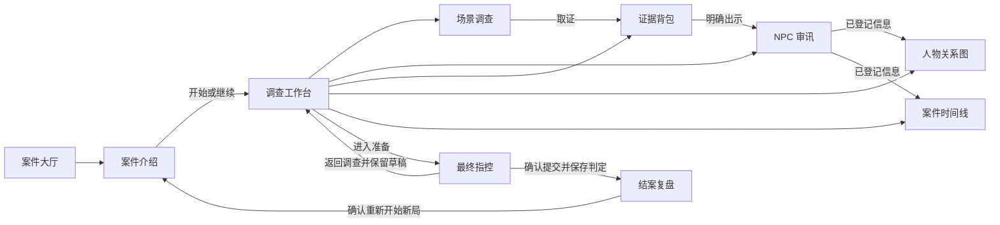
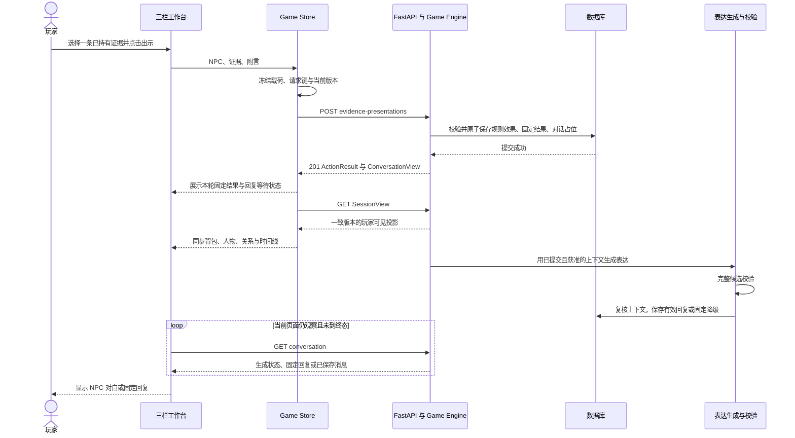

# 前端架构与交互设计

本文基于 `docs/01`～`10` 的范围、需求、领域、状态机、证据、Agent、谎言、数据库及 API 设计，细化 Vue 3 + TypeScript + Element Plus + ECharts 前端。按照本次要求使用 Vue Router 和 Pinia；仅交付设计，不表示页面或接口已经实现。

**主界面采用“左侧调查导航、中间调查或审讯、右侧证据与人物状态、底部推理面板”。玩家在同一个工作台完成取证、出示、对照和指控，界面变化始终来自后端已经保存的结果。**

## 1. 页面结构与游戏主界面

### 1.1 设计基线

| 决策 | 本文约定 |
| --- | --- |
| 内容规模 | 1 个固定案件、4 个场景、4 个 NPC、12 条证据、3 条谎言链；数量是内容预算，不作为未发现内容的 UI 分母 |
| 目标设备 | 优先 1920 × 1080 桌面答辩，兼顾 1366 × 768；尺寸均为 CSS 像素，浏览器缩放后按实际视口适配 |
| 呈现方式 | 2D 场景插图、人物静态头像、档案卡片、图表；无 3D、镜头漫游或强制音效 |
| 主流程 | 案件大厅 → 案件介绍 → 调查与审讯 → 最终指控 → 结案复盘 |
| 权威来源 | 后端 `SessionView`、业务固定结果与正式判定；前端不重算谎言、证据解锁或评分 |
| NPC 状态 | 展示公开的情绪和承认进度；不画压力、信任数值条，不显示“有罪概率” |
| AI 输出 | 固定结果先显示，经过校验并保存的对白随后显示；当前契约使用 HTTP 轮询 |
| 范围处理 | 下文 SSE 是明确标注的后续接口提案；第一版不依赖它完成实时状态反馈 |

以 [状态机设计](05-state-machine.md) 的六个持久阶段和 [API 设计](10-api-design.md) 的公开字段为准。`INIT`、`INTRO`、`JUDGEMENT` 是后端事务内的瞬态，不建立对应的前端游戏状态。旧文中的宏观阶段名不再用于新页面判断。

### 1.2 信息架构



| 页面 | 主要内容 | 主操作与出口 |
| --- | --- | --- |
| 案件大厅 | 案件标题、公开简介、统一档案封面；独立的当前存档卡显示阶段和最后保存时间 | “查看案件”“继续调查”；已结案当前局显示“查看复盘” |
| 案件介绍 | `synopsis`、玩法说明；开局后另显示本局 `intro_text` | “开始新局”；已有当前局优先继续，重开须说明旧局保留但转为只读 |
| 调查场景 | 当前场景描述、装饰插图、已公开调查动作、最近固定结果 | 点击调查动作，获得证据后可查看详情或转去审讯 |
| NPC 审讯 | 公开身份、情绪、承认标签、聊天记录、固定披露、输入框与待出示材料 | “发送问题”“出示证据”“结束审讯” |
| 证据背包 | 已持有证据、类型和可信度筛选、来源、已知关联与矛盾 | 查看详情；审讯时选择一条放入出示栏；指控时作为引用 |
| 人物关系图 | 已知人物、公开关系、方向、来源、可信度；配套关系列表 | 选择人物或关系查看来源；放大到中间区域 |
| 案件时间线 | 精确时刻、时间区间、未知时间分组；保留各份证词 | 按人物与来源筛选、对照矛盾事件、查看证据 |
| 最终指控 | 凶手、凶器、动机、过程步骤、证据引用、补充说明 | 自动保存草稿、返回调查、确认最终提交 |
| 结案复盘 | 固定判定、逐项得分、玩家判断与真相对照、遗漏证据、完整证据链 | “完成复盘”“查看调查记录”“重新开始” |

大厅只展示实际发布的一个案件，不用虚构的“即将开放”案件撑满页面。封面、人物头像和场景插图不是现有 DTO 字段：第一版可用通用档案图形；定制素材需单独审核并与公开 ID 对应，不把后端 `backend/assets/cases/` 剧本包打进前端。

### 1.3 主界面线框

以下是审讯状态下的桌面布局，文案与人物仅作示意；正式名称来自接口。

```text
┌────────────────────────────────────────────────────────────────────────────┐
│ 案件标题 / 审讯中       已保存 14:32       [案件介绍] [准备指控] [返回大厅]  │
├────────────────┬─────────────────────────────────┬─────────────────────────┤
│ 调查导航       │ NPC01 · 公开身份                │ 证据背包 · 已获得 6 条   │
│                │ [紧张] [已部分交代]             │ [全部 / 物证 / 证词 …]   │
│ 场景           ├─────────────────────────────────┤                         │
│ ○ 值班室       │ 本轮调查记录                    │ 21:10 的走廊录像        │
│ ● 走廊         │ 已记录新证词 · 来源 NPC01        │ 数字材料 · 已核验       │
│                │ [查看来源]                      │ [详情] [选为出示材料]   │
│ 人物           ├─────────────────────────────────┤                         │
│ NPC01 [审讯中] │ 玩家：当晚你在哪里？            │ 监控检索索引            │
│ NPC02 [平静]   │ NPC：……                         │ 文书 · 已核验           │
│ NPC03 [戒备]   │                                 ├─────────────────────────┤
│                │ [有新回复，点击查看]            │ 当前人物                │
│ [证据总览]     ├─────────────────────────────────┤ 公开身份 / 当前情绪     │
│                │ 待出示：走廊录像 [移除]         │ 已部分交代              │
│                │ 输入问题或出示附言……            │ [查看已登记证词]        │
│                │ [出示证据]       [发送问题]      │                         │
├────────────────┴─────────────────────────────────┴─────────────────────────┤
│ [人物关系] [案件时间线]                 [展开 / 收起] [放大到主区域]       │
│ 可展开推理面板：选中节点或事件后，在面板内展示来源与可信度                 │
└────────────────────────────────────────────────────────────────────────────┘
```

顶栏高 64 px。宽屏左栏 240 px、右栏 320 px，中间自适应，栏间距 16 px，页面边距 16 px。底部默认只显示 48 px Tab 栏，展开后约 280 px；1366 × 768 下默认收起，避免聊天输入框被挤出视口。

布局实施参考，类名仅作设计约定：

```css
.game-shell {
  height: 100dvh;
  display: grid;
  grid-template-rows: 64px minmax(0, 1fr) auto;
}

.game-columns {
  min-height: 0;
  display: grid;
  grid-template-columns: 240px minmax(0, 1fr) 320px;
  gap: 16px;
  padding: 16px;
}

.game-columns > * {
  min-width: 0;
  min-height: 0;
}

.interrogation-panel {
  display: grid;
  grid-template-rows: auto auto minmax(0, 1fr) auto;
  min-height: 0;
}

.conversation-scroll {
  overflow: auto;
  overscroll-behavior: contain;
}
```

左导航、聊天记录、右背包各自滚动。固定结果摘要最多展示最近一轮，详情可展开；历史结果仍可从对应轮次查看，不能把持续增长的卡片堆在输入框上方。推理面板只改变工作区高度，输入栏仍在中间网格的末行。

| 实际视口 | 布局策略 |
| --- | --- |
| 宽度 ≥ 1600 px 且高度 ≥ 900 px | 完整三栏；推理面板可展开；正文每行长度限制在可阅读范围 |
| 宽度 1280～1599 px | 左栏 208 px、右栏 288 px；保留三栏，底部默认收起 |
| 宽度 960～1279 px，或高度不足 700 px | 左栏可收成导航按钮，右背包改为抽屉；推理图优先独立页面 |
| 宽度 < 960 px | 单主区域，导航与背包均通过抽屉打开；保留按钮与表单，不强行缩小三栏 |

答辩建议浏览器 100% 缩放；200% 缩放时应自动进入窄屏布局，主要操作仍可达。最终指控、复盘和图表独立页面可以隐藏重复的右侧摘要，为长表单与图表提供宽度。

### 1.4 调查与审讯的关键交互

**场景调查**：场景描述旁列出 `SceneView.actions`。第一版采用明确按钮，不要求玩家寻找像素热点。场景插图只承担气氛，不自行定义可调查物；以后增加热点，也必须映射已公开的 `action_id` 并保留键盘可用的动作列表。

点击动作后只锁定会话的新写操作，仍可阅读证据。收到成功结果才展示发现卡、背包新条目及新开放场景。`completed` 用作历史标记，是否还能执行由 `enabled` 决定；不能永久禁用所有做过的调查。未开放场景不以带名称的锁定卡出现，也不显示剩余隐藏场景数。

**NPC 审讯**：人物项的名称打开公开档案和历史；其明确标注的“审讯”按钮执行开始或切换命令。服务端确认当前 NPC 后才启用输入。头像可依据公开情绪换边框或已有表情图，不从对白关键词推测情绪。

输入支持 Enter 发送、Shift+Enter 换行，中文输入法组合期间不触发发送。问题最多 2,000 个 Unicode 字符，出示附言最多 1,000 字符；前端计数与服务端 Unicode 字符口径一致，不能直接把 UTF-16 的 `.length` 当作最终校验。

**证据出示**按以下顺序进行：

1. 在右侧点击“选为出示材料”，中间输入区出现材料卡和明确 NPC 名称，尚未发请求。
2. 玩家可阅读内容、移除材料、添加附言；每次只出示一条，组合反证通过连续出示完成。
3. 点击“向当前 NPC 出示”，提交 `evidence_id` 与 `comment`；普通提问按钮保持独立，提问不能隐式附带材料。
4. 成功后固定结果区展示实际反馈；背包、人物状态与推理数据按同一版本刷新，AI 对白随后到达。
5. 重复出示允许由后端重新检查当前条件。界面不承诺“再出示一定增加压力”，也不根据历史记录自行禁止。

切换 NPC 时清除待出示选择并保留各 NPC 的未发送文字，防止材料误投。未确认成功的发送保留原目标、文字和请求标识；“新证据”标记仅表示本次浏览尚未查看，不是权威调查进度。

### 1.5 证据、关系图与时间线

证据详情使用 `ElDrawer`，显示名称、类型、正文、来源、获得时间、可信度、已披露关联。点击来源只定位已知对象。可信度文字固定为“未核验／已核验／有争议／已反驳”；“证词”是来源性质，不能与“已核验”互斥。关键徽标严格读取 `key_badge`。

| 推理视图 | 视觉与交互 | 数据约束 |
| --- | --- | --- |
| 人物关系图 | ECharts `graph`，少量节点采用稳定环形或固定坐标；支持平移、缩放、复位和点击选中 | `character_id` 对应节点，`relationship_id` 对应边；不运行自动关系推断 |
| 关系区分 | 关系类型用文字，方向用箭头；事实／证词用图例和线型，可信度另加状态标签 | 同一对人物的多条边用曲率错开，来源不同的矛盾关系分别保留 |
| 关系详情 | 选中边后展示描述、来源、核验状态及已知矛盾；关系列表提供同等操作 | 受害者等节点可查看，只有 NPC 列表中可接触的人物才提供“审讯” |
| 案件时间线 | 默认用 `ElTimeline` 展示事件；答辩展开模式用 ECharts 散点和区间带对照人物行 | 精确时间画点，区间画带，时间不明单独列出，不硬塞在 00:00 |
| 时间联动 | 点击事件打开详情并定位来源；点击公开矛盾引用并排对照两条记录 | 仅依据 `known_conflicts` 标记矛盾，不将时间重叠自动判为撒谎 |

时间轴使用 `origin_label` 与案内相对分钟，可包含负值和跨日区间；`time_label` 保留作者的精度表达。发现时间只作次要信息，不能作为案发时间轴。按开始分钟、结束分钟、ID 稳定排序，未知时间排后；重叠区间不宣称确定先后。

ECharts 区间带如需 `custom` 系列，仅在 `CaseTimeline.vue` 内实现这一种图形，不建设通用时间图框架。图表容器有实际尺寸且可见后才初始化，展开、缩放或投影尺寸变化时通过 `ResizeObserver` 调用 `resize()`，卸载时 `dispose()`；底部与独立页共用组件，每次只挂载一个实例。[ECharts 容器与尺寸文档](https://echarts.apache.org/handbook/en/concepts/chart-size/)

图表下保留语义化列表作为键盘和读屏入口。详情用 Vue 普通文本渲染；图表 tooltip 不插入未经转义的 HTML。没有关系时保留已知人物和“尚未发现关系”，没有时间项时显示“调查或出示证据后，可在此查看已登记事件”。

### 1.6 最终指控与复盘

指控采用一个页面上的四段表单，不增加长向导：前三段选择凶手、凶器、动机，第四段组织作案步骤与证据。使用公开 `AccusationOptions`，不按疑似正确程度排序。

- 作案步骤从 `process_steps` 添加，通过“上移／下移／移除”调整；无需拖拽依赖。按 `process_constraints` 校验数量与重复限制。
- 如果允许重复步骤，UI 用本地行标识区分出现次数，提交仍是 `ordered_process_step_ids`；`step_evidence_links` 按步骤 ID 关联，不能冒充能够区分每次出现的证据关系。
- 已持有证据可多选引用，再为步骤绑定证据；删除引用时明确提示并移除受影响的本地配对。合法引用集合允许为空，不把“集齐证据”当作提交门槛。
- 补充说明最多 5,000 字，标注“用于记录你的解释，不参与规则评分”。不提供 AI 自动填写正确答案。
- 固定底栏显示“草稿保存状态”“返回调查”“检查并提交”。字段校验失败定位首个错误；证据少或未招供只提示可能影响判定，不禁用合法指控。

最终确认框展示凶手、凶器、动机、步骤数量和引用证据，并写明“提交后本局结束，不能修改；可重新开始新局”。确认后一次 POST 提交完整 `content` 和 `confirm=true`。确认框属于游戏交互，不替代后端校验。

复盘首先展示服务端 `category`，随后是 `score / max_score` 及逐项依据。分数按接口十进制字符串展示，不在浏览器重新求和或默认满分 100。使用“你的判断／案件真相”两列与证据链，遗漏证据标注“本局未发现”，只存在于复盘区域。返回调查记录仍是只读，不把真相和遗漏证据写回背包。

## 2. Router 设计

### 2.1 路由表

页面路径与 `/api/v1` 接口路径分离。采用 history 路由；部署需把非 `/api/`、非静态资源的页面深链回退至前端入口。

| 路径 | 名称与组件 | 读取和进入策略 |
| --- | --- | --- |
| `/` | 重定向 `/cases` | 不创建会话 |
| `/cases` | `case-lobby` / `CaseLobbyView` | 公开列表，独立加载当前入口 |
| `/cases/:caseId` | `case-intro` / `CaseIntroView` | 公开简介，开始游戏是按钮命令 |
| `/sessions/:sessionId` | `GameLayout` | 先加载会话；空子路径按阶段选择默认视图 |
| `…/intro` | `session-intro` / `SessionIntroView` | 本局固定介绍；关闭介绍不执行初始化 |
| `…/scenes/:sceneId` | `scene` / `SceneInvestigationView` | 所有持久阶段可读；只有调查阶段可调查 |
| `…/npcs/:npcId` | `npc` / `InterrogationView` | 可查看已知 NPC；提问另需服务端确认其为当前审讯目标 |
| `…/evidence` | `evidence` / `EvidenceView` | 已持有列表；可用 `?evidence=E07` 定位详情 |
| `…/relationships` | `relationships` / `RelationshipView` | 已知图的主区域模式 |
| `…/timeline` | `timeline` / `TimelineView` | 已知时间线的主区域模式 |
| `…/accusation` | `accusation` / `AccusationView` | A 阶段编辑；其他未结案阶段先显示“进入指控准备”；已结案转复盘 |
| `…/review` | `review` / `ReviewView` | 仅 R/F 且后端授权成功；否则显示尚未结案并提供工作台入口 |
| `/:pathMatch(.*)*` | `not-found` / `NotFoundView` | 返回大厅，不尝试猜测会话或隐藏资源 |

在场景和 NPC 页面使用 `?board=relationships` 或 `?board=timeline` 表示展开的底部 Tab，无参数则收起；用 `router.replace` 更新，避免浏览器后退逐个关闭筛选项。独立图表页不再挂载底部相同图表。URL 不保存消息正文、指控内容、身份凭据或隐藏信息。

### 2.2 路由结构示意

以下仅说明文件拆分与懒加载方式；页面、守卫和路由元数据类型需在实现阶段补齐，并非当前可直接运行的工程。

```ts
import { createRouter, createWebHistory } from 'vue-router'

export const router = createRouter({
  history: createWebHistory(),
  routes: [
    { path: '/', redirect: '/cases' },
    {
      path: '/cases',
      name: 'case-lobby',
      component: () => import('../views/CaseLobbyView.vue'),
    },
    {
      path: '/cases/:caseId',
      name: 'case-intro',
      component: () => import('../views/CaseIntroView.vue'),
    },
    {
      path: '/sessions/:sessionId',
      component: () => import('../layouts/GameLayout.vue'),
      meta: { requiresSession: true },
      children: [
        // 空路径在会话读取守卫中按服务端阶段重定向。
        { path: 'intro', name: 'session-intro', component: () => import('../views/SessionIntroView.vue') },
        { path: 'scenes/:sceneId', name: 'scene', component: () => import('../views/SceneInvestigationView.vue') },
        { path: 'npcs/:npcId', name: 'npc', component: () => import('../views/InterrogationView.vue') },
        { path: 'evidence', name: 'evidence', component: () => import('../views/EvidenceView.vue') },
        { path: 'relationships', name: 'relationships', component: () => import('../views/RelationshipView.vue') },
        { path: 'timeline', name: 'timeline', component: () => import('../views/TimelineView.vue') },
        { path: 'accusation', name: 'accusation', component: () => import('../views/AccusationView.vue') },
        { path: 'review', name: 'review', component: () => import('../views/ReviewView.vue') },
      ],
    },
    {
      path: '/:pathMatch(.*)*',
      name: 'not-found',
      component: () => import('../views/NotFoundView.vue'),
    },
  ],
})
```

### 2.3 导航不等于业务转换

守卫只负责读取、校验已知目标和选择入口，不在 `beforeEach` 中自动执行开始审讯、结束审讯、开局或指控。Vue Router 支持异步守卫返回路由位置或 `false`，本项目采用返回值方式，避免与 `next()` 混用。[Vue Router 导航守卫文档](https://router.vuejs.org/guide/advanced/navigation-guards.html)

| 用户操作或入口 | 顺序与边界 |
| --- | --- |
| 首次开始 | POST 新局成功 → 保存会话投影 → 跳转本局介绍；“开始调查”仅关闭介绍 |
| 继续当前局 | GET current → I/D 到第一个可见场景，T 到 active NPC，A 到指控，R/F 到复盘；没有场景时保留介绍与可用导航 |
| 点击“审讯” | PUT interrogation → 按返回版本刷新 → 跳转 NPC 页并启用输入；失败保留原目标 |
| 从审讯浏览场景 | GET 展示场景，不自动结束审讯；要调查时点击“结束审讯并调查”，先 DELETE interrogation，再用新版本 POST 调查 |
| 进入指控 | 点击“准备指控”执行 PUT accusation-preparation，成功后导航；直接输入 URL 时先展示准备入口，不因浏览执行写操作 |
| A 阶段返回调查 | 先完成或明确处置未保存草稿，再 DELETE accusation-preparation；成功后按返回 I/D 导航 |
| 浏览器后退、刷新 | 路径决定正在看什么，服务端 phase 决定能做什么；不会通过后退撤销已保存状态 |
| 自己的旧局 | `is_current=false`：允许读取，全部写入口关闭；提供“回到当前游戏”，不自动恢复旧局为当前局 |

首次进入某会话、刷新、窗口恢复前台及发生冲突后重新读取会话。单纯切换图表 Tab 可复用同一版本的缓存。非当前 NPC 的深链可读历史，但必须显式激活才能发送；未知 scene/NPC/evidence 参数显示通用不可访问状态。

切换会话先递增客户端加载代次，停止旧轮询并清理当前局 UI 引用，避免迟到结果回填。带未保存指控编辑离开时提供“保存后离开／放弃本地修改／取消”，这只处理真实未保存输入；无修改时不弹确认。关闭浏览器只能尽力提示，不能依赖异步 `beforeunload` 完成保存。

## 3. Vue Component 拆分

### 3.1 目录与页面边界

前端是独立的 `frontend/` 子项目，源码放在 `frontend/src/`，依赖和工具配置留在 `frontend/` 内，仓库根目录只放项目级文档。以下是建议结构，不在本次文档任务中创建脚手架。

```text
frontend/src/
├── main.ts
├── App.vue
├── router/index.ts
├── layouts/GameLayout.vue
├── views/                     # 第 2 节列出的路由页面
├── components/
│   ├── game/                  # 导航、顶栏、侧栏、推理面板
│   ├── investigation/         # 场景内容和固定结果
│   ├── interrogation/         # 聊天记录和输入
│   ├── evidence/              # 背包、详情和信息标签
│   └── reasoning/             # 关系图、时间线、过程编辑
├── stores/
│   ├── game.ts
│   ├── conversation.ts
│   └── workspace.ts
├── api/
│   ├── http.ts                # fetch、错误解析、请求取消
│   ├── game.ts                # 明确命名的业务请求函数
│   └── types.ts               # 对应第 10 篇公开 DTO
├── composables/
│   ├── useReplyPolling.ts
│   └── useEChart.ts
└── styles/theme.css

frontend/public/               # 公开且不剧透的图片、字体等资源
frontend/tests/                # 实现后按行为建立自动化检查
```

一个路由页面负责获取数据和编排动作，一个展示组件负责清晰呈现。不要把每个标签都包装一层，也不为一个案件增加通用表单引擎、通用工作流编辑器或事件总线。

### 3.2 主界面组件树

```text
App
└── RouterView
    └── GameLayout
        ├── GameHeader
        ├── InvestigationNav
        ├── RouterView
        │   ├── SceneInvestigationView
        │   │   ├── ScenePanel
        │   │   └── FixedOutcomeCard
        │   ├── InterrogationView
        │   │   ├── FixedOutcomeCard
        │   │   ├── ConversationList
        │   │   └── MessageComposer
        │   ├── AccusationView
        │   │   └── ProcessStepEditor
        │   └── 证据、图表、介绍与复盘页面
        ├── EvidenceSidebar
        │   ├── EvidenceList
        │   └── NpcStatusCard
        ├── ReasoningDock
        │   └── RelationshipGraph 或 CaseTimeline
        └── EvidenceDetailDrawer
```

| 组件 | 输入与输出 | Element Plus / 原生实现 |
| --- | --- | --- |
| `GameHeader` | 接收标题、阶段、保存与只读状态；发出进入指控、返回大厅等意图 | `ElTag`、`ElButton`；不用进度百分比模拟破案程度 |
| `InvestigationNav` | 接收可见 scenes、npcs、当前路由；发出 browse、interrogate 意图 | 导航列表与按钮；选中浏览项和“正在审讯”分别标识 |
| `ScenePanel` | 接收 `SceneView` 与请求状态；发出 `investigate(action_id)` | 插图、说明、`ElButton`；禁用原因来自公开字段 |
| `FixedOutcomeCard` | 接收 `PlayerOutcome` 与请求标识；发出查看来源 | `ElCard`、标签；只用程序固定反馈 |
| `ConversationList` | 接收完整轮次、加载更早状态；发出加载更早、重试某轮 | 语义化消息列表；按消息 ID 更新，保留滚动锚点 |
| `MessageComposer` | 接收 draft、已选材料、目标、可发送状态；发出问答或出示 | `ElInput` textarea、材料卡、两个独立按钮 |
| `EvidenceList` | 接收已持有集合、筛选、只读状态；发出查看或选择 | 紧凑卡片与 `ElSelect`；右栏与独立证据页共用 |
| `EvidenceDetailDrawer` | 接收一份已知证据及模式；发出关闭、选择材料 | `ElDrawer`；关闭后焦点返回触发按钮 |
| `NpcStatusCard` | 接收一个 `NpcView` | 情绪文字、承认标签、已登记证词入口；不计算隐藏数值 |
| `ReasoningDock` | 接收 Tab、展开状态、已知数据；发出展开或放大 | `ElTabs` 与区域容器，不复制一套图表数据 |
| `RelationshipGraph` | 接收 `RelationshipGraph`；发出选中人物或关系 | ECharts 图与等价关系列表 |
| `CaseTimeline` | 接收 `TimelineView` 与显示模式；发出选中事件 | `ElTimeline`，展开模式使用 ECharts |
| `ProcessStepEditor` | 接收本地步骤及选项、约束、证据引用；发出新表单值 | 列表、选择框、上移下移按钮，无拖拽依赖 |

事实／证词与可信度标签在证据、图表和固定结果中共用同一个小型展示组件 `InformationBadge`，其输入仅为公开枚举。其他静态头部或只出现一次的区块先内联在页面，真实复用时再拆。

### 3.3 组件通信与生命周期

- 展示组件以类型化 props 接收数据，通过 emits 表达用户意图；不直接调用写 API，不修改传入的对象。
- 页面调用 Pinia action；HTTP 细节只在 `api/`，API 层不反向引用 Store，避免循环依赖。
- `GameLayout` 编排会话切换和侧栏，不将模型轮询、关系布局、评分表单都塞入一个大组件。
- `useReplyPolling` 只管理当前观察任务的计时、取消和请求顺序；每个会话同一时刻只观察一个未完成 NPC 轮次。页面重新进入通过服务端记录恢复。
- `useEChart` 只封装两张图共同的初始化、尺寸变化和释放；图的 option 和点击语义保留在各业务组件。
- 第一版不对整个工作台使用无边界 `KeepAlive`。页面销毁停止计时器、观察器及请求，输入草稿保存在明确的 workspace 状态中。

## 4. Pinia Store 设计

### 4.1 三个 Store 与状态归属

使用三个小型 Setup Store。`ref` 保存状态、`computed` 提供只读派生、函数作为 action；组件解构响应式状态时用 `storeToRefs`。不把每个后端实体都建成 Store。[Pinia 核心概念文档](https://pinia.vuejs.org/core-concepts/)

| Store | State | Getters / computed | Actions |
| --- | --- | --- | --- |
| `useGameStore` | 当前查看的 `SessionView`、加载状态、加载代次、正在提交或待确认的请求、最近固定结果 | 当前阶段、当前 NPC、是否旧局、能力集合、证据 ID 索引、是否需要刷新 | loadCurrent、loadSession、startSession、investigate、setInterrogation、endInterrogation、openAccusation、saveDraft、cancelAccusation、submitAccusation、finishReview、recoverRequest |
| `useConversationStore` | 按 `(session_id,npc_id)` 分组的轮次、分页游标、历史加载状态、当前观察对象、轮次读取代次 | 当前 NPC 有序轮次、生成等待状态、服务端返回的可重试状态 | loadHistory、observeReply、mergeTurn、stopObserving、clearSession；不直接变更游戏状态 |
| `useWorkspaceStore` | 按局与 NPC 区分的未发送文字、待出示证据、指控本地编辑副本和基准、详情选择、筛选、已读新条目、动效偏好 | 指控 dirty、本地字段校验、选中详情 | editDraft、acceptSavedDraft、restoreLocalDraft、selectEvidence、clearSessionUi |

聊天、出示和表达重试也由 `game` Store 的明确 action 发起，统一经过请求登记与版本校验；完成后把关联 `ConversationView` 交给 conversation Store。Conversation Store 只维护对话读取与展示，不从回复文字更新背包。

路由已经保存的 `sceneId`、`npcId`、底部 Tab 不在 Store 重复维护。案件列表与公开简介是各页面的本地数据；`ReviewView` 和指控候选由对应页面读取并按 session 隔离，不新增 lobby、review、timeline、evidence 等 Store。

### 4.2 核心前端状态类型

以下是 UI 状态设计，`SessionView`、`ConversationView`、`AccusationContent` 等直接沿用 API DTO，保持 `snake_case`。业务阶段与网络状态分开命名。

```ts
type GamePhase =
  | 'INVESTIGATION'
  | 'DEEP_INVESTIGATION'
  | 'INTERROGATION'
  | 'ACCUSATION'
  | 'REVIEW'
  | 'FINISHED'

type ReadStatus = 'idle' | 'loading' | 'ready' | 'error'
type CommandStatus = 'idle' | 'submitting' | 'confirming' | 'rejected'
type DraftStatus = 'clean' | 'dirty' | 'saving' | 'error' | 'conflict'

interface PendingCommand {
  requestId: string
  method: 'POST' | 'PUT' | 'DELETE'
  path: string
  sessionId: string | null
  expectedStateVersion: number | null
  bodyJson: string | null
}

interface ReplyObservation {
  sessionId: string
  npcId: string
  conversationId: string
  requestId: string
  sourceStateVersion: number
  readEpoch: number
}
```

`PendingCommand` 在首次发出前冻结。一次运输重试复用同一个对象，不能从当前编辑框重建请求体。首次开局没有 session/version；重开保存被替换旧局及旧版本。正式结案的未知结果也保留这一记录，刷新后先核实，不能重新生成键再指控。

请求登记不是离线命令队列。UI 同时只允许一个未确认的业务写请求；用户尚可阅读、修改本地文字。收到 201 后业务锁释放，NPC 仍在生成时只禁用聊天、出示和表达重试；切换 NPC、退出审讯和进入指控仍可执行，并由后端使旧生成失效。

### 4.3 快照、版本与迟到响应

1. `SessionView` 是当前工作台唯一的游戏投影。证据、NPC、关系和时间线从它派生，不在多个 Store 维护可各自修改的副本。
2. 小案件优先选择“有效业务变更后 GET 一次完整 SessionView”。成功的 `ActionResult` 可立即显示本轮固定结果，但不把零散字段拼成新权威快照；旧面板短暂标记“正在同步”，同步完成再一起更新。
3. 游戏请求已保存而刷新失败时，保留固定结果和旧投影，显示“操作已保存，界面同步失败”；恢复读取即可，不重新出示或调查。新业务写入等同步或明确恢复后再开放。
4. 应用响应前核对目标会话和加载代次；同局低版本不能覆盖高版本。同版本也要核对最新读取代次，因为聊天生成变化不增加 `state_version`。
5. 对话另外按 `conversation_id` 与 `message_id` 合并，用 `conversation_seq` 排序。表达重试期间递增观察代次并串行读取，避免旧 FALLBACK 响应盖掉新的生成状态；不能用 `state_version` 判断同轮表达的新旧。
6. 旧请求重放返回较低 `result_state_version` 时，只确认历史业务成功并读取当前状态；旧固定卡可留在所属轮次，不触发当前人物动画。
7. 当前 NPC、阶段或局入口变化后停止旧轮询。历史轮次可保留已校验的消息并标注历史状态；迟到消息不能替代新 NPC 的回复或修改当前局。

`available_actions` 决定业务入口，具体还叠加 `SceneView.actions.enabled`、`is_contactable`、当前 NPC、只读状态与生成占位。它是展示提示，不是客户端授权凭证；后端每次仍完整校验。

### 4.4 草稿与浏览器存储

| 内容 | 保存位置与恢复规则 |
| --- | --- |
| 权威游戏进度、已持有证据、正式判定 | 服务端；刷新重新读取，禁止上传本地快照覆盖 |
| 指控已保存草稿 | `SessionView.accusation_draft`；workspace 另外持有编辑副本及基准版本 |
| 指控编辑副本、未发送文字 | `sessionStorage`，按局与 NPC 隔离；只用于恢复用户输入，显示“本机未保存草稿” |
| 未确认的请求 | 发出前保存 requestId、原路径、原载荷和版本到 `sessionStorage`；收到确定结果后清理 |
| 动效或主题偏好 | 可存 `localStorage`；不使用全 Store 自动持久化插件 |
| Cookie、完整剧本、模型密钥、隐藏规则 | 不进入 Store 或浏览器存储；Cookie 由浏览器管理且 HttpOnly |

指控字段变化先更新本地副本，合法草稿停止编辑约 800 ms 后完整 PUT 保存；同一时刻只保存一个请求。请求期间继续编辑时记录新副本，上一笔成功后再用最新版本保存最新内容，不能让旧保存响应清掉新编辑的 dirty 状态。

保存冲突停止自动发送，保留服务器草稿和本地副本，提供“采用已保存草稿”或“检查后保存本地版本”。首次恢复本地副本也对比局、阶段和基准，不盲目覆盖。字段不完整允许保存，非法引用等本地错误则标记“尚未保存”并等用户修正。

最终提交或返回调查前停止待触发的自动保存，等待正在进行的保存确认并重新核对版本；提交发送当前完整内容，不依赖最后一次自动保存。正式指控确认成功后清理本局编辑副本；不在提交未知时清空它。

存储不可用或空间不足时降级为内存并提示“刷新后可能丢失未发送内容”，不能承诺持久恢复。匿名凭据失效后，旧 pending 请求不能自动发到新身份下；旧局材料先从当前视图撤下，再提供返回大厅重新开始的入口。

## 5. 前后端数据流

### 5.1 读取与写入约定

前端通过同源 `/api/v1` 调用 FastAPI，使用原生 `fetch` 即可，不为现有需求额外加入请求缓存框架或 WebSocket 客户端。API 层处理响应解析与 `ApiError`，业务恢复由 Store 处理。

| 操作 | 请求与数据去向 |
| --- | --- |
| 应用启动 | POST `/visitors` 建立或复用身份；GET `/cases` 与 `/sessions/current`，公共列表可先显示 |
| 会话加载 | GET `/sessions/{sid}` → 整体替换 game 投影；历史、候选与结案复盘按需读取 |
| 调查 | POST `/sessions/{sid}/scenes/{scene_id}/investigations`，body 为 `{action_id}` → 固定结果 → 刷新整体投影 |
| 开始或切换审讯 | PUT `/sessions/{sid}/interrogation`，body 为 `{npc_id}` → 更新投影 → 读取该 NPC 历史 |
| 提问 | POST `/sessions/{sid}/npcs/{npc_id}/conversations`，body 为 `{message}` → 201 与轮次 → 轮询单轮 |
| 出示证据 | POST `/sessions/{sid}/npcs/{npc_id}/evidence-presentations`，body 为 `{evidence_id,comment}` → 固定结果、投影同步与轮询 |
| 仅重试表达 | POST `/sessions/{sid}/conversations/{cid}/reply-retries`，body 为 `{}` → 更新原轮回复槽 |
| 进入及退出指控 | PUT / DELETE `/sessions/{sid}/accusation-preparation` → 服务端阶段与新版本 |
| 草稿与正式提交 | PUT `/sessions/{sid}/accusation-draft` 或 POST `/sessions/{sid}/accusation` → 保存草稿或唯一判定 |
| 复盘 | GET `/sessions/{sid}/review`；完成按钮 PUT `/sessions/{sid}/review-completion` |
| 未知结果恢复 | GET `/requests/{request_id}` → 确认原结果或同键重发原请求 |

除初始化访问者外，业务写操作统一带 `Idempotency-Key`；已有会话写入带 `X-Expected-State-Version`。DELETE 不带 body，空对象写入按契约发送 `{}`。Cookie 自动携带，不能在 JS 读取令牌或自行设置 Origin；同源浏览器请求提供 Origin，由后端检查。

类型只覆盖公开 API，不把数据库表类型直接共享到前端。模型文本采用插值或 `textContent`，保留换行；不使用 `v-html`，也不自动把模型文本变成链接、调查按钮或证据。

### 5.2 出示证据的完整时序



图中的生成与会话刷新可并行，不要求先刷新完才启动模型。前端同时显示两种反馈：“调查记录已保存”与“NPC 正在回复”。普通问答不触发证据、情绪或图表变化，不因聊天里出现“我承认”就播放击破动效。

### 5.3 幂等恢复与边界

| 已知情况 | 前端下一步 |
| --- | --- |
| POST 尚未返回或连接断开 | 标记“正在确认保存结果”，GET 原 request_id；不能宣称失败或成功 |
| RequestRecord 为 COMMITTED / NOOP | 接受保存事实，按局核对响应，恢复读取与轮询；不要再次执行业务 |
| RequestRecord 为 REJECTED | 显示记录中的 error；修改输入或解决冲突后，用户新操作才生成新键 |
| 查询为 REQUEST_NOT_FOUND | 原事务仍可能提交；有限次数重查，或用户点击“重试原操作”后原键、原版本、原载荷重发 |
| 创建新局的响应丢失 | 同样按 request_id 查询，无须预先知道新 session_id；取得结果后核对当前入口 |
| 重开已成功但旧响应晚到 | 不将入口切回旧局；GET current 确认入口，旧结果只归原会话 |
| 再次登录页面发现旧局 pending | 先验证当前凭据可访问原会话；不因当前入口不同就把请求目标改为新局 |

客户端对未知写结果没有“自动换键重试”策略，也不对模型调用作透明重试。查询请求可以重试，原写请求只能按冻结记录恢复；确认后才开放依赖该结果的新写操作。

## 6. 实时 AI 输出的交互设计

### 6.1 当前契约下的实时体验

[Agent 设计第 8 节](07-agent-design.md) 要求完整候选通过校验后才展示，[API 设计第 3 节](10-api-design.md) 已确定普通 HTTP 与轮询。因此第一版提供“即时操作反馈、持续更新生成状态、校验完成后渐进呈现对白”，不把未经检查的模型 token 直接显示给玩家，也不把打字动效宣称为模型实时生成。

| 时点或状态 | 中间区域 | 右侧与操作权限 |
| --- | --- | --- |
| 点击发送、尚未确认 | 本地问题显示“发送中”；失败前保留输入副本 | 锁定新写请求；可读证据 |
| 201 已保存，PREPARING | 当前轮显示“回复准备中”；有出示结果则立即显示固定卡 | 已保存的变化按投影同步；可切换 NPC 或退出 |
| GENERATING | “NPC 正在组织回答…”和小型等待指示；可展开固定回复 | 禁用新的提问、出示、表达重试；仍可查看关系与时间线 |
| COMPLETED | 用服务端有效 NPC 消息填充这一轮，可做短暂逐段揭示 | 不再占用生成锁；自动恢复发送权限 |
| FALLBACK | 显示固定回复及“本轮使用预设回复，调查进度已保留” | 仅 `can_retry_reply=true` 时显示“重新生成本轮回复” |
| STALE | 保留已保存的历史内容，提示“已切换调查上下文”；不展示迟到候选 | 停止轮询；不可重试旧上下文 |
| 仍生成但 deadline_exceeded=true | 展示固定回复，提示“等待已超时，已显示预设回复” | 停止本次轮询，不擅自改成 FALLBACK；重新查询后按服务端能力决定能否重试 |

没有服务端字段支持的“正在分析谎言 70%”“正在核对秘密”不出现在界面。前端可以显示等待时长，但不能伪造进度百分比、模型思维链、推理过程或未公开的后台检查阶段。

### 6.2 轮询、揭示与滚动

轮询建议间隔 1.5 秒，上一笔 GET 完成后再安排下一笔，防止慢网下请求重叠。以服务端终态或 `deadline_exceeded` 停止；页面隐藏时暂停，返回前台先读会话与当前轮，离开页面或切局时取消读取。网络错误的恢复策略见第 7 节。

初次加载将 `pending_conversations` 交给 conversation Store 建立观察目标；随后等待状态以该轮最新查询为准，不能让 game 投影中较旧的 pending 列表永久锁住输入。重新加载会话时也按会话、轮次与读取代次核对后合并。

完整有效文本到达后，最多用约 600～900 ms 做逐段揭示，长文本直接加大每次显示的片段，不能让播放器拖延几秒。使用 `requestAnimationFrame` 和 Unicode 字素分段，避免拆开 emoji；无分段能力时直接全文显示。数据库中的正文和复制内容始终是完整文本，动效进度只属于组件。

- 用户在底部附近时随新内容滚动；用户正在阅读旧记录时保留位置，出现“有新回复”按钮。
- 向上加载历史后按首个可见轮次恢复锚点，不跳回底部。
- “立即显示全文”只结束视觉揭示，不新建请求；历史回复与页面恢复不重播打字效果。
- 不提供没有接口支持的“取消模型生成”。如提供“停止等待”，明确它只停止页面观察，上游可能仍在处理；恢复等待只查询原轮。
- 读屏区域在完整有效回复到达时播报一次，不逐字播报；固定结果和错误另用简短的礼貌通知。

固定结果的详细历史需要时按该轮 `request_id` 查询原记录；当前状态也能从背包和 `known_information` 恢复。不能要求玩家重新出示一次，才能在刷新后重新看见已保存的承认依据。

### 6.3 后续可选 SSE 增强契约

若实测发现轮询延迟影响答辩，再在第 10 篇正式增加以下接口；本节是提案，当前 API 尚未提供，不可直接当作已实现接口接入。

| 项目 | 提议 |
| --- | --- |
| 订阅入口 | GET `/api/v1/sessions/{sid}/conversations/{cid}/events`，只订阅已存在轮次 |
| 身份与归属 | 继续同源 Cookie；校验会话、轮次及访问者；GET 不调用模型或重跑规则 |
| 事件包 | `event_id`、`session_id`、`conversation_id`、`source_state_version`、`type`、`data`；event_id 在订阅内递增 |
| `status` | 发送已有公开生成状态；不夹带 Prompt、秘密或原始模型片段 |
| `reply.ready` | 完整候选通过校验、版本复核并保存后，发送完整 `ConversationView` |
| `done` | 通知此观察结束；FALLBACK/STALE 同样通过规范 ConversationView 表达 |
| 心跳 | 例如每 15 秒发送注释心跳，无业务副作用；代理关闭该端点的缓冲 |
| 断流恢复 | 关闭旧连接，先 GET 原轮快照；仍在生成再建立新订阅，并使旧订阅回调失效 |
| 降级 | 订阅不可用回到原轮 HTTP 查询，不重新 POST 问题 |

MVP 无需建立持久事件回放日志；新订阅先发送当前快照，客户端按轮次身份、订阅代次和事件顺序去重。SSE 的连接恢复不能创造新生成尝试；用户显式重试表达后重新建立观察代次，旧连接不能覆盖新结果。

该方案实时推送状态与已验证结果，可减少轮询等待；它仍不提供未经校验的 token 流。若将来确实要求逐 token 生成边到边显示，需要先修改现有“完整候选校验后展示”的内容约束，建立单独评估，不能仅靠前端收到违规内容后撤回来宣称安全。当前毕业设计保留已有校验边界。

## 7. Loading、Error 与 Retry

### 7.1 Loading 与空状态

| 区域 | 等待方式 | 空数据或恢复方式 |
| --- | --- | --- |
| 案件大厅 | `ElSkeleton` 案件卡；当前存档独立加载 | 无当前局显示“开始调查”；案件列表为空明确提示暂无可用案件 |
| 首次会话加载 | 三栏骨架，暂不展示上一个会话的数据 | 无权或不存在时给通用不可访问提示 |
| 调查动作 | 被点击按钮 loading；固定结果位置预留 | NOOP 或无新信息显示普通反馈，不使用报错红色 |
| NPC 历史 | 最近消息骨架；加载更早只在顶部显示小提示 | “可以询问案发时的行踪”；示例问题仅填入输入框，不自动发送 |
| NPC 回复 | 一轮内状态提示，固定回复可展开 | 无模型也能使用固定回复；不能无限转圈 |
| 证据背包 | 首次加载骨架；状态同步保留旧列表并标记 | 无证据显示“调查场景后，已取得的材料会出现在这里” |
| 关系与时间线 | 已有数据保留，区域显示同步状态 | 无关系／无事件各有说明，不生成占位秘密节点 |
| 指控保存 | 表单可继续编辑，底栏显示“草稿保存中” | 明确区分“本机暂存”和“已保存”；失败保留输入 |
| 正式提交 | 确认按钮 loading，禁止再次提交 | 等待固定规则与保存结果，不显示“AI 正在裁决” |
| 复盘加载 | 结果区域骨架，加载完成统一揭示 | 失败只重读复盘，不重复提交指控 |

交互反馈目标为点击后约 100 ms 内出现；短请求可延迟约 200 ms 再显示骨架，减少闪烁。非 AI 服务端响应目标沿用需求中的 P95 ≤ 1 秒，并另计浏览器渲染和网络时间；这些都是待实测目标，不是已经达到的指标。

### 7.2 错误和重试矩阵

| 情况 | 用户文案与位置 | 重试方式 |
| --- | --- | --- |
| 普通 GET 网络失败 | 受影响区域内联提示“加载失败”，保留已知内容 | 最多两次短退避重试，之后显示“重新加载”；401/404 等确定错误不自动重试 |
| POST/PUT/DELETE 超时、断网、5xx | 固定位置显示“暂未确认是否保存，正在查询” | 先查原请求；有限查询仍无结论后，由“继续查询／重试原操作”恢复，同键同载荷 |
| 业务成功，模型超时或输出被拒 | 对话内显示固定回复和中性降级提示 | 按 `can_retry_reply` 显式重试表达；不重新出示，不显示被拒原文 |
| 业务成功，界面刷新失败 | “操作已保存，部分界面尚未更新” | 重读 SessionView；保留业务固定结果 |
| 409 STATE_VERSION_CONFLICT | “游戏进度已更新，请检查后再操作” | GET 最新会话，保留本地表单；用户重新操作时用新键与最新版本 |
| 409 IDEMPOTENCY_KEY_CONFLICT | “请求内容与原操作不一致” | 停止写入，保留原记录供核对；不透明更换键掩盖客户端问题 |
| 409 GENERATION_BUSY | “当前人物回复尚未结束” | 读取错误中可访问的原轮；可等待、切换 NPC 或结束审讯 |
| 409 ACTIVE_NPC_MISMATCH / ACTION_NOT_ALLOWED | “当前阶段或人物已变化” | 刷新会话，保留文字；让玩家显式选择正确操作 |
| 409 REPLY_RETRY_NOT_ALLOWED | “这一轮已无法重新生成” | 读取原轮与会话，撤下重试按钮；可在当前上下文提出新问题 |
| 409 SESSION_NOT_CURRENT | “这是历史存档，可查看但不可继续修改” | GET current，提供回到当前游戏 |
| 409 CURRENT_SESSION_EXISTS / CURRENT_SESSION_CONFLICT | “已有当前游戏，或入口已发生变化” | 读取当前入口，提供继续或明确重开；不自动替换 |
| 409 CASE_VERSION_CHANGED / CASE_UNAVAILABLE | “案件版本已更新或暂不可新开” | 重新读取公开案件；保留旧存档继续入口 |
| 409 ACCUSATION_ALREADY_SUBMITTED | “本局已有结案结果” | 读取正式判定与复盘，不重新评分 |
| 422 字段、证据或候选错误 | 表单字段下展示简短错误，焦点定位首个问题 | 保留输入，校正后新请求；不暴露隐藏证据是否存在 |
| 429 RATE_LIMITED | “请求过于频繁，请稍后再试” | 遵循 `Retry-After`；写请求仍按原请求恢复规则处理 |
| 表达额度耗尽 | “本局将使用预设回复，调查可继续” | 不自动再次请求模型；保留非 AI 玩法与复盘 |
| 401 VISITOR_AUTH_REQUIRED | “当前访问凭据已失效” | 暂停保护资源与写入，提供返回大厅；不自动拿新身份重发旧请求 |
| 404 受保护资源不可访问 | “该记录不存在或暂不可访问” | 提供返回当前局／大厅，不根据错误猜测隐藏内容 |
| 409 SAVE_VERSION_UNSUPPORTED | “当前版本暂时无法读取此存档” | 保留存档；提示联系维护或返回大厅，不自动重置 |
| 500 配置或存档完整性错误、503 持久化不可用 | “游戏数据暂时无法处理”并提供可复制错误编号 | 停止相关写入，按原请求核实；数据库失败不降级成假保存 |

错误编号使用 `trace_id`，可放在“问题详情”里复制；玩家主界面不展示堆栈、SQL、Prompt、供应商原始错误。403 来源错误与 400/415/428 等协议错误按客户端或部署问题反馈，不诱导玩家反复点击。

轮询失败不清空已有对白；连续两次读取失败后暂停自动观察并提供“重新连接”。重连先查询原轮，再决定是否继续观察。浏览器 `online` 事件仅用于提示可尝试重连，不能证明原请求没有提交，也不能触发新业务命令。

### 7.3 操作保护与可访问性

不使用全屏遮罩覆盖所有等待过程。只有首次会话载入或正式确认需要较强聚焦；其他等待保留阅读能力。Toast 用于短提示，保存未知、字段错误和可重试故障必须留在对应区域，不依赖会消失的通知。

所有主操作可通过键盘执行，焦点轮廓清晰；抽屉与对话框关闭后归还焦点。状态使用文字、图标和颜色共同表达。工具提示不能是唯一的信息来源；图表有等价列表。页面标题、选中的导航和按钮 disabled 原因均有可读文本。

## 8. 适合答辩展示的 UI 动效

### 8.1 视觉方向

采用“侦探档案工作台”：低饱和深蓝灰背景、浅色正文、青色主操作、琥珀色线索强调。主要区域保持实色，避免玻璃模糊让投影文字发灰。使用 Element Plus 主题变量统一颜色、圆角和控件尺寸，不大量覆写组件内部 DOM。

| 项目 | 建议值或用法 |
| --- | --- |
| 背景与面板 | 背景 `#111827`，面板 `#1F2937`，边框 `#425069` |
| 正文与辅助文字 | 正文 `#F3F4F6`，辅助 `#B6C2D2`；错误与状态均有文字 |
| 主操作与状态 | 青 `#67E8F9`、琥珀 `#FBBF24`、绿 `#86EFAC`、红 `#FB7185`；亮色按钮配深色文字 |
| 字体 | 系统中文字体栈；正文 16 px、主标题 24～28 px、辅助文字不小于 14 px |
| 间距与形状 | 8 px 基础间距，面板内边距 16～24 px，圆角 8～12 px |
| 点击与焦点 | 主要按钮高 40～44 px，清晰焦点框；图中小节点另有可点击列表行 |
| 投影适配 | 默认字号便于远距离阅读，复盘和推理图可放大；必要时提供浅色主题，主题选择只影响显示 |

颜色为设计起点，实施时按实际字重、状态组合检查对比度，普通文字目标至少 4.5:1；尤其检查禁用说明、图例和选中项。人物立绘可选，但必须给正文足够空间，不做占据半屏的静态人像。

### 8.2 动效与业务触发一一对应

| 场景 | 触发依据 | 动效与时长 | 降级行为 |
| --- | --- | --- | --- |
| 进入案件 | 成功读取公开简介或本局介绍 | 档案面板淡入，位移不超过 8 px，180～240 ms | 直接显示，不卡住“开始”按钮 |
| 切换场景或 NPC 视图 | 导航和所需数据已就绪 | 中间内容短淡入 120～160 ms，左右栏保持稳定 | 立即切换，不移动焦点到装饰图 |
| 获得新证据 | 已提交结果中的 `new_evidence`，且本次请求尚未提示 | 发现卡淡入，背包对应条目高亮约 600 ms | 仅显示“新”文字；同键重放不重复庆祝 |
| 证词或公开状态变化 | `disclosed_information` 或 NPC 公开字段确认变化 | 固定记录卡展开 180 ms，状态标签高亮一次 | 直接展示新值；没有明确固定依据时不写“谎言已击破” |
| 证据出示 | 玩家明确选择并发出请求 | 材料卡进入当前轮位置，120～180 ms，显示提交状态 | 保留静态材料卡，不能提前演出成功 |
| AI 对白到达 | COMPLETED 且有效消息已经保存 | 可跳过的逐段揭示，总长约 600～900 ms | 全文立即显示，不重播历史 |
| 推理面板展开 | 用户切换底部 Tab | 小幅高度变化约 180 ms，结束后图表 resize | 直接展开并 resize |
| 已知关系新增 | 新投影确有新增已披露边 | 新边淡入 200～300 ms，已有节点不重新乱排 | 直接画边，列表标记新条目 |
| 时间线定位 | 用户选择事件或公开矛盾 | 选中边框与详情卡切换约 150 ms | 立即定位，保持时间精度与来源 |
| 结案结果 | 正式指控已保存且复盘读取成功 | 结果卡淡入 240 ms，逐项判定错开 60 ms，整体不超过 600 ms | 所有判定立即可见，不做猜奖式揭晓 |

Vue 过渡和 CSS 已足够处理这些效果，ECharts 使用自身图形更新能力；不增加动效库。第一版跳过证据跨栏飞行轨迹、持续粒子、屏幕震动和无限力导向摆动，它们会增加实现和答辩操作成本。

遵循 `prefers-reduced-motion`，并提供“减少动效”显示偏好：关闭位移、逐段揭示、自动平滑滚动和图表过渡。业务状态必须在响应确认时更新，不能等 `animationend` 才保存或开放下一步。

### 8.3 六分钟答辩演示路径

以下时间是演示编排建议，证据与 NPC 使用正式剧本审核过的路径；当前文档中的 E07 等仍是示例，不能当作已经存在的完整案件。

| 时间 | 操作 | 可展示的工程与交互价值 |
| --- | --- | --- |
| 0:00～0:40 | 大厅打开案件介绍，开始新局 | 案件版本固定、开局成功即保存、清晰的玩法入口 |
| 0:40～1:30 | 在一个场景执行调查，查看证据来源 | 预设动作、确定性获得证据、背包同步和发现动效 |
| 1:30～3:00 | 审讯 NPC，先提问，再明确出示反证 | 固定结果先出现、NPC 状态随规则改变、AI 负责对白表达 |
| 3:00～3:50 | 展开人物关系和时间线，点开一组矛盾来源 | 只显示已知信息，证词保留来源，模糊时间不被伪造为精确时间 |
| 3:50～4:30 | 刷新并继续；展示一次预先安排的模型降级 | 进度恢复、原轮查询、固定回复仍能推动玩法 |
| 4:30～6:00 | 填写结构化指控、确认提交、查看复盘 | 一局唯一判定、逐项依据、真相与遗漏证据仅结案后开放 |

模型降级通过演示环境的后端固定回复配置或受控故障样例准备，不在玩家前端添加授予证据、修改压力或“强制通关”按钮。演示前准备一条正常路径和一条固定回复路径；网络或模型不稳定时可诚实说明使用预设回复，核心规则与存档仍真实运行。

### 8.4 实施顺序与验收

先完成同一条竖向流程：大厅开局 → 单场景取证 → 单 NPC 出示 → 固定回复 → 指控 → 复盘。随后扩展其余内容与 Pinia 恢复，再接真实模型、图表和动效。SSE 只在轮询体验经过测量仍不满足时加入。

实现阶段以行为检查为主，不给每个只展示文字的组件写冗余测试。至少覆盖以下场景；本次仅编写设计，尚未执行应用验收。

| 验收场景 | 通过标准 |
| --- | --- |
| 桌面与缩放 | 1920 × 1080、1366 × 768 下输入与提交按钮可见；200% 缩放和窄屏不产生不可操作的三栏 |
| 完整玩法 | 固定回复模式可完成全部九类页面的主要操作，无需 3D、真实模型或隐藏调试按钮 |
| 路由恢复 | T/A/R 阶段深链、刷新和后退不擅自改变后端阶段；旧局只读 |
| 重复与未知提交 | 连点、断线、同键重放不重复获得证据或结案；未知结果先查询 |
| 版本与跨局迟到 | 低版本、旧读取代次、旧 NPC 和旧局响应不能覆盖当前界面 |
| 草稿并发 | 保存中继续输入、409 冲突、刷新恢复均保留玩家输入；旧响应不把新编辑标成已保存 |
| AI 各状态 | PREPARING、GENERATING、COMPLETED、FALLBACK、STALE 与超期都有确定出口；表达重试不再次执行业务效果 |
| 模型伪造内容 | “我给你一条证据”“我认罪”等模型文字不能生成背包或改变 NPC 标签 |
| 信息边界 | 未发现内容不出现在响应、Store、前端构建资源、图表或错误细节；关键标记与承认标签不泄露隐藏规则 |
| 图表正确性 | 同人物多关系、矛盾证词、区间、未知与跨日时间均有来源和正确呈现 |
| 指控与复盘 | 合法错误推理正常结案，空引用不被前端禁止，未结案不能预取真相，复盘遗漏证据不回填背包 |
| 可访问性与动效 | 键盘完成选择、出示与指控；读屏不逐字刷消息；减少动效后所有结果和操作仍完整 |

后续联调先固定第 10 篇 DTO、公开素材与一条可解剧本路径。页面和 Store 无需知道数据库采用何种物理布局；后端已经确定的知识隔离、幂等与一致性契约由前端正确呈现和使用。
