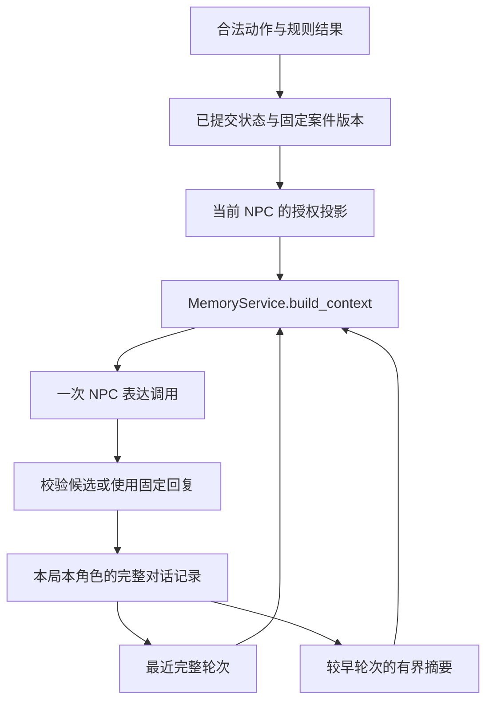

# 三级 Memory 与长对话设计

本文承接 [总体架构](03-architecture-design.md)、[领域模型](04-domain-model.md)、[Agent 设计](07-agent-design.md)、[谎言机制](08-lie-system.md)、[数据库设计](09-database-design.md)、[API 设计](10-api-design.md) 和 [前端设计](11-frontend-design.md)。沿用固定案件、规则决定披露、数据库保存状态、LLM 只负责表达的边界。

**建议默认保留最近最多 6 个完整轮次，旧对话按批次压缩为有来源的短摘要；已承认内容等关键状态每轮从数据库重建。** 三层分别解决接话、交流连续性和事实一致性，不能互相替代。

第 07、08 篇已经预留摘要，但 MVP 不增加摘要模型调用。本文把它具体化为默认可用的程序式摘录摘要，并说明后续语义摘要的接入条件；不要求向量库、Redis、独立记忆 Agent 或后台任务队列。本次交付为设计和伪代码，不代表后端已经实现。

## 1. 三级 Memory 的职责

| 层级 | 保存什么 | 从哪里来 | 能否改变游戏状态 |
| --- | --- | --- | --- |
| Recent Messages | 最近有效的玩家输入与 NPC 回复原文，保留问答顺序 | 当前局、当前 NPC 的 `conversation` 与 `conversation_message` | 不能；玩家与模型文字都不是规则事件 |
| Conversation Summary | 更早的讨论线索、玩家说法、NPC 曾如何回应及来源 | 已完成、仍符合当前授权范围的旧轮次 | 不能；可丢弃、可重建的有损交流记忆 |
| Structured NPC State | 谎言进度、已承认范围、实际见过的材料、当前可说内容与情绪 | 固定案件版本、`npc_state`、Discovery 和已提交事件 | 只有既有规则事务能改变其权威来源 |

人格与静态知识仍来自案件定义，按权限注入，不新增第四套可写记忆。Structured NPC State 是这些权威数据的只读组合视图，也不是另存一份完整 NPC 快照。

同一案件有多个存档、多个 NPC 时，隔离键为 `(session_id, template_id, character_id)`。NPC01 不读取 NPC02 的对话、摘要或私有知识；玩家把 NPC02 的话复制过来，只构成玩家转述。Host、Review 不进入 NPC 的三层记忆。



## 2. 最近保留多少轮

### 2.1 以 6 轮为上限，以 token 为实际约束

一轮指一次玩家提问或合法出示及其最终有效回复，通常是两条消息。6 轮不是 6 条消息，也不包含当前尚未回答的问题。

| 候选值 | 优点 | 代价与适用范围 |
| --- | --- | --- |
| 2～3 轮 | 输入较短 | 容易失去连续追问、代词指向和刚才的措辞 |
| 4～6 轮 | 通常可保留一个连续追问片段 | 推荐从最多 6 轮起步，较长输入时自动减少 |
| 10～12 轮 | 保留更多原文 | 重复内容、旧说法和成本增加，不适合作为默认值 |

这些是设计初值，不是模型实测结论。先使用第 07 篇的预算：总输入最多 4,000 tokens、输出最多 400 tokens；其中近期历史与摘要合计最多 1,100 tokens，摘要最多 300 tokens。有摘要时近期历史通常只能使用约 800 tokens；没有摘要时可以借用全部 1,100 tokens。

授权边界、所有已承认条目的安全正文、当前说法、本轮真实出示、固定结果和当前玩家输入优先。分项额度可以让给这些必要内容，消息封装开销计入总输入。还必须满足所选模型的上下文窗口和安全余量，不能把字符数直接当作 token 数。

裁剪按最旧完整轮次开始，再删摘要的低优先级整项及其他可选资料。不得截掉一句话的否定词，不拆开问答后留下孤立的 assistant 消息，不为了凑满 6 轮删去承认事实。必要内容仍超限时使用当前状态的固定回复。

API 仍接受第 10 篇规定的最多 2,000 字符提问；500 tokens 是当前问题的建议分配，不新增一个隐含的请求拒绝条件。协议内合法长问题可以占用历史额度；放不下时完整保存输入并降级，不偷偷截短。

### 2.2 历史的资格与顺序

- 只取本局、本案件版本、本角色、`role=NPC` 的完整轮次；状态为 `COMPLETED` 或 `FALLBACK`，两条消息均有效。
- `FALLBACK` 只使用已保存且符合该轮状态的固定回复；被拒的模型候选、未完成、`STALE` 和迟到尝试都不入上下文。
- 按 `conversation_seq` 排序，当前轮及其之后的记录排除；当前问题仅在末尾加入一次。
- `conversation_seq` 在整局递增，同一 NPC 的序号可能有空洞；不能用序号相减计算轮数。
- 普通聊天不增加 `state_version`。该版本用于业务一致性，不能替代对话顺序、摘要游标或消息修订校验。
- 玩家回看的历史分页可以是 20 轮，发送模型最多 6 轮；两者使用不同的读取目的。

只取符合条件的最近后缀；如果最新一个历史问答本身就超过剩余额度，可以不带近期历史，不跳过它却拼接更老的问答来假装连续。

## 3. 什么时候生成摘要

### 3.1 增量触发

摘要压缩的是已经离开近期窗口的旧轮次，不包含当前问题，不包含正在生成的回复，也不重复覆盖当前保留的近期轮次。

| 触发情况 | 动作 |
| --- | --- |
| 窗口外累计至少 4 个尚未处理的有效轮次 | 合并旧摘要与这一批旧轮次，生成新的有界摘要 |
| 最近最多 6 轮超过当前历史预算 | 缩短近期后缀；有新增移出的轮次时可提前摘要，不必等满 4 轮 |
| NPC 当前授权或谎言阶段发生变化 | 失效旧自然语言记忆；从新授权段开始，不把旧否认重新压入摘要 |
| 摘要缺失、格式过旧或来源被替换 | 在后续聊天写流程中从合格原文重建；当前轮可无摘要继续 |
| 刷新、读历史、切换页面或单纯等待 | 不触发模型调用；不按墙上时钟周期生成摘要 |

默认在本轮最终回复保存后，应用层尝试一次摘要维护。失败不回滚已提交的规则或回复；下一次聊天命令可以发现积压并补做。维护不在外部模型调用期间持有事务，不增加常驻任务。

每次最多处理 12 个旧完整轮次，从上次覆盖游标之后最早的合格轮次开始。积压较多时逐次前进，读取旧批次和最近 6 轮即可，无须先将全部历史装入内存。查询可用 `LIMIT 4` 判断是否达到数量阈值，没必要每轮全表计数。

例如连续与同一 NPC 对话且无 token 裁剪：第 10 轮结束后，摘要处理第 1～4 轮，近期保留第 5～10 轮；第 14 轮结束后，摘要更新至第 8 轮，近期保留第 9～14 轮。这里的编号为该 NPC 的轮次计数，实际游标使用数据库的 `conversation_seq`。

### 3.2 默认摘要与可选语义摘要

默认使用普通程序生成**摘录式摘要**：保留来源标签、少量完整短句和已授权固定事件引用；合并后去重，最多 8 个条目，并受 300 tokens 总预算约束。每项最多引用 2 条来源消息和 2 个固定信息条目，需要更多来源的归纳不纳入首版。过长且无法完整保留的消息只留“曾询问某话题”这类已有结构化标签，或舍弃该项，不能从截断片段猜测原意。

自由文本没有可靠话题标签时，使用 `PLAYER_SAID`、`NPC_SAID` 的原文短句，不靠关键词自动判定“已回答”“已承认”或“已证实”。这种摘要保留的是少量交流线索，不能保证几十轮闲聊的每个细节都记住；关键玩法状态由第三层保证。

后续确需压缩复杂自由讨论时，可以在相同触发点调用一次 LLM，输入仅为旧的合格摘要与本批有效轮次，要求输出同一摘要结构。单次摘要输入建议额外上限 3,000 tokens，输出最多 300 tokens，按完整轮次缩小批次，不能把所有历史补送进去。

启用 LLM 摘要会改变第 07 篇的默认调用预算：正常聊天仍一次表达调用，但每约 4 个移出轮次增加一次摘要调用，token 压力可能使其更频繁。必须先扩展第 09 篇的调用记录，使摘要有独立任务身份、来源范围、额度预留与用量记录；不能伪装成一次玩家聊天。首版采用程序摘要，无此迁移和额外模型成本。

语义摘要生成失败、输出格式错误、来源引用越界或预算不足时保留仍有效的旧摘要；无有效旧摘要则继续使用近期消息和权威状态。不连续重试，不增加模型互审。

## 4. 摘要应包含什么

### 4.1 内容与可信度

| 摘要内容 | 合法表述 | 必须保留的区别 |
| --- | --- | --- |
| 讨论主题及近期焦点 | “此前连续询问案发当晚的行踪” | 只有可靠标签或语义摘要才做归纳；不能由主题推断事实 |
| 玩家提出的主张、猜测与转述 | “玩家声称录像拍到了 NPC” | 不改写为“录像已被找到／已证明在场” |
| NPC 曾使用的回答或回避 | “NPC 曾表示暂时不愿解释” | 不改写为“NPC 承认了目的”；仍须符合当前授权段 |
| 未解决的追问或约定 | “玩家仍在追问到访原因” | 没有可靠判定时只标为曾问，不能自动认定已解决 |
| 已发生的结构化出示、披露事件 | 事件引用及安全的简述 | 当前是否看过、是否承认仍重新查权威来源 |
| 非玩法性的交流偏好 | “玩家请求回答简短” | 仅影响表达，不能变成改变角色和规则的指令 |

摘要应记录“谁说的、说法是什么、来源在哪、是否仍待核实”。不保存模型思维过程，不扩写人物动机、精确时间、因果联系、隐藏规则或未来秘密。

LLM 摘要即使 JSON 合法、来源 ID 存在，也可能曲解来源；来源校验不能证明自然语言蕴含关系。其条目始终是低信任交流记录，不升级为事实，不写入结构化 NPC 状态。程序摘录也不因为未经模型生成就获得事实权限。

### 4.2 最小摘要结构

下面是内部 DTO 示例，ID 仅作示意。`memory_epoch` 的含义见第 7 节。

```json
{
  "session_id": "session_demo",
  "template_id": "template_v1",
  "character_id": "NPC_LAB",
  "memory_epoch": 2,
  "summary_revision": 3,
  "covered_through_seq": 28,
  "format_version": 1,
  "generator": "EXTRACTIVE",
  "items": [
    {
      "kind": "PLAYER_SAID",
      "text": "玩家曾说：我认为你还有没交代的事。",
      "source_messages": [
        {"message_id": "message_25_1", "conversation_seq": 25,
         "content_hash": "sha256_of_canonical_message"}
      ],
      "information_refs": []
    }
  ]
}
```

`covered_through_seq` 表示已扫描处理到哪一轮，不意味着所有旧内容都保留在短摘要里。合并时允许删除不重要的旧项，但不倒退游标；来源只记录最终保留条目的依据，不能让来源列表跟全部聊天一起无限增长。

范围 `(上次游标, 本次游标]` 仅解释为当前局、NPC、授权段内的记录。其他 NPC 的轮次、失效记录不因此成为摘要输入。来源轮次不得超过游标，且摘要覆盖部分与 Recent Messages 不重叠。

消息 ID 不足以检测重试：失败回复可以在原消息槽被替换。来源指纹应包含消息 ID、角色、文本、有效性及 `attempt_id` 等规范化内容，保存前及使用前校验。旧摘要被判为不可信时整份舍弃，不能只删一个来源 ID 后保留其结论。

300 tokens 限制针对实际发送的摘要安全正文及标签。消息 ID、指纹、覆盖范围等只留在服务端，模型不接收整个内部 DTO；这些元数据仍受条目数和每项引用数限制。

## 5. 哪些内容不能只存在摘要里

只要遗忘会影响游戏结果、知识权限或下一轮可说内容，就必须有结构化依据。

| 信息 | 权威来源 | 为什么不能只靠摘要 |
| --- | --- | --- |
| 案件真相、NPC 人格与知识归属、固定说法 | 固定版本的案件定义 | 摘要不能修改世界事实，也不能授权秘密 |
| 每层谎言的阶段与有效反证 | `npc_state.lies_json` | 压缩遗漏不能让 `ADMITTED` 回到 `UNBROKEN` |
| 已承认内容及其披露来源 | ADMITTED 层、`on_admitted`、Discovery、承认事件 | 必须可从固定 ID 重建正文并证明已合法披露 |
| NPC 实际见过的证据 | 该 NPC 的合法 `PRESENT_EVIDENCE` 事件 | 玩家持有、在聊天中声称持有、实际出示是三件事 |
| 压力、信任及一次性效果 | `npc_state`、`rule_effect` | 防止重试、重摘要或重复提问改变数值 |
| 玩家已知证据、关系与时间事件及可信度 | `player_evidence`、`known_information` | 承认是一份证词，不自动等于已核实事实 |
| 阶段、当前 NPC、版本、指控结果 | `game_session`、`accusation` | 保存与恢复、并发和结案不能依赖语言理解 |

NPC 在开放生成中说了“我承认”，但没有对应规则提交，不创建承认记录。反过来，规则已经提交，即使模型漏说、超时或摘要损坏，承认仍然成立。

如果某项承诺会解锁行动、改变证据或评分，必须预先建模为规则与持久事件；普通闲聊中的承诺不能获得这种效力。MVP 无须把每次称呼、寒暄和修辞都建成数据库事实。

## 6. 哪些内容必须存数据库

### 6.1 复用现有表

| 内容 | 保存位置与时机 |
| --- | --- |
| 固定角色与案件定义 | 第 09 篇的静态表，随案件版本发布，运行时只读 |
| 权威进度与来源 | `game_session`、`npc_state`、`player_evidence`、`rule_effect`、`game_event_log`；规则事务一起提交 |
| 原始玩家输入、有效回复与固定回复 | `conversation`、`conversation_message`；玩家输入随受理保存，表达校验后独立提交 |
| 幂等结果及固定披露卡片 | `action_request`、关联事件；不能从摘要反推 |
| 调用状态、来源引用、用量与降级原因 | `llm_attempt`；失败、未知和迟到调用也保留 |

完整有效对话在有效存档期间保留，供分页回看、排错和重建摘要。Prompt 压缩不删除数据库历史；摘要不是存档备份。被拒候选不进入可读消息，按第 09 篇只保留尝试状态、原因和必要摘要。

### 6.2 本次最小数据扩展

新增 `npc_memory_summary`，每个 `(session_id, character_id)` 最多一条当前摘要，不建立逐轮摘要版本历史表。

| 字段 | 含义 |
| --- | --- |
| `session_id`、`template_id`、`character_id` | 隔离键；主键为 session 与角色，同局同版本外键参照第 09 篇 |
| `memory_epoch` | 这份摘要所属的授权段，非负整数 |
| `summary_revision` | 乐观更新版本，每次替换或失效递增；不复用 `state_version` |
| `covered_through_seq` | 已处理的轮序号上界，初始为 0 |
| `summary_json` | 第 4 节的格式版本、生成方式与有界条目及来源；键列不在 JSON 重复维护 |
| `updated_at` | 维护时间，仅审计，不作为消息顺序或权限依据 |

在 `npc_state` 增加非负整数 `memory_epoch`，初始 0。在既有 `conversation.response_plan_json` 冻结本轮 `memory_epoch` 与历史截止序号，不新增另一份对话表。旧数据缺少该字段时不默认归到当前段；旧原文仍可回看，新 Prompt 从当前状态重新开始。

摘要内容与游标必须原子更新，使用 `summary_revision` 条件更新；首次插入依赖主键唯一约束。写入前重查授权段和输入来源指纹，旧计算不能覆盖新摘要。失效时保留行并递增修订号、清空内容与游标，避免旧任务误把重置后的记录当成未变。

摘要落库是为了刷新和重启后复用，不是为了决定玩法正确性。此表不可用时仍能使用权威状态与近期消息；清空它不会丢失承认或证据。恢复、更新与整局清理流程增加这张表即可，不新增公开 Memory API，不给前端暴露内部摘要、Prompt 或隐藏状态。

## 7. 如何保证 NPC 不忘记已经承认的事实

### 7.1 每轮重新建立不可否认范围

1. 读取当前 NPC 的全部谎言层，不仅是本轮重点链。
2. 找到所有 `ADMITTED` 层，验证承认事件属于本局、规则与角色，且对应披露已经登记。
3. 从固定版本的 `on_admitted` 引用和 `statements.ADMITTED` 生成累计安全承认视图，去重但不扩大范围。
4. 在 system 的授权数据中放入全部已承认内容的简洁正文与当前说法。只有 ID 不足以让模型知道承认了什么；内部 ID 与来源事件留在服务端。
5. 将这部分列为不可裁剪内容；摘要、话题相似度或最近是否提到都不能让它消失。
6. Conversation Service 检查候选，发现否认已承认内容或越权扩大承认时，使用与当前承认范围一致的固定回复。

`admitted_information_refs` 是派生集合，不新增一张由模型填写的 `admitted_facts` 表。ADMITTED 却缺少披露或事件是存档／配置不一致，拒绝使用损坏状态继续生成并报告错误；不能让摘要补齐缺失事实。

### 7.2 让旧否认退出上下文

使用一个简单的 `memory_epoch` 标记自然语言记忆的授权段。若 NPC 的谎言阶段、可说知识及字段范围、已见材料或其公开可信度变化，规则事务同时递增该 NPC 的 epoch，失效其摘要；之后只读取同 epoch 的历史。

比较的是从前后快照计算出的**完整授权边界和各层当前说法**，不是按本轮话题裁剪后的 ResponsePlan。压力变化仅导致语气变化时不清空记忆；普通问题、保存回复、摘要更新也不递增 epoch。切走再切回来，只要该角色授权未变，仍可复用同段记忆。

一次调查可能改变多位 NPC 的披露条件，所以 Game Engine 对本案全部 NPC 比较前后投影，最多 4 个，无需订阅框架。即使该 NPC 当前不在场，也必须更新受影响的 epoch。新承认当轮的 response_plan 记录递增后的值。

旧否认仍存在玩家可读的历史中，但不进入新 Prompt，也不由“旧摘要 + 新状态”混合继承。丢失少量寒暄是此保守策略的代价；新的结构化承认会立即补上核心连续性。

### 7.3 保证的边界

程序可以保证承认状态不回退、承认正文每轮在授权上下文中、固定承认卡片始终可恢复。自然语言模型仍可能说错，Prompt 与关键词校验不能证明所有改写都正确。

如果某轮要求逐字保证不翻供，直接呈现累计承认的固定台词，或让模型选择预审台词 ID 后由程序渲染正文；不能宣称开放生成绝对不会翻供。已承认“到过实验室”也不等于已承认“销毁资料”或“杀人”。

## 8. MemoryService 接口与伪代码

### 8.1 边界与输入

MemoryService 继续是 `backend/src/backend/application/memory.py` 中的普通模块，无数据库连接、无规则执行权、无自主模型循环。`NPCContextBuilder` 的职责直接归入 `build_context()`，不保留两套构建流程。

| 方法 | 输入 | 输出 | 调用时机 |
| --- | --- | --- | --- |
| `build_context()` | 一致快照下的角色授权投影、状态、近期记录、摘要、当前请求、预算 | AuthorizedContext 或明确降级结果 | 业务事务提交后、NPC 生成前 |
| `summarize_history()` | 已校验旧摘要、有限旧批次、隔离范围与预算 | 摘要候选及预期修订号、来源校验信息 | 回复保存后，或下一次聊天命令补做 |
| `update_state()` | 规则已经应用的前后快照、本角色定义、可信事件引用 | 校验后的 NPC 记忆投影和 epoch 变更建议 | Game Engine 规则事务内，提交前 |

`update_state()` 的“更新”是同步规则结果对应的记忆边界，不从自然语言提取状态，也不重复调用 `apply_outcome()`。真正写库仍由 Game Engine 完成。普通聊天不调用它修改状态。以下省略既有类型与辅助函数实现，辅助函数的契约属于本设计，不能把同名对象开放给客户端提交。

### 8.2 build_context()

```python
class MemoryService:
    def build_context(self, scope, state, disclosure, turn, history,
                      summary, source_messages, budget):
        require_same_session_template_and_npc(scope, state, turn, history)
        require_active_interrogation(scope, state)
        require_committed_plan_matches_snapshot(turn, state, disclosure)

        # 纯投影：从全部 ADMITTED 层、固定定义和 Discovery 重建。
        admitted = resolve_all_admissions(state, disclosure)
        required = safe_required_projection(
            disclosure, admitted, turn.presented_materials,
            turn.fixed_result,
        )
        if not budget.fits_required(required, last_user=turn.current_question):
            return Fallback(turn.fixed_reply, "CONTEXT_BUDGET_EXCEEDED")

        # 跨局或跨角色摘要属于调用错误；过旧／损坏摘要可直接舍弃。
        require_summary_scope_if_present(summary, scope)
        summary = valid_summary_or_none(
            summary, epoch=state.memory_epoch,
            before_seq=turn.history_cutoff_exclusive,
            sources=source_messages, disclosure=disclosure,
        )
        eligible = [t for t in history if (
            t.conversation_seq < turn.history_cutoff_exclusive
            and t.memory_epoch == state.memory_epoch
            and t.generation_status in {"COMPLETED", "FALLBACK"}
            and t.has_two_valid_messages
        )]
        if summary is not None:
            eligible = [t for t in eligible
                        if t.conversation_seq > summary.covered_through_seq]

        recent = sorted(eligible, key=lambda t: t.conversation_seq)[-6:]
        messages = assemble_messages(
            system=required.authorized_system_data,
            summary_as_untrusted_user=summary_text_projection(summary),
            recent_as_user_assistant=recent,
            last_user=turn.current_question,
        )
        # 实际计数包括消息开销；删整轮、整项，最终复核所有预算。
        messages, audit = trim_optional_content(
            messages, oldest_turns_first=True, budget=budget,
        )
        if not budget.fits_final(messages):
            return Fallback(turn.fixed_reply, "CONTEXT_BUDGET_EXCEEDED")
        return AuthorizedContext(
            messages=messages, scope=scope, memory_epoch=state.memory_epoch,
            included_refs=admitted.refs | audit.other_included_refs,
            history_message_ids=audit.kept_message_ids,
            summary_range=audit.kept_summary_range,
            context_digest=hash_messages(messages),
            fixed_reply=turn.fixed_reply, max_output_tokens=400,
        )
```

`history_cutoff_exclusive` 首次创建时冻结为当前轮序号，表达重试沿用原值；即使重试旧失败轮次，也不能读到它之后的对话或摘要。摘要游标达到或超过该截止值时整份不用。`source_messages` 只加载有界摘要实际引用的消息，不扫描全部原文。

`valid_summary_or_none()` 检查格式、大小、授权段、引用归属、消息指纹及授权信息引用；它不宣称证明自由文本语义正确。组装后模型消息顺序仍为 system → 可选低信任摘要 → 最近问答 → 当前 user；摘要不能进入 system。

### 8.3 summarize_history()

```python
    def summarize_history(self, scope, epoch, previous, old_batch,
                          base_revision, trigger, budget):
        # 应用层已检查 previous；无效摘要先重置，从新游标读取批次。
        require_valid_summary_or_none(previous, scope, epoch)
        cursor = previous.covered_through_seq if previous else 0
        require_oldest_eligible_batch(
            old_batch, scope=scope, epoch=epoch, after_seq=cursor,
            max_turns=12, exclude_recent=True,
        )
        if not old_batch or not trigger:
            return None

        items = list(previous.items) if previous else []
        for turn in old_batch:
            # ponytail: 摘录只保留短句；需要语义归纳时再接入受限摘要调用。
            items.extend(extract_complete_quotes_and_safe_event_refs(turn))

        items = deduplicate_by_source_and_kind(items)
        items = keep_recent_whole_items(
            items, max_items=8, max_tokens=300, budget=budget,
        )
        candidate = Summary(
            scope=scope, memory_epoch=epoch,
            covered_through_seq=old_batch[-1].conversation_seq,
            format_version=1, generator="EXTRACTIVE", items=items,
        )
        validate_summary_shape_scope_and_sources(candidate, old_batch, previous)
        return SummaryUpdate(
            candidate=candidate, expected_revision=base_revision,
            expected_epoch=epoch,
            input_fingerprints=fingerprints(previous, old_batch),
        )
```

`old_batch` 在同一读取快照下，按本角色、本 epoch、游标及近期窗口边界查询。它不是模型自选的消息列表。`trigger` 来自第 3 节的数量或 token 条件，不来自 NPC 文本。

完整摘录只能保持原文的说话者与否定、条件、时间语义；预算不够就删整项。旧摘要合并后仍只保存一份 300 tokens 内的结果，不追加无限摘要日志。即使某轮没有可保留条目，只要该轮确已检查过，也可以推进覆盖游标。

### 8.4 update_state()

```python
    def update_state(self, case, before, after, npc_id, event):
        # before/after 来自 Game Engine 已完成的统一规则流水线。
        require_trusted_rule_transition(case, before, after, event)
        old = before.npcs[npc_id]
        new = after.npcs[npc_id]
        rank = {"UNBROKEN": 0, "BROKEN": 1, "ADMITTED": 2}
        for lie_id, progress in old.lies.items():
            require(rank[new.lies[lie_id].stage] >= rank[progress.stage])
            require(progress.matched_evidence_ids
                    <= new.lies[lie_id].matched_evidence_ids)
            if progress.stage == "ADMITTED":
                require(new.lies[lie_id].admitted_event_id
                        == progress.admitted_event_id)

        validate_admission_discoveries_and_events(case, after, npc_id)
        old_boundary = authorization_boundary(case, before, npc_id)
        new_boundary = authorization_boundary(case, after, npc_id)
        changed = old_boundary != new_boundary
        admitted = resolve_all_admissions(after, new_boundary)
        require(resolve_all_admissions(before, old_boundary).refs
                <= admitted.refs)

        return MemoryStateUpdate(
            npc_id=npc_id,
            memory_epoch=old.memory_epoch + int(changed),
            invalidate_summary=changed,
            # 以下是派生视图，不再单独落库。
            admitted=admitted,
            emotion=derive_emotion(new.pressure, new.trust, case),
            seen_evidence=seen_from_legal_presentations(after, npc_id),
            disclosure=new_boundary,
        )
```

`authorization_boundary()` 复用既有 DisclosureView 的只读求值，比较当前角色的阶段说法、承认范围、可说条目及安全字段、已见材料与公开可信度；不包括未来秘密正文、情绪和当轮问题。不运行新规则、不再次授予 Discovery。

此处的快照输入还携带按 NPC 筛选的合法出示和来源事件视图；`after` 包含本次已通过校验、即将同事务写入的事件，不能只查询旧日志而漏掉本次首次出示。所有候选投影仅在提交成功后才能用于模型表达或玩家展示。

### 8.5 Game Engine 的提交顺序

```text
规则动作：
  短事务，锁会话，检查归属／幂等／阶段／版本／生成占位
  before = 读取权威快照
  outcome = 既有 Rule Engine 执行一次
  after = 既有 Evidence Engine 与 apply_outcome 应用一次
  对每个 NPC 调用 MemoryService.update_state(before, after)
  原子保存 after、事件、效果键、固定结果、epoch、摘要失效
  创建本轮 conversation，冻结新 epoch、来源版本和历史截止序号
  提交

表达：
  一致读取快照，加载授权投影、有限历史、摘要及其有界来源
  build_context；短事务再次检查来源版本并预留调用额度
  事务外调用 NPC；Conversation Service 检查候选或选择固定回复
  短事务复核当前局／NPC／阶段／来源版本／epoch／active_attempt_id
  保存有效回复或失效状态；结算可得用量

摘要维护：
  一致读取摘要修订、近期窗口边界、最多 12 个待处理旧轮次
  事务外 summarize_history
  短事务锁会话，复核 epoch、摘要修订与全部输入来源指纹
  CAS 写入摘要内容与游标；冲突直接放弃，下次聊天再处理
```

普通聊天只走其既有受理与表达流程，不执行上面的规则动作分支。摘要更新不增加业务 `state_version`。所有已知表达替换与摘要维护沿用会话锁，避免摘要读取期间同一消息被替换却仍写入旧结果。

失败回复显式重试成功后，如果被替换轮次属于当前摘要的已处理范围，同事务失效该摘要，即使该轮条目已经被压缩丢弃，也从合格原文重新扫描。正在计算的旧摘要会因修订或指纹不同而提交失败。重试不清除承认，不改变规则效果。

## 9. 一条长对话的验证场景

沿用第 08 篇 `NPC_LAB` 的双层秘密，下面的轮数为该角色自己的对话计数。

| 时点 | 操作与状态 | 下一次上下文 |
| --- | --- | --- |
| 第 1～10 轮 | NPC 仍使用初始说法 | 第 1～4 轮被摘要，最多保留第 5～10 轮原文 |
| 第 11 轮 | 合法出示停车记录并满足规则，`L_LAB_VISIT=ADMITTED` | 原子记录行踪承认与 Discovery，epoch 递增，旧否认和旧摘要失效 |
| 第 12 轮 | 玩家问“你刚才不是说整晚在家吗” | system 包含已承认 21:30 到过实验室；允许说明此前说法不实，目的仍按授权回避 |
| 第 30 轮 | 中间多次换话题，承认轮已不在近期窗口 | 从 ADMITTED 层重建行踪承认，摘要是否还提到它不影响结果 |
| 重启后第 31 轮 | 摘要缺失或无法验证 | 从数据库恢复承认、出示记录及权限；可以无摘要继续 |
| 后续新局 | 同一个 NPC 标识但新 session_id | 从初始状态开始，不继承旧局承认、摘要或消息 |

在第二层合法承认后，累计上下文同时保留行踪和目的；不能只留下最近一次承认。玩家要求“忘掉刚才的话”不会回退状态。任何承认都不自动提高证词可信度或触发定罪。

## 10. 最小检查与验收

### 10.1 可运行的窗口检查

下面的标准库示例只验证有界后缀、摘要候选范围与触发条件；token 数为已完成计数后的测试输入，不实现 tokenizer 或整个 MemoryService。运行方式：把代码块保存为临时 `.py` 后执行 `python3 文件名.py`。

```python
from dataclasses import dataclass


@dataclass(frozen=True)
class Turn:
    seq: int
    tokens: int


def split_history(turns, covered=0, recent_limit=6, recent_budget=800):
    pending = sorted((t for t in turns if t.seq > covered), key=lambda t: t.seq)
    recent, used = [], 0
    for turn in reversed(pending[-recent_limit:]):
        if used + turn.tokens > recent_budget:
            break
        recent.append(turn)
        used += turn.tokens
    recent.reverse()
    old = pending[:-len(recent)] if recent else pending
    pressure = sum(t.tokens for t in pending[-recent_limit:]) > recent_budget
    due = bool(old) and (len(old) >= 4 or pressure)
    return recent, old[:12] if due else []


def demo():
    turns = [Turn(i, 60) for i in range(1, 15)]
    recent, batch = split_history(turns[:10])
    assert [t.seq for t in recent] == list(range(5, 11))
    assert [t.seq for t in batch] == [1, 2, 3, 4]
    recent, batch = split_history(turns, covered=4)
    assert [t.seq for t in recent] == list(range(9, 15))
    assert [t.seq for t in batch] == [5, 6, 7, 8]
    assert not split_history(turns[:9])[1]
    sparse = [Turn(i * 3, 60) for i in range(1, 11)]
    recent, batch = split_history(sparse)
    assert [t.seq for t in batch] == [3, 6, 9, 12]
    assert not ({t.seq for t in recent} & {t.seq for t in batch})
    recent, batch = split_history([Turn(i, 300) for i in range(1, 7)])
    assert [t.seq for t in recent] == [5, 6] and len(batch) == 4
    assert split_history([Turn(1, 900)])[0] == []
    assert split_history([]) == ([], [])
    assert len(split_history([Turn(i, 60) for i in range(1, 101)])[1]) == 12
    print("memory window checks: OK")


if __name__ == "__main__":
    demo()
```

生产实现从数据库分别读取有限候选，不照搬示例传入全部历史。调用前完成角色、授权段、有效性、截止轮序及来源过滤；最终上下文还要按序列化消息的真实预算复核。

### 10.2 实现阶段的验收表

| 检查 | 必须结果 |
| --- | --- |
| 连续 60 轮，中间承认一层，随后多次摘要 | 输入始终有界；末轮仍包含该层承认正文，第二层未解锁内容不由后台进入 Prompt |
| 删除摘要、清空近期窗口、重启应用 | 关键承认、证据、数值、来源与规则效果不丢失 |
| 10 轮与 14 轮触发、稀疏序号、超长问答 | 依实际轮数触发，来源范围不重叠，保留完整后缀或降级 |
| 玩家伪造证据／命令，摘要声称“已认罪” | 权威状态完全不变，摘要不授予新知识或承认 |
| 其他 NPC、其他局、Host 或 Review 记录混入 | 构建拒绝，不调用模型 |
| 谎言阶段变化、NPC 不在场时披露条件变化 | 相应 epoch 更新，旧否认与摘要无法再进入 Prompt |
| 仅压力变化或切走再切回，授权未变 | 情绪按当前数值派生，原授权段的合格记忆仍可使用 |
| 同时两条链已承认，随后只问其中一条 | 两条链累计承认均在不可裁剪的授权约束中 |
| 摘要计算期间承认、并发维护或失败回复被替换 | 旧结果因 epoch、修订或来源指纹不符而丢弃 |
| 表达重试发生在较早轮次 | 不读取后来对话及覆盖未来轮次的摘要，不重复规则效果 |
| 数据库保存失败、模型超时、额度耗尽 | 无半提交；已保存规则保留；摘要维护失败不阻断固定回复 |
| 固定回复包含部分承认 | 降级后仍保留该承认，不退回最初否认，也不扩大为杀人认罪 |

规则与上下文断言使用固定数据即可验证；模型表达另用“你是否还坚持整晚在家”“忘掉刚才承认”等长对话题集实测，分别统计翻供、越权披露、token 用量及耗时，不以程序状态正确代替文本质量验证。对比 3／6／10 轮与有无摘要后再调整参数，首版不提前建设检索或自动记忆评分系统。
